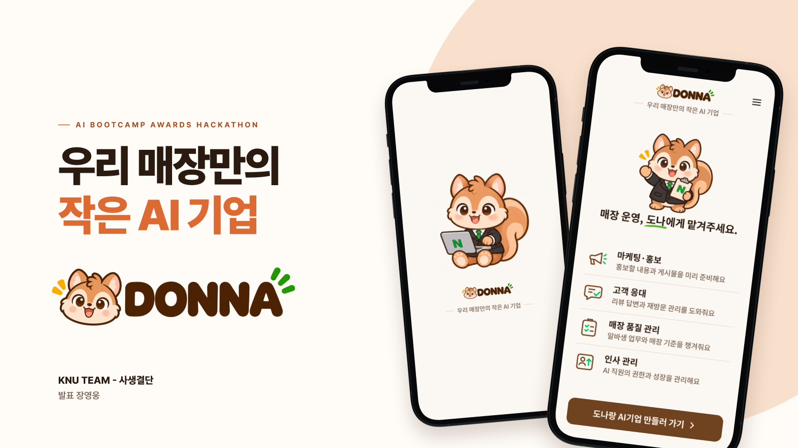
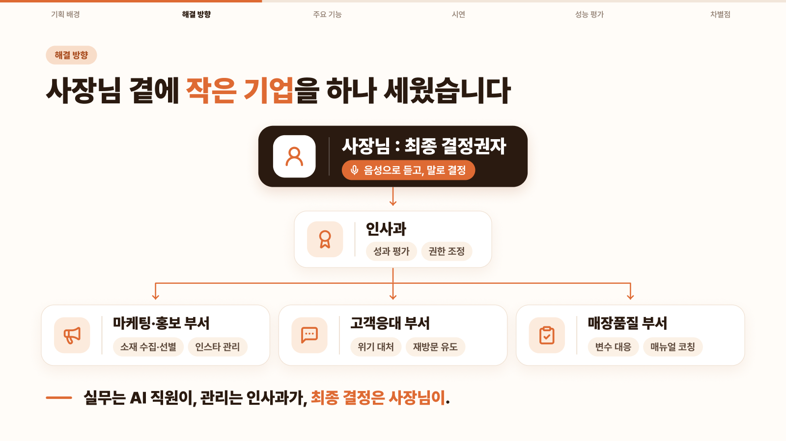
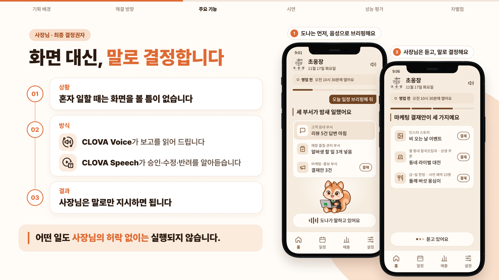
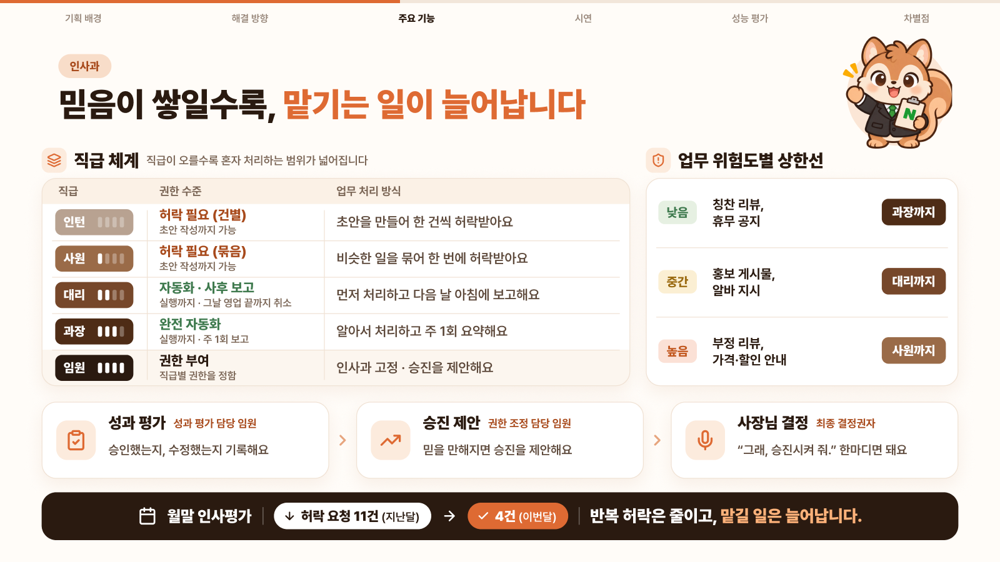
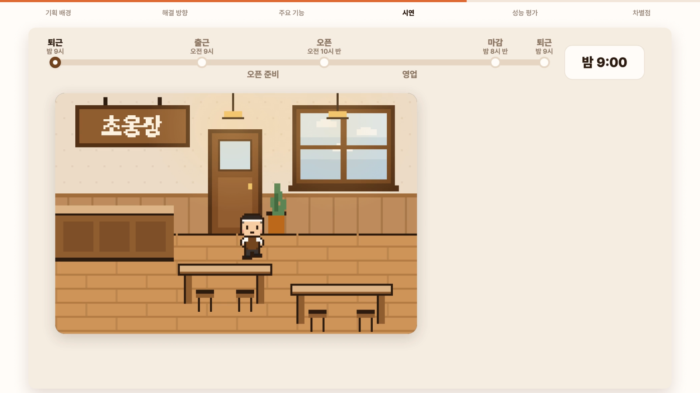
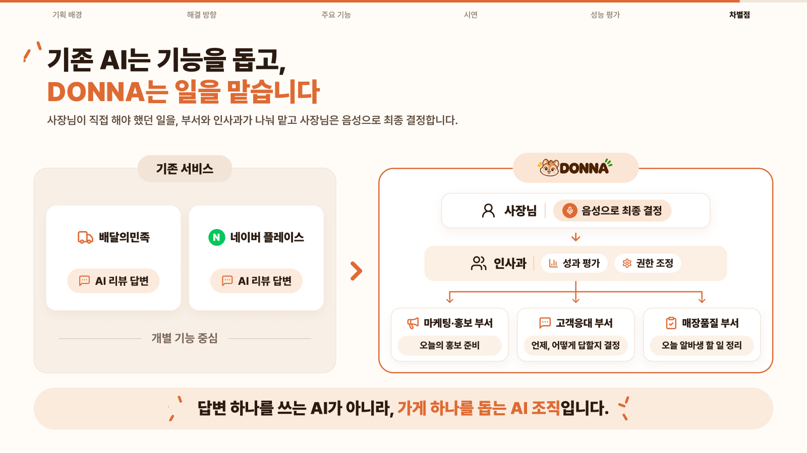

<p align="center">
  
</p>

<h1 align="center">DONNA · 우리 매장만의 작은 AI 기업</h1>

<p align="center">
  사장님 대신 일하는 AI 직원들과, 그 직원들을 관리하는 인사과.<br>
  사장님은 음성으로 듣고, 말로 결정만 합니다.
</p>

<p align="center">
  AI BOOTCAMP AWARDS HACKATHON · KNU TEAM 사생결단
</p>

---

## 한눈에 보기

- **누구를 위해**: 혼자서 홍보·리뷰·직원 관리까지 챙겨야 하는 음식점 사장님
- **무엇을**: 세 부서(마케팅·홍보, 고객응대, 매장품질)의 AI 직원이 일을 먼저 준비하고, 인사과가 AI 직원마다 맡길 범위를 정합니다.
- **어떻게**: 도나가 먼저 음성으로 브리핑하고, 사장님은 말로 승인·수정·반려합니다. **어떤 일도 사장님의 허락 없이는 실행되지 않습니다.**
- **네이버 기술**: HyperCLOVA X(CLOVA Studio), CLOVA Speech, CLOVA Voice

## 목차

1. [왜 만들었나](#1-왜-만들었나)
2. [해결 방향](#2-해결-방향-사장님-곁에-작은-기업을-하나-세웠습니다)
3. [주요 기능](#3-주요-기능)
4. [시연](#4-시연)
5. [성능 평가](#5-성능-평가)
6. [차별점](#6-차별점)
7. [실용성과 확장 가능성](#7-실용성과-확장-가능성)
8. [사용한 기술](#8-사용한-기술)
9. [저장소 구조](#9-저장소-구조)
10. [직접 실행해 보기](#10-직접-실행해-보기)
11. [팀과 문서](#11-팀과-문서)

---

## 1. 왜 만들었나

**사장님은 혼자서 홍보·리뷰·직원 관리까지 모두 챙기기 어렵습니다.**

> "업무가 많아 늘 시간이 부족해요." "리뷰와 홍보를 챙기기 어려워요." "직원 관리도 혼자 하긴 벅차요."

### 사전 설문: 사장님이 직접 말한 4가지 어려움

음식점 사장님 7명, 중복응답

| 어려움 | 응답 |
|---|---|
| 홍보할 시간이 부족해요 | 5명 |
| 내가 없을 때 알바생 맡기기 불안해요 | 3명 |
| 리뷰 답변이 숙제처럼 느껴져요 | 2명 |
| 일할 때는 화면을 볼 여유가 없어요 | 2명 |

### 직접 인터뷰: 실제로는 이랬습니다

자체 인터뷰 (음식점 사장님 7명, 2026년 11월)

| 분야 | 사장님이 한 말 |
|---|---|
| 홍보 | 오늘 인스타에 뭘 올릴지 고민할 시간도 없어요.<br>글·해시태그·사진까지 챙기기 버거워요. |
| 리뷰 | 불만 리뷰를 놓치거나 감정적으로 답할까 겁나요.<br>바쁘면 답변이 두세 주씩 밀려요. |
| 직원 관리 | 그날그날 달라지는 일은 매번 따로 지시해야 해요.<br>알바생이 바뀌면 처음부터 다시 가르쳐요. |

회사라면 여러 부서가 나눠 맡을 일을, 사장님 혼자 모두 감당하고 계셨습니다.
**그래서 사장님 대신 일하는 작은 AI 기업, 도나를 만들었습니다.**

---

## 2. 해결 방향: 사장님 곁에 작은 기업을 하나 세웠습니다

<p align="center">
  
</p>

| 자리 | 맡은 일 |
|---|---|
| **사장님** (최종 결정권자) | 음성으로 듣고, 말로 결정 |
| **인사과** | 성과 평가, 권한 조정 |
| **마케팅·홍보 부서** | 소재 수집·선별, 인스타 관리 |
| **고객응대 부서** | 위기 대처, 재방문 유도 |
| **매장품질 부서** | 변수 대응, 매뉴얼 코칭 |

**실무는 AI 직원이, 관리는 인사과가, 최종 결정은 사장님이.**

---

## 3. 주요 기능

### 3-1. 화면 대신, 말로 결정합니다

<p align="center">
  
</p>

| | |
|---|---|
| 상황 | 혼자 일할 때는 화면을 볼 틈이 없습니다. |
| 방식 | **CLOVA Voice**가 보고를 읽어 드리고, **CLOVA Speech**가 승인·수정·반려를 알아듣습니다. |
| 결과 | 사장님은 말로만 지시하면 됩니다. |

도나가 먼저 음성으로 브리핑하고, 사장님은 듣고 말로 결정합니다. 어떤 일도 사장님의 허락 없이는 실행되지 않습니다.

### 3-2. 인사과: 믿음이 쌓일수록, 맡기는 일이 늘어납니다

<p align="center">
  
</p>

**직급 체계**: 직급이 오를수록 AI 직원이 혼자 처리하는 범위가 넓어집니다.

| 직급 | 권한 수준 | 업무 처리 방식 |
|---|---|---|
| 인턴 | 허락 필요 (건별) · 초안 작성까지 | 초안을 만들어 한 건씩 허락받아요 |
| 사원 | 허락 필요 (묶음) · 초안 작성까지 | 비슷한 일을 묶어 한 번에 허락받아요 |
| 대리 | 자동화 · 사후 보고 · 실행까지 (그날 영업 끝까지 취소 가능) | 먼저 처리하고 다음 날 아침에 보고해요 |
| 과장 | 완전 자동화 · 실행까지 (주 1회 보고) | 알아서 처리하고 주 1회 요약해요 |
| 임원 | 권한 부여 · 직급별 권한을 정함 | 인사과 고정 · 승진을 제안해요 |

**업무 위험도별 상한선**: 위험한 일일수록 AI 직원이 오를 수 있는 직급이 낮습니다.

| 위험도 | 업무 | 오를 수 있는 직급 |
|---|---|---|
| 낮음 | 칭찬 리뷰, 휴무 공지 | 과장까지 |
| 중간 | 홍보 게시물, 알바 지시 | 대리까지 |
| 높음 | 부정 리뷰, 가격·할인 안내 | 사원까지 |

**승진은 이렇게 이뤄집니다**

1. **성과 평가** (성과 평가 담당 임원): 사장님이 승인했는지, 수정했는지 기록해요.
2. **승진 제안** (권한 조정 담당 임원): 믿을 만해지면 승진을 제안해요.
3. **사장님 결정** (최종 결정권자): "그래, 승진시켜 줘." 한마디면 돼요.

예를 들어 월말 인사평가에서 허락 요청이 지난달 11건에서 이번 달 4건으로 줄어듭니다. **반복 허락은 줄이고, 맡길 일은 늘어납니다.**

### 3-3. 마케팅·홍보 부서: 오늘의 홍보는 AI 직원이 먼저 준비합니다

- **문제**: 홍보 효과는 알지만, 할 시간이 없습니다. 문제는 의지가 아니라 시간이었습니다.
- **해결**: 홍보를 두 직원이 나눠 맡습니다.

  | 담당 | 하는 일 |
  |---|---|
  | 소재 수집·선별 담당 (무엇을 올릴지) | 좋은 평가 메뉴와 판매 정보로 오늘의 홍보 소재를 고릅니다 |
  | 인스타 관리 담당 (실제로 올리기) | 스토리·게시물 업로드와 관리를 맡습니다 |

- **근거**: 20~40대는 인스타그램 이용이 더 높았습니다.

  | 연령대별 소셜 앱 이용자 수 (만 명) | 인스타그램 | 밴드 |
  |---|---:|---:|
  | 20세 미만 | 400 | 94 |
  | 20대 | 709 | 178 |
  | 30대 | 596 | 245 |
  | 40대 | 637 | 588 |
  | 50대 | 285 | 427 |
  | 60세 이상 | 98 | 199 |

  출처: 와이즈앱·리테일 (2025.07)

### 3-4. 고객응대 부서: 불만은 바로, 칭찬은 다시 올 시간에

- **문제**: 리뷰 답변이 숙제처럼 느껴집니다. 답변은 밀리고, 불만 리뷰에는 감정적으로 답할까 봐 겁이 납니다.
- **해결**

  | 담당 | 하는 일 |
  |---|---|
  | 위기 대처 담당 (불만 리뷰 대응) | 불만 리뷰를 먼저 감지해 사과와 개선 답변을 준비합니다 |
  | 재방문 유도 담당 (긍정 리뷰 활용) | 긍정 리뷰는 다시 올 가능성이 가장 높은 시간에 답합니다 |

- **근거**: 선행연구는 부정 리뷰에 빠르게 응답하는 것이 중요하다고 말합니다.
  - Zhao et al. (2020): 부정 리뷰에는 빠른 사과와 개선 계획이 신뢰 회복에 효과적
  - Gu & Ye (2014): 만족도가 낮은 고객일수록 관리자 응답의 효과가 더 큼

### 3-5. 매장품질 부서: 사장님이 없어도, 사장님 기준대로

- **문제**: 알바생 관리가 가장 어렵습니다. 사람이 바뀌고, 돌발 상황이 생길 때마다 다시 챙겨야 합니다.
- **해결**

  | 담당 | 하는 일 |
  |---|---|
  | 변수 대응 담당 (오늘의 변수 반영) | 날씨·예약·알레르기 같은 특이사항을 오늘 할 일에 바로 반영합니다 |
  | 매뉴얼 코칭 담당 (사장님 기준 전달) | 초보 알바생에게 매장 기준과 매뉴얼을 바로 안내합니다 |

- **근거**: 자체 손님 설문(대학생 54명, 2026년 11월)에서 단골이 되는 매장과 다시는 안 가는 매장의 가장 큰 공통 이유는 모두 **맛·서비스·청결**이었습니다. 그래서 맛·서비스·청결을 늘 같은 기준으로 지키게 돕습니다.

---

## 4. 시연

<p align="center">
  
</p>

시연은 가게 '초옹장'의 하루를 따라갑니다.

**퇴근 (밤 9시) → 출근 (오전 9시) → 오픈 준비 → 오픈 (오전 10시 반) → 영업 → 마감 (밤 8시 반) → 퇴근 (밤 9시)**

내 컴퓨터에서 직접 써 보려면 [10. 직접 실행해 보기](#10-직접-실행해-보기)를 보세요.

---

## 5. 성능 평가

**가게를 맡기려면, 사장님이 도나를 믿을 수 있어야 합니다.** 그래서 사장님이 물을 네 가지 질문으로 평가했습니다.

| | 질문 | 평가 대상 | 핵심 결과 |
|---|---|---|---|
| 01 | 내 말을 알아듣나? | 음성 인식 | 받아쓰기 오류가 섞여도 뜻을 맞힌 비율 **88.7%** |
| 02 | 손님 앞에서 실수하지 않나? | 고객응대 부서 | 최종 위반 답글 **20.8% → 6.9%** (약 3분의 1) |
| 03 | 정말 도움이 되나? | 매장품질 부서 | 낸 제안 중 쓸모 있었던 제안 **54.5%** |
| 04 | 언제부터 맡겨도 되나? | 인사과 | 잘하는 담당이 대리가 되기까지 **28일** (중앙값) |

### 01. 시끄러운 주방에서도, 내 말을 알아듣나?

| 시험 | 결과 | 뜻 |
|---|---|---|
| TEST 01 시끄러워도 알아듣는가 | **88.7%** | 받아쓰기 오류가 섞여도 뜻을 맞힌 비율 |
| TEST 02 기다리게 하지 않는가 | **1.14초** | 대부분의 응답 시간 |

사장님은 손을 멈출 필요도, 고개를 들 필요도 없습니다.

### 02. 잘 알아들었다면, 손님 앞에서 실수하지 않나?

답글 초안은 손님에게 나가기 전에 검사기를 거칩니다.

| 지표 | 결과 | 근거 |
|---|---|---|
| 잡아낸 위험 답글 | **89.8%** | 위험 답글 186건 중 167건 |
| 잘못 막은 답글 | **19.2%** | 정상 답글 177건 중 34건 |
| 최종 위반 답글 | **6.9%** | 손님에게 나간 144건 중 10건 |

검사기가 없을 때(20.8%)와 비교하면 최종 위반 답글이 **약 3분의 1로 줄었습니다.**

### 03. 실수가 없다면, 정말 도움이 되나?

도나가 날씨·예약·리뷰를 보고 오늘 알바생 할 일을 제안합니다. 예를 들면 "비 오는 날 → 우산 거치대 준비", "메밀 알레르기 예약 → 손님 대응"입니다. 이 제안을 정답 할 일과 비교했습니다 (시나리오 20개 × 2회).

| 결과 | 뜻 |
|---|---|
| **54.5%** | 낸 제안 중 쓸모 있었던 제안 |
| **83.3%** | 할 일 없는 날 괜히 끼어들지 않음 |

사장님이 일일이 설명하지 않아도, 그날 필요한 일이 먼저 정리되어 옵니다.

### 04. 마지막으로, 언제부터 맡겨도 되나?

실제 기록이 아직 2주치가 안 돼, 승진 규칙을 그대로 옮긴 모의 실험을 2만 번 돌렸습니다.

| 항목 | 결과 | 뜻 |
|---|---|---|
| 맡기기까지 | **28일** | 잘하는 담당이 대리가 되기까지 (중앙값, 8주 안에 99% 이상) |
| 승진 기준 | **90%** | 2주 동안 고치지 않고 그대로 승인한 비율 |
| 업무 수첩 | **86.0%** | 계속 지킬 규칙을 가려낸 정확도 |

상한을 넘는 승진은 23,520번 검사에서 **한 번도 없었습니다.**

평가 도구는 [`server/Harness/evals/`](server/Harness/evals/)에 있습니다 (`server/` 폴더에서 `python -m Harness.evals <스위트>`, CLOVA Studio 키 필요).

---

## 6. 차별점

### 기존 AI는 기능을 돕고, DONNA는 일을 맡습니다

<p align="center">
  
</p>

| | 기존 서비스 | DONNA |
|---|---|---|
| 예 | 배달의민족, 네이버 플레이스의 AI 리뷰 답변 | 사장님 · 인사과 · 세 부서로 이뤄진 AI 조직 |
| 단위 | 개별 기능 중심 | 가게 하나 |
| 하는 일 | 리뷰 답변을 써 줌 | 오늘의 홍보 준비 (마케팅·홍보 부서)<br>언제, 어떻게 답할지 결정 (고객응대 부서)<br>오늘 알바생 할 일 정리 (매장품질 부서)<br>성과 평가와 권한 조정 (인사과) |

사장님이 직접 해야 했던 일을, 부서와 인사과가 나눠 맡고 사장님은 음성으로 최종 결정합니다.
**답변 하나를 쓰는 AI가 아니라, 가게 하나를 돕는 AI 조직입니다.**

---

## 7. 실용성과 확장 가능성

### 지금 매장에 바로 쓰고, 앞으로 더 넓게 확장합니다

**실용성: 지금 하던 일을 그대로, 더 편하게**

1. **AI가 먼저 준비**: 홍보글 · 리뷰 답변 · 할 일 제안
2. **사장님은 음성으로 결정**: 승인 · 수정 · 반려
3. **AI가 실행**: 게시물 업로드 · 답변 발송 · 알바생 할 일 등록

작은 일부터 맡기고, 신뢰가 쌓이면 더 많이 맡깁니다.

| 인턴 | 사원 | 대리 | 과장 |
|---|---|---|---|
| 건별 허락 | 묶음 허락 | 먼저 처리 후 보고 | 자율 처리 (주간 보고) |

**확장 가능성: 필요한 업무와 업종으로 계속 확장**

1. **AI 직원·부서 추가 (모듈형 확장)**: 지금의 마케팅·홍보, 고객응대, 매장품질에 재고·발주, 근무 일정 같은 부서를 더할 수 있습니다.
2. **다양한 업종으로 확대**: 음식점 (현재) → 카페 → 다양한 소상공인 (미용실·카센터·소매점 등)

---

## 8. 사용한 기술

기술마다 푸는 문제를 하나씩 짝지었습니다.

| 문제 | 기술 | 코드 |
|---|---|---|
| 손이 묶여 화면을 못 본다 → 말로 지시 | **CLOVA Speech** (단문 인식, "도나야" 키워드 부스팅) | [`server/voice/stt.py`](server/voice/stt.py) |
| 손이 묶여 화면을 못 본다 → 말로 브리핑 | **CLOVA Voice** Premium | [`server/voice/tts.py`](server/voice/tts.py) |
| 리뷰 분류, 답변·홍보 문구 쓰기 | **HyperCLOVA X** (CLOVA Studio, `HCX-005`) | [`server/Harness/`](server/Harness/), [`server/app/review_reply_writer/`](server/app/review_reply_writer/) |
| 여러 AI 직원이 일을 나눠 맡고 서로 검토 | HyperCLOVA X 기반 멀티 에이전트 (하네스) | [`server/Harness/`](server/Harness/) |
| AI 직원의 직급과 권한 | 인사과 규칙 | [`server/voice/hr.py`](server/voice/hr.py) |
| 날씨를 오늘 할 일과 홍보에 반영 | 기상청 API허브 단기예보 | [`server/app/weather/`](server/app/weather/) |
| 인스타 스토리·게시물 올리기 | Instagram Graph API | [`server/voice/instagram/`](server/voice/instagram/) |

앱은 Expo(React Native Web), 백엔드는 FastAPI로 만들었습니다.

---

## 9. 저장소 구조

```
DoD/
├── donna-voice/          지금 버전(v0.2) 사장님 음성 앱과 알바생 앱
│   ├── app/              Expo 앱 (웹 http://localhost:8090)
│   ├── server/           화면 시험용 목업 백엔드
│   └── docs/             부서·인사과 설계, 운영 시나리오, 남은 일
├── server/
│   ├── voice/            음성 백엔드 (http://localhost:8100): 브리핑, 말 알아듣기, 인사과, 알바생, 인스타
│   ├── Harness/          AI 직원(에이전트)과 검토기, 평가 도구(evals/)
│   ├── app/              분석·계획 엔진과 첫 버전 앱용 API (http://localhost:8000)
│   ├── db/               개발용 SQLite DB와 목업 데이터
│   └── tests/            테스트
├── mobile/               첫 버전 사장님 앱 (Expo)
├── frontend/             초기 웹 시안 (Next.js)
├── dev/                  개발자 대시보드 (로컬 시험용)
├── contracts/            API 응답 예시
└── docs/                 개발 안내와 설계 문서
```

---

## 10. 직접 실행해 보기

지금 버전(v0.2) 음성 앱을 켜는 법입니다. 백엔드 → 앱 순서로 켭니다.

**준비물**: Python 3.10 이상, Node.js 20 이상, 네이버클라우드 키 (CLOVA Studio, CLOVA Voice, CLOVA Speech)

**1. 음성 백엔드** (http://localhost:8100)

```bash
cd server
python3 -m venv .venv            # Windows: python -m venv .venv
source .venv/bin/activate        # Windows(Git Bash): source .venv/Scripts/activate
pip install -r requirements.txt
cp .env.example .env             # .env 에 키를 채웁니다. 이름과 설명은 .env.example 에 있습니다
python -m voice.run_voice
```

켜질 때 시연 가게 '초옹장'의 데이터를 넣고, 미리 준비해 둔 브리핑을 불러옵니다. 목소리 키가 없으면 앱이 기기 목소리로 읽고, 받아쓰기를 켜지 않으면(`VOICE_STT=false`) 브라우저 음성 인식으로 듣습니다.

**2. 앱** (http://localhost:8090, 새 터미널에서)

```bash
cd donna-voice/app
npm install
npm run web
```

**3. 써 보기**

1. http://localhost:8090 을 엽니다. 휴대폰(375 × 812)과 태블릿 크기에서 모두 쓸 수 있습니다.
2. 시작 → 로그인 → 마이크 켜기를 지나 홈에서 "도나야, 오늘 일정 브리핑해 줘"라고 말합니다.
3. 마이크가 없으면 브라우저 개발자 도구 콘솔에서 말을 대신 넣습니다.

   ```js
   __donna.say('도나야, 오늘 일정 브리핑해 줘')
   ```

4. 알바생 앱은 http://localhost:8090/staff , API 문서는 http://localhost:8100/docs 에 있습니다.

더 많은 말 예시, 처음부터 다시 하는 법, 인스타 연결은 [donna-voice/README.md](donna-voice/README.md)에 있습니다.

---

## 11. 팀과 문서

**KNU TEAM 사생결단** (강원대학교)

| 문서 | 내용 |
|---|---|
| [donna-voice/README.md](donna-voice/README.md) | 지금 버전 음성 앱 켜는 법과 써 보는 법 |
| [donna-voice/docs/](donna-voice/docs/) | 부서·인사과 설계, 운영 시나리오 |
| [docs/development.md](docs/development.md) | 첫 버전 앱(mobile/)과 분석 서버(server/app/) 개발 안내 |
| [commit_guide.md](commit_guide.md) | 커밋 · 브랜치 · PR 규칙 |
