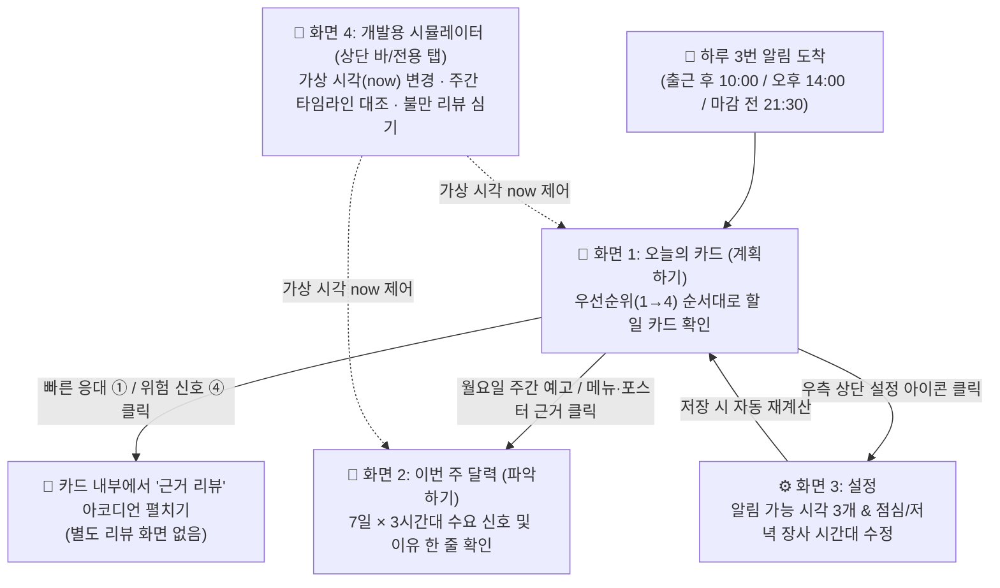

# 도나(DoNA) 1차 UX/UI 디자인 마스터 계획서 (외부 디자인 에이전트 입력용)

> **문서 목적**: 이 문서는 외부 UX/UI 디자인 에이전트(Figma AI 등)에 그대로 입력하여 **도나(DoNA) 1차 모바일 웹의 디자인 시스템, 컴포넌트 세트, 4대 핵심 화면(11개 상세 프레임)**을 한 번에 생성하기 위한 자급자족형(Self-Contained) 디자인 명세서입니다.  
> 다른 문서를 참조하지 않아도 이 문서의 텍스트, 레이아웃 구조, 컬러 토큰, 실제 데모 데이터를 그대로 사용하여 모든 화면을 완벽히 구성할 수 있습니다.

---

## 0. 외부 디자인 에이전트를 위한 작업 지시문 (System Prompt)

```text
당신은 소상공인 B2B SaaS 모바일 앱 전문 프로덕트 디자이너(UX/UI)입니다.
아래 명세서에 정의된 [도나(DoNA) 1차 모바일 웹 서비스]의 디자인 시스템과 4대 화면을 Figma 캔버스에 설계하세요.

[필수 준수 사항]
1. 모든 화면은 모바일 웹 기준 폭 375px (권장 높이 812px 이상, 세로 스크롤 허용) 프레임으로 제작합니다.
2. 서버 코드값(영문 대문자)을 화면에 그대로 노출하지 말고, 본 문서의 [코드값 → 한국어 UI 라벨 매핑표]에 정의된 한국어 문구만 화면에 표시하세요.
3. 3P 문구 체계를 각 화면 헤더와 카드에 반영하세요:
   - 이번 주 달력 = "파악하기"
   - 오늘의 카드(알림 묶음) = "계획하기"
   - 카드 내 실행 영역 = "홍보하기"
4. 1차 개발 범위에 맞춰 '초안 본문 자리'와 '[승인] [수정] [보류]' 버튼은 실제 동작하지 않는 '플레이스홀더(2차 개발 예정 안내)' 스타일로 디자인하세요.
5. 별도의 '리뷰 목록 화면'을 만들지 마세요. 빠른 응대(①)와 위험 신호 개선(④) 카드 내부에서 아코디언 형태로 '근거 리뷰'가 펼쳐지는 UI로 설계해야 합니다.
6. 실제 텍스트는 더미 텍스트(Lorem Ipsum)를 절대 쓰지 말고, 본 문서의 [데모 주간 실제 데이터]에 적힌 한국어 문구와 숫자를 그대로 넣으세요.
```

---

## 1. 서비스 개요 및 핵심 UX 철학

### 1.1 프로덕트 정의
* **서비스명**: 도나 (DoNA) — 소상공인(음식점 사장님)을 위한 하이퍼로컬 AI 매장 운영 비서
* **타깃 사용자**: 하루 종일 조리, 홀 서빙, 배달 포장으로 바빠서 복잡한 통계 대시보드를 들여다볼 시간이 없는 음식점 사장님
* **1차 범위 핵심 목표**: **'파악하기'**와 **'계획하기'**
  * 매출 패턴, 지역행사·경기·날씨·계절에 따른 **우리 매장 달력**, 손님 주문 주기, **리뷰 위험 신호**를 분석해 둔다.
  * 사장님이 해야 할 **4가지 일(① 손님 답글, ② 메뉴판 순서 조정, ③ 포스터 홍보, ④ 리뷰 위험 개선)**마다 **승인 요청 시각, 실행 시각, 우선순위(1~4)**를 정해 **하루 3번(출근 후 10:00, 오후 14:00, 마감 전 21:30)** 알림 묶음(오늘의 카드)으로 보여준다.

### 1.2 사용자 흐름 (User Flow - `F1`)


---

## 2. 디자인 시스템 및 스타일 가이드 (`F2`)

### 2.1 뷰포트 및 그리드 시스템
* **Frame Size**: Width `375px` × Height `812px` (콘텐츠 길이에 따라 세로 확장)
* **Layout Grid**: 좌우 마진 `16px` (내부 콘텐츠 폭 `343px`), 컬럼 간격 `8px`
* **Spacing**: 섹션 간격 `24px`, 카드 간 간격 `12px`, 카드 내부 패딩 `16px`
* **Border Radius**: 카드 `16px`, 버튼/인풋 `10px`, 배지/칩 `6px` (또는 Pill `9999px`)

### 2.2 컬러 토큰 (Color Palette)

#### (1) 기본 UI 컬러
| 용도 | 토큰명 | HEX | 설명 |
| :--- | :--- | :---: | :--- |
| **Background** | `bg-canvas` | `#F4F6F8` | 앱 전체 배경 (눈이 편안한 쿨그레이) |
| **Surface** | `bg-surface` | `#FFFFFF` | 기본 카드 및 시트 배경 |
| **Primary** | `brand-primary` | `#1E293B` | 메인 네이비/슬레이트 액센트 |
| **Accent** | `brand-accent` | `#2563EB` | 주요 액션 버튼, 선택된 탭 |
| **Text Primary** | `text-primary` | `#0F172A` | 제목 및 핵심 본문 |
| **Text Secondary** | `text-secondary` | `#475569` | 보조 설명, 이유 한 줄 |
| **Text Muted** | `text-muted` | `#94A3B8` | 시각 표시, 비활성 안내 문구 |
| **Border** | `border-default` | `#E2E8F0` | 카드 및 구분선 기본 보더 |

#### (2) 수요 신호 (`signal`) 컬러 (이번 주 달력 21칸 & 요약용)
| 코드값 | 한국어 표시 | 배경색 (`BG`) | 보더 (`Border`) | 텍스트/점 (`Text`) | 시각적 의미 |
| :--- | :---: | :---: | :---: | :---: | :--- |
| `HIGH` | **많음** | `#FFF1F2` | `#FECDD3` | `#E11D48` | 평소보다 주문/매출이 몰리는 시간대 (강조 코랄 레드) |
| `NORMAL` | **보통** | `#F8FAFC` | `#E2E8F0` | `#475569` | 평소 기준선 수준의 시간대 (차분한 슬레이트) |
| `LOW` | **적음** | `#F0F9FF` | `#BAE6FD` | `#0284C7` | 평소보다 한산한 시간대 (소프트 블루) |

#### (3) 우선순위 (`priority`) 및 알림 종류 컬러 (오늘의 카드 상단 배지용)
| 우선순위 | 대상 알림 | 배지 문구 | 배경색 (`BG`) | 텍스트 (`Text`) | 카드 좌측 보더 강조 |
| :---: | :--- | :--- | :---: | :---: | :---: |
| **`1`** | 빠른 응대 (불만 리뷰 즉시 대응) | `우선순위 1 · 긴급 응대` | `#FEE2E2` | `#DC2626` | `4px solid #DC2626` |
| **`2`** | 위험 신호 개선 (같은 불만 반복) | `우선순위 2 · 위험 신호` | `#FFEDD5` | `#EA580C` | `4px solid #EA580C` |
| **`3`** | 내일/다가올 실행할 일 승인 요청 | `우선순위 3 · 승인 요청` | `#DBEAFE` | `#2563EB` | `4px solid #2563EB` |
| **`4`** | 오늘 실행 알림 / 주간 예고 / 매출 이상 | `우선순위 4 · 실행·안내` | `#CCFBF1` | `#0F766E` | `4px solid #0D9488` |

#### (4) 이유 태그 (`reason_tag`) 칩 스타일
| 코드값 | 칩 라벨 (아이콘 + 한국어) | 배경색 | 텍스트색 |
| :--- | :--- | :---: | :---: |
| `EVENT` | `🎪 축제·행사` | `#F3E8FF` | `#7C3AED` |
| `GAME` | `⚽ 경기일정` | `#DCFCE7` | `#15803D` |
| `WEATHER` | `🌧️ 날씨급변` | `#E0F2FE` | `#0369A1` |
| `SEASON` | `🍂 계절전환` | `#FEF3C7` | `#B45309` |

### 2.3 타이포그래피 (Typography - Pretendard 기준)
* **Screen Title (H1)**: `20px`, Bold (`700`), Line-height `28px`
* **Section Header (H2)**: `16px`, Bold (`700`), Line-height `24px`
* **Card Title (H3)**: `15px`, SemiBold (`600`), Line-height `22px`
* **Body (이유 한 줄 / 리뷰 원문)**: `14px`, Regular (`400`), Line-height `20px`
* **Caption / Meta (시각, 기한, 플랫폼)**: `12px`, Medium (`500`), Line-height `16px`
* **Badge / Chip**: `11px`, SemiBold (`600`), Line-height `14px`

---

## 3. 코드값 → 한국어 UI 문구 변환 사전 (필수 준수)

외부 에이전트는 화면 디자인 시 영문 코드값을 절대 그대로 쓰지 말고 아래 표의 한국어 라벨로 변환하여 배치해야 합니다.

| 분류 | 서버 코드값 | 화면 표시 한국어 문구 | 아이콘 / 보조 설명 |
| :--- | :--- | :--- | :--- |
| **4가지 일 (`task_type`)** | `REVISIT_REPLY` | **① 손님 답글 달기** | `💬` 재방문을 유도하는 맞춤 리뷰 답글 |
| | `MENU_ORDER` | **② 메뉴판 순서 바꾸기** | `📋` 배달앱 대표/상단 메뉴 구성 전환 |
| | `POSTER` | **③ 홍보 포스터 올리기** | `🎨` 매장/SNS 이벤트 포스터 게시 |
| | `REVIEW_FIX` | **④ 리뷰 위험 신호 개선** | `🚨` 반복되는 불만 원인 점검 및 개선 |
| **답변 시점 분류 (`revisit_class`)** | `QUICK` | **빠른 응대** | 불만 리뷰 감지 후 가장 빠른 슬롯에 즉시 대응 |
| | `WEEKLY` | **주간 맞춤** | 주간 단골(`c_w01` 등) 다음 주문 예상일 하루 전 답글 |
| | `MONTHLY` | **월간 맞춤** | 월간 단골(`c_m01` 등) 다음 주문 예상일 하루 전 답글 |
| | `BASIC` | **기본 답변** | 주문 주기 없는 일반 리뷰 (같은 실행 시각끼리 1장으로 묶음) |
| **알림 가능 시간 (`slot`)** | `OPENING` | **출근 후 (10:00)** | 오전 준비 시간 슬롯 |
| | `AFTERNOON` | **오후 (14:00)** | 점심 피크 종료 후 한가한 시간 슬롯 |
| | `CLOSING` | **마감 전 (21:30)** | 저녁 영업 마무리 슬롯 |
| **장사 시간대 (`daypart`)** | `LUNCH` | **점심** | 기본 `11:00 ~ 13:30` (바쁜 시간대) |
| | `DINNER` | **저녁** | 기본 `17:00 ~ 21:00` (바쁜 시간대) |
| | `NIGHT` | **야간** | 기본 `21:00 ~ 22:00` (영업 종료 22:00) |
| **알림 종류 (`notify_kind`)** | `APPROVAL_REQUEST` | **승인 요청** | 사장님이 미리 확인하고 승인할 계획 카드 |
| | `EXECUTE_REMINDER` | **실행 알림** | 승인된 일을 실제로 실행할 시각에 알려주는 카드 |
| | `PREVIEW` | **월요일 주간 예고** | 월요일 출근 후 한 주 일정과 할 일을 브리핑하는 카드 |
| | `NOTICE` | **매출 이상 알림** | 달력에 없던 매출 급증/급감을 알려주는 카드 |
| **불만 유형 (`complaint_type`)** | `TASTE` / `PORTION` / `HYGIENE` / `PHOTO_MISMATCH` | **맛 불만 / 양 불만 / 위생 불만 / 사진과 다름** | 묶음: `음식 관련 (FOOD)` |
| | `DELIVERY_DELAY` | **배달 지연** | 묶음: `배달 관련 (DELIVERY)` |
| | `SERVICE` | **응대 불만** | 묶음: `서비스 관련 (SERVICE)` |

---

## 4. 공통 레이아웃 셸 (Global App Shell)

모든 4개 화면은 아래의 상단/하단 고정 구조를 공유합니다.

```text
+-------------------------------------------------------+
| 🧪 [시뮬레이터 바] 가상 시각: 2026-11-17 (화) 14:00 [변경] | <-- 높이 36px, 다크 슬레이트(#0F172A), 노란/민트 포인트
+-------------------------------------------------------+
| 도나네 곱창 역삼점                       [📅 달력] [⚙️] | <-- 높이 52px, 앱 헤더
+-------------------------------------------------------+
|                                                       |
|                  (화면별 스크롤 본문)                   |
|                                                       |
+-------------------------------------------------------+
|  [📋 오늘의 카드]   [📅 이번 주 달력]   [⚙️ 설정]   [🧪 시뮬] | <-- 높이 64px, 하단 탭 바 (모바일 엄지 영역)
+-------------------------------------------------------+
```

---

## 5. 핵심 카드 컴포넌트 마스터 설계 (`F1`, `F2`, `F4`)

Figma에서 **Component Set**으로 먼저 제작해야 할 7가지 카드 레이아웃 명세입니다.

### 5.1 [Card Variant 1] 승인 요청 — ① 빠른 응대 (`REVISIT_REPLY` + `QUICK`, 우선순위 1)
* **특징**: 가장 긴급한 카드(좌측 Red 보더). 하단에 **근거 리뷰 펼치기 아코디언**이 반드시 포함됨.
```text
+-------------------------------------------------------+
| [우선순위 1 · 긴급 응대] [승인 요청]          14:00 도착 |
| 💬 ① 빠른 응대 · 배달 지연 리뷰                        |
|    [배지: ⚡ 빠른 응대] [배지: 배달 관련 불만]           |
|-------------------------------------------------------|
| 📌 이유 한 줄:                                         |
| "어제 저녁 배달이 25분 늦었다는 별점 2점 리뷰가 등록됐어요. |
|  오늘 바로 사과와 재방문 안내 답글을 달아보세요."           |
|                                                       |
| ⏰ 승인 요청: 11/17(화) 14:00  |  🚀 실행 시각: 즉시 실행 |
|-------------------------------------------------------|
| 🔽 근거 리뷰 1건 펼쳐보기 (rv_118 · 배달의민족 ⭐2.0)   | <-- 클릭 시 아래 박스 펼침
|   +-------------------------------------------------+ |
|   | [배민] ⭐ 2.0 | 2026-11-17 12:40 작성            | |
|   | "음식은 따뜻했는데 배달이 예정보다 너무 늦게 왔어요." | |
|   | 태그: [배달 지연]                                | |
|   +-------------------------------------------------+ |
|-------------------------------------------------------|
| 🎯 홍보하기 (2차에서 AI 답글 초안이 여기에 표시됩니다)    | <-- 점선 박스 (#F8FAFC)
| [   승인 (2차)   ]  [   수정 (2차)   ]  [  보류 (2차)  ] | <-- 비활성(Disabled) 스타일 버튼 3개
+-------------------------------------------------------+
```

### 5.2 [Card Variant 2] 승인 요청 — ④ 위험 신호 개선 (`REVIEW_FIX`, 우선순위 2)
* **특징**: 같은 불만 유형이 반복 감지되었을 때 뜨는 경고 카드(좌측 Orange 보더). **복수의 근거 리뷰 펼치기** 포함.
```text
+-------------------------------------------------------+
| [우선순위 2 · 위험 신호] [승인 요청]          14:00 도착 |
| 🚨 ④ 배달 지연 개선 (같은 불만 반복 감지)               |
|    [배지: 배달 지연 3건 누적]                           |
|-------------------------------------------------------|
| 📌 이유 한 줄:                                         |
| "최근 일주일 사이 '배달 지연' 불만 리뷰가 3건 반복되었어요. |
|  피크타임 조리·배차 동선을 점검할 계획입니다."             |
|                                                       |
| ⏰ 승인 요청: 11/17(화) 14:00  |  🚀 실행 기한: 11/18 전 |
|-------------------------------------------------------|
| 🔽 근거 리뷰 3건 펼쳐보기 (risk_004)                   |
|-------------------------------------------------------|
| 🎯 홍보하기 / 개선 체크리스트 (2차에서 초안 제공)        |
| [   승인 (2차)   ]  [   수정 (2차)   ]  [  보류 (2차)  ] |
+-------------------------------------------------------+
```

### 5.3 [Card Variant 3] 승인 요청 — ① 단골 맞춤 답글 (`WEEKLY` / `MONTHLY`, 우선순위 3)
* **특징**: 손님 주문 주기(`customer_cycle`)에 맞춰 다음 예상 주문일 하루 전에 답글을 달도록 제안하는 카드.
```text
+-------------------------------------------------------+
| [우선순위 3 · 승인 요청]                     14:00 도착 |
| 💬 ① 주간 맞춤 답글 · 단골 손님 (c_w01)                 |
|    [배지: 🔄 주간 단골 (7일 주기)]                      |
|-------------------------------------------------------|
| 📌 이유 한 줄:                                         |
| "매주 수요일 저녁마다 주문하시는 단골 손님(c_w01)이에요.   |
|  내일(11/18) 예상 주문 전에 지난 리뷰에 감사 답글을 남겨요."|
|                                                       |
| ⏰ 승인 요청: 11/17 14:00  |  🚀 실행 시각: 11/18 14:00 |
|-------------------------------------------------------|
| 🔽 근거 리뷰 및 주문 주기 보기 (평균 7일 간격 · 저녁 주문) |
|-------------------------------------------------------|
| 🎯 홍보하기 (2차에서 단골 맞춤 답글 초안 표시)           |
| [   승인 (2차)   ]  [   수정 (2차)   ]  [  보류 (2차)  ] |
+-------------------------------------------------------+
```

### 5.4 [Card Variant 4] 승인 요청 — ① 기본 답변 N건 묶음 (`BASIC` Grouped, 우선순위 3)
* **특징**: **실행 시각이 같은 `BASIC`(기본 답변)은 개별 카드로 쪼개지 않고 반드시 카드 1장으로 묶어서 표시** (금요일 `11/20 14:00`에 등장).
```text
+-------------------------------------------------------+
| [우선순위 3 · 승인 요청]                     14:00 도착 |
| 💬 ① 기본 답변 4건 일괄 준비                            |
|    [배지: 📝 기본 답변 × 4건 묶음]                      |
|-------------------------------------------------------|
| 📌 이유 한 줄:                                         |
| "이번 주에 등록된 일반 긍정 리뷰 4건에 대한 감사 답글을    |
|  내일(11/21) 오전 10시에 한 번에 등록할 수 있게 묶었어요." |
|                                                       |
| ⏰ 승인 요청: 11/20 14:00  |  🚀 실행 시각: 11/21 10:00 |
|-------------------------------------------------------|
| 🔽 묶인 리뷰 4건 목록 펼쳐보기                          |
|-------------------------------------------------------|
| 🎯 홍보하기 (2차에서 4건의 답글 초안 일괄 승인 제공)      |
| [ 4건 일괄 승인(2차) ] [ 개별 수정(2차) ] [ 보류(2차) ] |
+-------------------------------------------------------+
```

### 5.5 [Card Variant 5] 승인 요청 — ② 메뉴판 조정 & ③ 포스터 (`MENU_ORDER` / `POSTER`, 우선순위 3)
* **특징**: 우리 매장 달력의 태그(`SEASON`, `GAME`, `EVENT`)를 근거로 메뉴판 순서 변경이나 포스터 홍보를 제안. **`[📅 이번 주 달력에서 근거 보기]` 서브 링크** 포함.
```text
+-------------------------------------------------------+
| [우선순위 3 · 승인 요청]                     14:00 도착 |
| 📋 ② 메뉴판 계절 전환                                  |
|    [칩: 🍂 계절전환]                                   |
|-------------------------------------------------------|
| 📌 이유 한 줄:                                         |
| "내일(11/18 수)부터 기온이 뚝 떨어져 겨울 메뉴 수요가     |
|  늘어납니다. 전골·국물 메뉴를 메뉴판 맨 위로 올려보세요."  |
|                                                       |
| ⏰ 승인 요청: 11/17 14:00  |  🚀 실행 시각: 11/18 10:00 |
| 🔗 [📅 이번 주 달력(11/18 수) 수요 근거 보기 ->]         |
|-------------------------------------------------------|
| 🎯 홍보하기 (2차에서 추천 메뉴 순서/포스터 초안 표시)     |
| [   승인 (2차)   ]  [   수정 (2차)   ]  [  보류 (2차)  ] |
+-------------------------------------------------------+
```

### 5.6 [Card Variant 6] 실행 알림 (`EXECUTE_REMINDER`, 우선순위 4)
* **특징**: 앞서 승인했던 계획의 실제 실행 시각이 되었을 때 사장님께 행동을 리마인드하는 컴팩트 카드(좌측 Teal 보더, 승인/수정/보류 버튼 없음).
```text
+-------------------------------------------------------+
| [우선순위 4 · 실행 알림]                     10:00 도착 |
| 🚀 [실행] ③ 경기 포스터 게시                           |
|-------------------------------------------------------|
| "목요일(11/19) 저녁 국가대표 축구 경기에 맞춰 준비한      |
|  배달 프로모션 포스터를 지금 매장/SNS에 게시할 시간이에요."|
|                                                       |
| [        🎯 실행 도우미 열기 (2차 개발 예정)        ]   |
+-------------------------------------------------------+
```

### 5.7 [Card Variant 7] 월요일 주간 예고 (`PREVIEW`) & 매출 이상 알림 (`NOTICE`, 우선순위 4)
* **특징**: 승인이 필요 없는 브리핑 카드.
  * **월요일 주간 예고 (`11/16 월 10:00`)**: 이번 주 핵심 일정 3가지(`11/18 수 계절 전환`, `11/19 목 저녁 경기`, `11/21~22 토·일 축제`), 이번 주 할 일 요약, **`[📅 이번 주 달력 전체 열기]` 큰 버튼** 포함.
  * **매출 이상 알림 (`11/18 수 10:00`)**: *"📈 알림: 어제(11/17 화) 점심 매출이 평소 기준선보다 35% 많았고 달력에 없던 일이었어요."*

---

## 6. 4대 화면별 상세 프레임 설계 지침 (`F3`, `F4`, `F5`)

외부 에이전트는 아래 **4개 화면(총 9개 상세 프레임)**을 Figma 캔버스에 나란히 배치하여 생성합니다.

---

### 화면 1. 오늘의 카드 (`/today` - `F4`) — 총 5개 상태 프레임 제작

#### 상단 공통 구성
* **3P 헤더 배너**: `"📋 계획하기 · 오늘 사장님이 확인하실 알림 묶음"`
* **슬롯 세그먼트 탭 (3개)**:
  * `[출근 후 10:00]` | `[오후 14:00 (선택됨)]` | `[마감 전 21:30]`
  * 각 탭 우측에 알림 개수 뱃지 표시 (알림이 없는 슬롯은 `0`)

#### 제작할 5개 프레임 (실제 데모 데이터 적용)
1. **Frame 1-A [대표 화면: `11/17(화) 14:00` 오후 슬롯 - 기본 상태]**:
   * 명세서 `F4` 완료 기준인 **4장의 카드가 정확한 우선순위 순서로 세로 배치**된 화면:
     1. `[우선순위 1 · 승인 요청]` **① 빠른 응대, 배달 지연 리뷰** (`REVISIT_REPLY:rv_118:2026-11-17`)
     2. `[우선순위 2 · 승인 요청]` **④ 배달 지연 개선** (`REVIEW_FIX:risk_004:2026-11-17`)
     3. `[우선순위 3 · 승인 요청]` **① 주간 맞춤 `c_w01`** (`REVISIT_REPLY:rv_102:2026-11-18`)
     4. `[우선순위 3 · 승인 요청]` **② 메뉴판 계절 전환** (`MENU_ORDER:2026-11-18:2026-11-18`)
2. **Frame 1-B [`11/17(화) 14:00` - 근거 리뷰 펼침(Expanded) 상태]**:
   * Frame 1-A에서 1번 카드(배달 지연 리뷰 원문 1건)와 2번 카드(반복된 배달 지연 리뷰 원문 목록)의 아코디언이 활짝 펼쳐진 상태.
3. **Frame 1-C [`11/16(월) 10:00` 출근 후 슬롯 - 월요일 주간 예고 화면]**:
   * `[우선순위 4 · 예고]` **이번 주 달력, 이번 주 할 일 순서, 목요일 저녁 경기, 토일 축제, 수요일부터 계절 전환** 브리핑 카드 + `[📅 이번 주 달력 보러가기]` 버튼 강조.
4. **Frame 1-D [`11/18(수) 10:00` 출근 후 슬롯 - 실행 알림 + 매출 이상 알림]**:
   * 카드 1: `[우선순위 4 · 실행 알림]` **② 메뉴판 계절 전환**
   * 카드 2: `[우선순위 4 · 알림]` **어제 점심 매출이 평소보다 35% 많았고 달력에 없던 일**
5. **Frame 1-E [`11/20(금) 14:00` 오후 슬롯 - 기본 답변 4건 묶음 화면]**:
   * 카드 1: `[우선순위 3 · 승인 요청]` **① 기본 답변 4건** (4건이 카드 1장으로 묶인 UI)
   * 카드 2: `[우선순위 3 · 승인 요청]` **② 메뉴판 축제**
   * 카드 3: `[우선순위 4 · 실행 알림]` **① 월간 맞춤 답변 붙여넣기**

---

### 화면 2. 이번 주 달력 (`/calendar` - `F3`) — 총 2개 프레임 제작

* **진입 맥락**: 평소에는 열지 않으며, '오늘의 카드'나 '월요일 주간 예고'에서 `[📅 이번 주 달력 보기]`를 눌렀을 때 진입.
* **상단 구성**:
  * 뒤로가기(`← 오늘의 카드로`) + **3P 타이틀**: `"📅 파악하기 · 우리 매장 수요 달력"`
  * 주간 표시: `2026. 11. 16 (월) ~ 11. 22 (일)`
  * 수요 신호 범례(Legend): `🔴 많음(HIGH)` `⚪ 보통(NORMAL)` `🔵 적음(LOW)`

#### 7일 × 3시간대 매트릭스 데이터 (명세서 `F3` 완료 기준 100% 반영)
| 날짜 (요일) | 점심 (`LUNCH`) | 저녁 (`DINNER`) | 야간 (`NIGHT`) |
| :--- | :--- | :--- | :--- |
| **11/16 (월)** | `보통` | `보통` | `적음` |
| **11/17 (화)** | `보통` *(실제 매출 +35% 이상 발생일)* | `보통` | `보통` |
| **11/18 (수)** | `보통` `[🍂계절]` | `보통` `[🍂계절]` | `보통` `[🍂계절]` |
| **11/19 (목)** | `보통` `[🍂계절]` | **`🔴 많음` `[⚽경기]` `[🍂계절]`** *(선택됨)* | **`🔴 많음` `[⚽경기]` `[🍂계절]`** |
| **11/20 (금)** | `보통` `[🍂계절]` | `보통` `[🍂계절]` | `보통` `[🍂계절]` |
| **11/21 (토)** | **`🔴 많음` `[🎪축제]` `[🍂계절]`** | **`🔴 많음` `[🎪축제]` `[🍂계절]`** | `보통` `[🍂계절]` |
| **11/22 (일)** | **`🔴 많음` `[🎪축제]` `[🍂계절]`** | **`🔴 많음` `[🎪축제]` `[🍂계절]`** | `적음` `[🍂계절]` |

*(참고: `11/18(수)` 야구 경기는 과거 매출 효과가 없어 달력 강조 및 어떤 알림에도 나오지 않음)*

#### 제작할 2개 프레임
1. **Frame 2-A [이번 주 달력 전체 그리드 + `11/19(목) 저녁` 선택 상세 패널]**:
   * 위 7×3 그리드 아래(또는 하단 고정 카드/바텀시트)에 선택된 **`11/19(목) 저녁 (DINNER)`** 상세 정보 표시:
     * **수요 신호**: `🔴 수요 많음 (평소 대비 +26%)`
     * **기준선 매출 (`baseline_sales`)**: `820,000원`
     * **예상 매출 (`expected_sales`)**: `1,030,000원`
     * **이유 태그 및 효과**: `[⚽ 경기일정 +21%]`, `[🍂 계절전환 +5%]`
     * **AI 이유 한 줄 (`reason_text`)**: *"저녁에 국가대표 축구 경기가 있어 배달이 늘 것 같아요"*
     * **연결된 계획 항목**: `③ 경기 포스터`, `② 메뉴판 경기`
2. **Frame 2-B [`11/21(토) 저녁` 축제 시간대 선택 상태]**:
   * 주말 지역 축제로 인해 토·일 점심/저녁이 `🔴 많음`으로 표시되고 축제 근거가 나타나는 상태.

---

### 화면 3. 설정 (`/settings` - `F4`) — 1개 프레임 제작

* **상단 구성**: `"⚙️ 매장 알림 및 영업 시간대 설정"`
* **섹션 1: 하루 3번 알림 가능 시간 (`slots`) 설정**
  * 설명: *"바쁜 시간대를 피해 사장님이 카드를 확인하기 편한 시각 3개를 정해주세요."*
  * `🌅 출근 후 (OPENING)`: 타임 픽커 `10 : 00`
  * `☀️ 오후 (AFTERNOON)`: 타임 픽커 `14 : 00`
  * `🌙 마감 전 (CLOSING)`: 타임 픽커 `21 : 30`
* **섹션 2: 장사 시간대 (`dayparts`) 및 바쁜 시간대 (`busy_dayparts`)**
  * 설명: *"바쁜 시간대(피크타임)로 지정하면 그 시간에는 알림을 보내지 않고, 직전 알림 가능 시간에 미리 당겨서 알려드려요."*
  * **점심 (`LUNCH`)**: `11:00 ~ 13:30` | `[토글 ON: 바쁜 시간대 (알림 차단)]`
  * **저녁 (`DINNER`)**: `17:00 ~ 21:00` | `[토글 ON: 바쁜 시간대 (알림 차단)]`
  * **야간 (`NIGHT`)**: `21:00 ~ 22:00` | `[토글 OFF: 알림 허용]`
* **하단 고정 버튼**:
  * `[💾 설정 저장하기]` (`PATCH /api/settings` 연동. 서버에 재계산 API가 아직 없어 저장 완료만 안내)

---

### 화면 4. 개발용 시뮬레이터 (`/simulator` - `F5`) — 1개(세로 확장) 프레임 제작

* **목적**: 심사위원 시연 및 1차 완료 기준(*데모 주간 `11/16 월 ~ 11/22 일` 기대 결과 100% 재현*)을 화면에서 즉시 검증하기 위한 컨트롤 센터.
* **섹션 1: 가상 시각 (`now`) 컨트롤러**
  * 현재 적용 중인 시각 표시: `2026-11-17 (화) 14:00:00+09:00`
  * 데모 주간 요일 퀵 버튼 (`월 16` `화 17` `수 18` `목 19` `금 20` `토 21` `일 22`) + 슬롯 버튼 (`10:00` `14:00` `21:30`)
  * 우측 상단 `[🔄 목업 상태로 초기화]` 버튼 (서버 초기화 API는 협의 후 연결, 지금은 프론트 상태만 초기화)
* **섹션 2: 데모 주간 한 주 알림 타임라인 (정답 대조표, `GET /api/plan` 응답을 슬롯별로 묶어 표시)**
  * 아래 **[부록: 데모 주간 기대 결과 전체 타임라인]**이 요일·시각별 카드로 한눈에 나열되며, 각 슬롯 옆에 `[이 시각으로 이동]` 버튼이 있어 누르면 즉시 '오늘의 카드' 화면을 해당 시각으로 볼 수 있음.
  * 알림이 없는 슬롯(예: `11/16 21:30`, `11/21 14:00` 등)은 `"조용한 시간 (알림 없음 ✓)"`으로 표시.
* **섹션 3: 시연용 불만 리뷰 즉석 심기 (서버 API 협의 전까지 프론트 상태에만 추가)**
  * 입력 폼: 플랫폼(`배달의민족`), 별점(`⭐ 1점`), 작성 시각(`2026-11-20 19:20`), 내용(`"고기가 식어서 왔고 양념 맛이 평소랑 달라요"`)
  * `[+ 불만 리뷰 추가 및 재계산]` 버튼 → 클릭 시 다음 알림 가능 시간(`11/20 21:30`)에 **`① 빠른 응대, 맛 불만 리뷰 (우선순위 1)`**가 생성되는 흐름 표시
* **섹션 4: 리뷰 분류 결과 목록 (`GET /api/reviews`)**
  * 각 리뷰 카드에 `감정(NEGATIVE/POSITIVE)`, `불만 유형 칩(TASTE, DELIVERY_DELAY)`, `빠른 응대 대상(is_quick: true)`, `분류기(HCX / RULE)` 배지 표시.

---

## 7. 부록: 데모 주간(`2026-11-16` ~ `11-22`) 기대 결과 전체 데이터

외부 에이전트는 시뮬레이터 타임라인 및 각 요일별 화면 텍스트에 아래 문구를 **한 글자도 빠짐없이 그대로** 사용하세요.

* **월 11/16**
  * `10:00` **예고**: 이번 주 달력, 이번 주 할 일 순서, 목요일 저녁 경기, 토일 축제, 수요일부터 계절 전환 `(우선순위 4)`
  * `14:00` **승인 요청**: ③ 경기 포스터 `(우선순위 3)`
* **화 11/17**
  * `10:00` **실행 알림**: ③ 경기 포스터 게시 `(우선순위 4)`
  * `14:00` **승인 요청**: ① 빠른 응대, 배달 지연 리뷰 `(우선순위 1)`, ④ 배달 지연 개선 `(우선순위 2)`, ① 주간 맞춤 `c_w01` `(우선순위 3)`, ② 메뉴판 계절 전환 `(우선순위 3)`
* **수 11/18**
  * `10:00` **실행 알림**: ② 메뉴판 계절 전환 `(우선순위 4)`. **알림**: 어제 점심 매출이 평소보다 35% 많았고 달력에 없던 일 `(우선순위 4)`
  * `14:00` **승인 요청**: ③ 축제 포스터 `(우선순위 3)`, ② 메뉴판 경기 `(우선순위 3)`. **실행 알림**: ① 주간 맞춤 답변 붙여넣기 `(우선순위 4)`
* **목 11/19**
  * `10:00` **실행 알림**: ② 메뉴판 경기 `(우선순위 4)`, ③ 축제 포스터 게시 `(우선순위 4)`
  * `14:00` **승인 요청**: ① 월간 맞춤 `c_m01` `(우선순위 3)`, ② 메뉴판 경기 끝 `(우선순위 3)`
* **금 11/20**
  * `10:00` **실행 알림**: ② 메뉴판 경기 끝 `(우선순위 4)`
  * `14:00` **승인 요청**: ① 기본 답변 4건 `(우선순위 3)`, ② 메뉴판 축제 `(우선순위 3)`. **실행 알림**: ① 월간 맞춤 답변 붙여넣기 `(우선순위 4)`
  * `21:30` **승인 요청**: ① 빠른 응대, 맛 불만 리뷰 `(우선순위 1)`
* **토 11/21**
  * `10:00` **실행 알림**: ① 기본 답변 4건 붙여넣기 `(우선순위 4)`, ② 메뉴판 축제 `(우선순위 4)`
* **일 11/22**
  * `14:00` **승인 요청**: ② 메뉴판 축제 끝 `(우선순위 3)`
