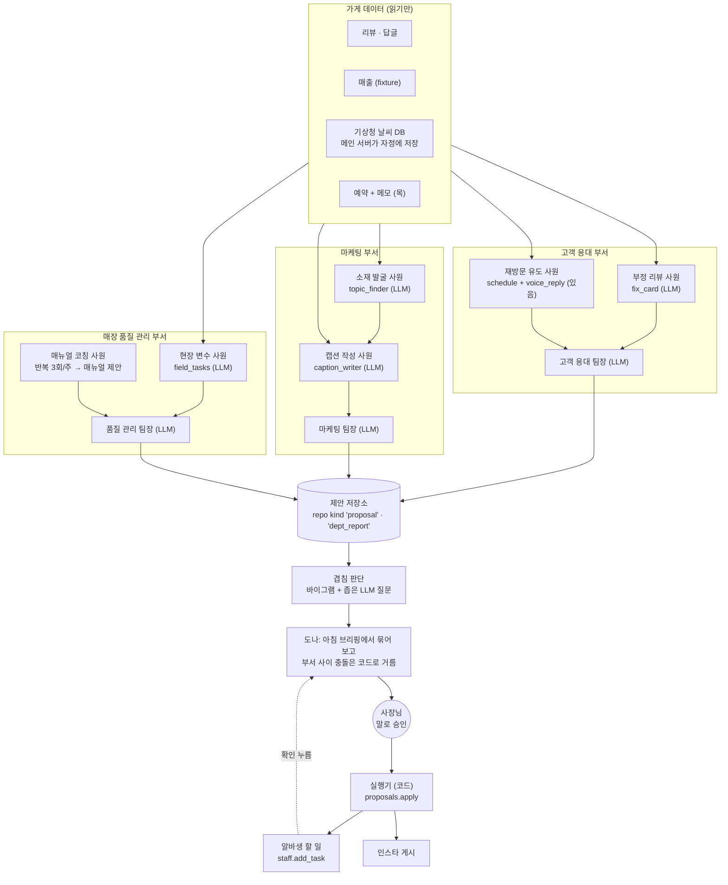

# 도나 에이전트 조직 개편 개발 계획서

2026-11-20 · 기준: 같은 날 의논에서 정한 것 (검토 문서: [도나 에이전트 조직 구조 검토](https://claude.ai/artifact/UeKDzCyuuBYnh8KGhHyeZj))

> **구현 결과 (2026-11-20):** 0~8단계를 모두 만들었습니다. 계약은 [인수인계 문서 23장](../../docs/v0.2.0-voice-agent-handoff.md), 남은 것은 [open-features.md](open-features.md) 9장. 계획과 다르게 한 것:
> - 리뷰 교정 할 일의 `origin`은 `negative_review`가 아니라 지금 값 `review`를 그대로 씁니다 (이미 저장된 할 일을 고치지 않으려고). 넣은 사원은 `source.by`에 남습니다
> - 마케팅 결과는 `proposal`이 아니라 `marketing_plan` 문서로 둡니다 (할 일로 넣는 `proposals.apply`와 섞지 않으려고)
> - 휴무는 가게 설정이 아니라 가게 문서의 `holidays`에 둡니다 (`hours.on`이 가게 문서만 받아서)
> - 글이 거의 같은 할 일(바이그램 0.9 이상)은 LLM 없이 묶습니다
> - "늦어서 식었다/불었다"는 배달 지연으로 먼저 봅니다 (교정 카드 없음)
> - 바로 답하기를 켠 가게는 영업 중 리뷰를 묻지 않으므로, 끈 가게의 25분 처리는 "초안으로 남김"이고 리마인드 문구도 그에 맞췄습니다

**무엇을 바꾸나:** 도나를 세 부서(고객 응대, 마케팅, 매장 품질 관리)로 나누고, 부서마다 팀장 LLM과 사원 에이전트를 둡니다.
- 사원 에이전트는 **제안만** 하고 DB에 남깁니다.
- 팀장 LLM이 제안을 판단합니다.
- 도나가 그 결과를 묶어 사장님께 보고합니다.
- 사장님이 말로 승인하면 코드가 실행합니다.

**어떤 순서로 하나:** 작업은 9단계입니다.
1. 기존 버그를 고칩니다(0단계).
2. 제안 저장소와 실행기를 만듭니다(1단계).
3. 부서를 하나씩 붙입니다.

경로는 모두 저장소 루트 기준이고, 줄 번호는 2026-11-20 `main`(2a36964) 기준입니다.

---

## 목차

0. [정한 것](#정한-것)
1. [전체 구조](#전체-구조)
2. [단계와 순서](#단계와-순서)
3. [0단계: 기존 버그 고치기](#0단계-기존-버그-고치기)
4. [1단계: 제안 저장소, 실행기, 출처 기록, 긴급의 뜻](#1단계-제안-저장소-실행기-출처-기록-긴급의-뜻)
5. [2단계: 겹침 판단과 반복 → 매뉴얼화](#2단계-겹침-판단과-반복--매뉴얼화)
6. [3단계: 고객 응대 부서](#3단계-고객-응대-부서)
7. [4단계: 기상청 날씨 자정 받기와 음성 백엔드 연결](#4단계-기상청-날씨-자정-받기와-음성-백엔드-연결)
8. [5단계: 매장 품질 관리 부서](#5단계-매장-품질-관리-부서)
9. [6단계: 마케팅 부서](#6단계-마케팅-부서)
10. [7단계: 팀장 LLM과 도나의 묶음 보고](#7단계-팀장-llm과-도나의-묶음-보고)
11. [8단계: 시험·평가·시연 저장본·문서](#8단계-시험평가시연-저장본문서)
12. [위험](#위험)
13. [열린 질문](#열린-질문)

---

## 정한 것

| # | 정한 것 |
|---|---|
| 1 | 부서는 세 개(고객 응대, 마케팅, 매장 품질 관리)이고, 부서마다 팀장과 사원을 둡니다. 마케팅도 같은 방식입니다 |
| 2 | **팀장도 LLM**입니다. 아래 사원들의 결과만 판단하고, **브리핑 준비처럼 미리(밤에)** 돕니다 |
| 3 | **보고는 도나가 묶어서** 합니다. 팀장들이 DB에 남긴 결과를 도나가 참고합니다 |
| 4 | 아쉬운 리뷰 사원과 현장 변수 사원 **둘 다 알바생 할 일을 넣을 수 있습니다.** 단, LLM은 제안만 하고, 넣는 것은 사장님이 승인한 뒤 코드가 합니다 |
| 5 | 현장 변수 할 일은 **매번 묻습니다** |
| 6 | 조치 가능 판정은 원칙 한 줄 + 리뷰 문장을 글자 그대로 인용 + 애매하면 넣지 않음. **하드코딩이나 빡빡한 프롬프트 예시는 쓰지 않습니다** |
| 7 | 배달 지연 리뷰는 **주문 기록이 생길 때까지** 교정 대상에서 뺍니다 |
| 8 | 교정 카드 문장은 **LLM이 씁니다.** 알바생이 할 수 없는 일(무엇을 사거나 바꾸기, 가격·정책 정하기)은 검사로 막습니다 |
| 9 | 긴급은 "오늘 안 하면 손님이 바로 겪는 일"입니다. 비 오는 날 이벤트는 긴급을 유지하고, **리뷰 교정은 "모두 확인 필요"**로 내립니다(퇴근을 막지 않음) |
| 10 | 출처는 넣는 쪽이 밝힙니다(`source.by`, `reason`, `same_as`). 같은 행동이면 새로 넣지 않고 묶습니다. **일주일에 3번** 반복되면 매뉴얼화를 제안합니다 |
| 11 | 밤사이 아쉬운 리뷰는 **안 B**로 합니다. 답글은 밤에 약속을 담아 올리고, 할 일은 아침 브리핑에서 묻습니다 |
| 12 | 아침에는 같은 행동끼리 묶어 한 번에 묻고, "두 번째는 빼" 같은 말로 고칠 수 있게 합니다 |
| 13 | 브리핑을 듣지 않으면 할 일은 넣지 않습니다. 알바생이 교정 없이 일하게 되더라도 이 약속은 지킵니다 |
| 14 | 영업 중 아쉬운 리뷰는 기본이 알림으로 묻기입니다. "아쉬운 리뷰 바로 답하기"(`negative_review_auto_reply`)를 켜면 자동으로 답합니다 |
| 15 | 자동 답글에는 **보상 문장을 붙이지 않고**, 올린 뒤 **바로 알립니다** |
| 16 | 날씨는 **메인 서버가 자정마다** 기상청에서 받아 DB에 저장하고, 도나는 그 DB를 읽습니다 |
| 17 | 예약은 **목 데이터**로 만듭니다(특이사항 메모 포함) |
| 18 | 11/16 결정("도나는 일정·날씨에서 할 일을 만들지 않는다")을 바꾼 것을 [operating-scenarios.md](operating-scenarios.md) 2-3장에 기록했습니다 |
| 19 | 리뷰 교정 카드는 **이틀**(넣은 날과 다음 날) 보입니다. 확인은 사람마다 한 번 누르면 됩니다 |
| 20 | 브리핑에서 묻지 못한 제안은 **그날 사장님이 다음에 "도나야"라고 부를 때 먼저 묻습니다**(안 B). 그날 문 닫을 때까지 묻지 못하면 버립니다 |
| 21 | 현장 변수 할 일의 긴급 여부는 사원이 낸 `today_impact`에 팀장 확인을 거쳐 정합니다 |
| 22 | **영업 중 실시간 경로도 팀장 LLM을 거칩니다** |
| 23 | 자동 답글 뒤 할 일 질문에 대답이 없으면 **다음 날 아침 브리핑으로 넘깁니다**(안 ③) |
| 24 | 매뉴얼로 올리는 문장은 **LLM이 다듬습니다** |
| 25 | 휴무는 **네이버 플레이스와 사장님 말** 둘 다로 받습니다 |
| 26 | 상황별 체크리스트·응대 가이드는 **이번 계획에서 뺍니다** |
| 27 | 0단계 버그 두 개는 의도한 것이 아닙니다. 계획서대로 고칩니다 |

**가정(따로 정하지 않아 계획서에서 정한 것):** 시연 가게 초옹장(s005)은 시나리오 날씨를 유지합니다. 시계를 2026-11-17에 고정해 두었기 때문입니다.

---

## 전체 구조



**지키는 원칙**
- LLM 사원과 팀장은 읽기 전용 도구만 씁니다. 결과는 `proposal`(제안)뿐입니다.
- 실제 쓰기(`staff.add_task`, 인스타 게시, 답글 올리기)는 승인 뒤 실행기(코드)가 합니다. 예외는 이미 허락받은 일(자동 답글, 예약 답글)뿐입니다.
- 사원 → 팀장 → 보고 단계는 **밤(브리핑 준비)에** 끝냅니다. 말하는 순간에는 저장된 결과를 꺼내기만 합니다(브리핑 단계 1초 목표 유지).
- 에이전트가 실패하면 지금의 규칙·템플릿으로 물러납니다. 화면은 멈추지 않습니다.

---

## 단계와 순서

| 단계 | 하는 일 | 먼저 끝나야 할 단계 | 크기 |
|---|---|---|---|
| 0 | 기존 버그 고치기 (echo 덮어쓰기, 중복 코드, 이벤트 카드 출처, 앱 알림 종류) | — | S |
| 1 | 제안 저장소·실행기, 출처 기록(`origin` 필수), 긴급과 확인 필요 나누기 | 0 | M |
| 2 | 겹침 판단, 반복 → 매뉴얼화 집계 | 1 | M |
| 3 | 고객 응대: 부정 리뷰 사원(LLM 카드), 영업 중 자동 답글, 밤사이 → 아침에 묻기, "두 번째는 빼" | 1, 2 | L |
| 4 | 메인 서버 날씨 자정 받기, 음성 백엔드가 날씨 DB 읽기 | — (언제든 따로 해도 됨) | S~M |
| 5 | 품질 관리: 예약 메모 목 데이터, 현장 변수 사원, 매뉴얼 코칭 사원 | 1, 2, 4 | L |
| 6 | 마케팅: 소재 발굴 사원, 캡션 작성 사원, 휴무 받기(네이버 플레이스 + 사장님 말) | 1 | M~L |
| 7 | 팀장 LLM 세 명, 부서 보고 저장, 도나 묶음 보고, 부서 사이 충돌 거르기 | 3, 5, 6 | M |
| 8 | 시험·평가 세트, 시연 저장본 다시 만들기, 문서 정리 | 단계마다 | S |

**브랜치와 커밋 ([commit_guide.md](../../commit_guide.md))**
- 단계마다 브랜치를 하나씩 만듭니다. 예: `이름/fix-voice-echo`, `이름/feat-proposals`, `이름/feat-fix-card`
- 커밋 메시지는 한 줄로 씁니다.
- PR을 올리고 여헌 님 승인을 받은 뒤 합칩니다.

**4단계와 6단계**는 다른 단계와 겹치는 파일이 거의 없어서 다른 사람이 동시에 진행할 수 있습니다.

---

## 0단계: 기존 버그 고치기

이번 일과 직접 관계는 없지만, 그대로 두면 3·5단계의 대화 흐름 시험이 흔들립니다. 11/19 되돌리기 커밋(ab8a811, 50bf489) 근처에서 생긴 것이고, **의도한 것이 아님을 확인했습니다**(2026-11-20). 지금 시연에도 영향을 주므로 브랜치를 따로 만들어(`이름/fix-voice-echo`) 먼저 올립니다.

### 0-1. echo 판정이 덮어써짐: `server/voice/dialog/turn.py:324-329`

```python
if echo.is_echo(store_id, utterance["text"]):
    intent = Intent("echo", intent_rules.tidy(utterance["text"]))
else:
    intent = understand(utterance["text"], session, view, addressed)
    session.pop("story_id", None)          # ← 328: 매번 스토리 기억을 지움
intent = understand(utterance["text"], session, view, addressed)   # ← 329: echo 결과를 덮어씀
```

**영향**
- 마이크로 다시 들어온 도나 자신의 말도 사장님 말로 처리됩니다.
- 사장님 말 한 번에 뜻 판정(필요하면 LLM 판정까지)이 두 번 돕니다.
- 스토리 포스터 알림을 연 뒤의 "응, 올려"가 `story_event.decide`로 가지 않고 `review_loop.decide`로 갑니다.

**고칠 것**
되돌리기 전 버전(65c07a1)과 같게 맞춥니다.

```python
        if session.get("last_type") != "ask_action":
            session.pop("alert_id", None)
            session.pop("story_id", None)                                   # ← 이 조건 안으로
        if echo.is_echo(store_id, utterance["text"]):
            intent = Intent("echo", intent_rules.tidy(utterance["text"]))
        else:
            intent = understand(utterance["text"], session, view, addressed)
        # (지금 329행의 두 번째 understand 줄은 지움)
```

**확인**
- echo 문장을 넣으면 `ignore`가 나옵니다.
- 스토리 알림을 연 뒤 "응, 올려"가 스토리로 올라갑니다.
- `understand`가 한 번만 불립니다(spy로 셈).

### 0-2. 같은 코드가 두 번 들어 있음: `server/voice/dialog/intent_rules.py`

- 122~180행과 184~242행이 통째로 같습니다(`NEAR_WORDS`, `NEAR_PROTECT`, `jamo`, `_distance`, `near_words`).
- 차이는 뒤쪽 `NEAR_PROTECT`에 `"하시"`가 더 있다는 것뿐입니다.
- **앞의 블록(119~181행)을 지웁니다.** 실제로 쓰이는 것은 뒤의 것이라 동작은 바뀌지 않습니다.

### 0-3. 비 오는 날 이벤트 카드가 "리뷰에서 나온 일"로 기록됨

- `server/voice/instagram/story_event.py:283`이 `staff.add_task(..., urgent=True, ...)`를 부르면서 `origin`을 넘기지 않습니다.
- 그러면 `server/voice/staff.py:76`이 "긴급이면 review"로 추측합니다.
- 알바생 화면에도 `staff.py:203`이 "리뷰에서 나온 일", 상세에는 `staff.py:285-297`이 "도나가 리뷰를 보고 넣은 일", "내일까지 맨 위에 보여요"를 띄웁니다. 실제로는 하루(days=1)만 보입니다.
- 1단계에서 근본적으로 고칩니다. 0단계에서는 `origin="story_event"`를 넘기는 한 줄만 고쳐 기록이 더 쌓이지 않게 합니다.

### 0-4. 앱 알림 종류 목록이 빠짐

- `donna-voice/app/src/lib/api.ts:72`의 `Notice.kind`에 `story_event`, `instagram`이 없습니다. 서버는 이미 보냅니다(`notices.py`).
- 목록에 더합니다. 3단계에서 `negative_auto`도 여기에 더합니다.

---

## 1단계: 제안 저장소, 실행기, 출처 기록, 긴급의 뜻

**목표:** 사원 에이전트가 무엇을 내든 같은 모양의 "제안"으로 저장하고, 승인 뒤에는 한 곳(실행기)에서만 실제로 넣습니다. 지금은 `review_loop._pin`과 `story_event.on_post_done`이 `staff.add_task`를 각자 직접 부릅니다.

### 1-1. 새 파일 `server/voice/proposals.py`

**저장 위치:** `voice.db`의 `docs` 표에 kind `"proposal"`로 둡니다(`server/voice/repo.py:72`). 표를 새로 만들지 않아 마이그레이션이 필요 없습니다. 이 저장소에는 열을 더하는 마이그레이션 장치가 없습니다.

**제안 하나의 모양**

```json
{
  "id": "pr_0012",
  "store_id": "s005",
  "dept": "customer | quality | marketing",
  "by": "negative_review | field_variable | manual_coach | topic_finder | caption_writer",
  "kind": "staff_task | instagram_post",
  "payload": {
    "title": "배달 용기 이중 실링",
    "detail": "국물 메뉴는 랩을 두 번 씌우고 뚜껑에 테이프를 한 번 더",
    "phase": "open",
    "repeat": "today",
    "days": 2,
    "must_confirm": true,
    "urgent": false
  },
  "reason": {"type": "review", "review_id": "rv_1003", "quote": "국물이 다 새서 왔어요"},
  "same_as": null,
  "ask_when": "briefing | now",
  "state": "proposed",
  "lead": {"verdict": "keep", "reason": "…", "run_id": "…"},
  "agent": {"source": "AGENT | FALLBACK", "run_id": "…", "notes": []},
  "task_id": null,
  "created_at": "…", "asked_at": null, "decided_at": null, "expires_at": "…"
}
```

**상태**

```
proposed ─(팀장 drop)→ dropped
   │
   ├─(겹침)→ merged            (same_as 에 기존 할 일·제안 id)
   │
   └→ asked ─→ approved → applied   (task_id 기록)
            ├→ declined           ("두 번째는 빼", "안 해")
            └→ expired            (그날 영업 끝까지 묻지 못함 — 결정 13)
```

**함수**

| 함수 | 하는 일 |
|---|---|
| `create(store_id, dept, by, kind, payload, reason, ask_when, agent)` | 제안을 저장합니다. 2단계 겹침 판단을 거칩니다 |
| `for_briefing(store_id, day)` | 그날 브리핑에서 물을 제안(팀장 keep, merged 아님, 아직 묻지 않음) |
| `mark_asked(ids)` | 물은 것으로 적습니다 |
| `apply(pid, trigger)` | 승인된 제안을 실제로 넣습니다. `staff_task`면 `staff.add_task(...)`를 부르고, `origin=by`, `source={by, dept, reason, proposal_id, same_as}`를 넘깁니다 |
| `decline(pid, trigger)` | 거절로 적습니다 |
| `expire(store_id, now)` | 영업이 끝난 날의 asked 안 된 제안을 expired로 바꿉니다. `jobs/queue.py`에 하루 한 번 작업을 더합니다 |
| `on_task_confirmed(task, person)` | 알바생이 확인했을 때 출처별로 후처리합니다. 리뷰면 `review_loop.on_staff_confirm`, 이벤트면 지금 동작 |

**같은 요청 한 번만 처리:** `apply`는 `repo._lock` 안에서 state를 보고 한 번만 넣습니다. `review_loop` 25분 작업과 사장님의 "응"이 겹칠 때 쓰는 방식과 같습니다.

### 1-2. `staff.add_task` 바꿀 것 (`server/voice/staff.py:66-82`)

**`origin`을 꼭 받게 합니다**
- 76행의 추측(`"review" if urgent else ...`)을 지웁니다. `origin`이 없으면 `ValueError`를 냅니다.
- 부르는 곳 네 군데를 모두 고칩니다.

| 부르는 곳 | 고친 뒤 |
|---|---|
| `staff.py:63` `seed()` 매뉴얼 | `origin="manual"` (지금과 같음) |
| `staff_orders.py:284` `_send()` 사장님 말 | `origin="owner"` (지금과 같음) |
| `review_loop.py:248` `_pin()` 리뷰 교정 | 직접 부르지 않고 `proposals.apply()` 경유. `origin="negative_review"` |
| `story_event.py:283` 이벤트 | `origin="story_event"` |

- 이 변경으로 `staff_orders._sent_today()`(334-338행)의 `origin ∈ ("owner", "review")` 조건과 `_cancel`(382-405행)도 새 이름에 맞춥니다. 사장님이 "그거 취소해"로 지울 수 있는 것은 지금처럼 `owner`만 둡니다.

**`source` 모양을 맞춥니다**

```json
{"by": "negative_review", "dept": "customer", "proposal_id": "pr_0012",
 "reason": {"type": "review", "review_id": "rv_1003", "quote": "…"},
 "same_as": null, "merged": [], "promoted_at": null,
 "alert_id": "al_rv_1003"}
```

- `alert_id`처럼 지금 쓰는 칸은 그대로 둡니다. `review_loop.on_staff_confirm`이 `source.alert_id`를 읽기 때문입니다.
- 지금 있는 할 일(`source.type` 기준)도 읽을 수 있게, 읽는 쪽은 `by`가 없으면 `type`을 봅니다.

**`staff_db.py`에 `update_task_source(task_id, source)`를 새로 둡니다.** 2단계에서 `merged`와 `promoted_at`을 적을 때 씁니다. 지금은 넣기와 취소만 있습니다.

**알바생 화면 문구를 출처 기준으로 바꿉니다** (`staff.py:193-213` `task_view`, `staff.py:285-297` `detail`)

| `origin` | 목록 줄 아래 (`sub`) | 상세 `owner_words_label` | 상세 `until` |
|---|---|---|---|
| `negative_review` | 리뷰에서 나온 일 | 도나가 리뷰를 보고 넣은 일 | `end_date`로 계산 ("내일까지 보여요" / "오늘만 보여요") |
| `story_event` | 오늘 이벤트 | 도나가 이벤트를 올리고 넣은 일 | 같음 |
| `field_variable` | 오늘 날씨·예약 | 도나가 오늘 날씨·예약을 보고 넣은 일 | 같음 |
| `manual_coach` / `manual` | 매일 | — | — |
| `owner` | 지금과 같음 | 사장님이 {시각}에 한 말 | 지금과 같음 |

- 확인했거나 했으면 지금처럼 "…에 확인함", "…에 함"이 먼저 나옵니다.

### 1-3. 긴급과 확인 필요 나누기 (결정 9)

지금 `urgent=True` 하나에 다섯 가지가 묶여 있습니다.
1. `must_confirm` 강제 (75행)
2. `origin` 추측 (76행)
3. 화면 맨 위 붉은 카드
4. 퇴근 막기 (`checkout` 459-468행)
5. `review_loop` 확인 훅 (`confirm` 452행)

**나누는 법**
- **리뷰 교정:** `urgent=False, must_confirm=True, days=2`로 둡니다. 화면에서는 phase 묶음의 "확인 필요"(`groups[].must`)로 가고, 퇴근은 막지 않습니다.
- **비 오는 날 이벤트:** `urgent=True` 그대로 둡니다. 맨 위에 뜨고, 확인해야 퇴근할 수 있습니다.
- **현장 변수:** 사원이 낸 `today_impact`가 참이고 팀장이 유지하면 `urgent=True`, 아니면 `must_confirm=True`입니다(5단계).
- **확인 훅 (`confirm` 452행):** 조건을 `task["urgent"] and first`에서 `task["must_confirm"] and first and origin in ("negative_review", "story_event", "field_variable")`로 바꾸고 `proposals.on_task_confirmed`를 부릅니다. 이렇게 해야 리뷰 카드를 확인했을 때 지금처럼 사장님께 "하린 씨가 … 확인했어요"가 갑니다.
- **사장님 화면 카드 색:** `review_loop._cards`(172행)의 `tone: "urgent"`를 리뷰 교정에서는 뺍니다. `cards.tsx:388-412` `Checklist`는 그대로 둡니다.

### 1-4. 앱 (`donna-voice/app`)

- `src/app/staff/today.tsx`: 서버가 `urgent`와 `must` 목록을 나눠 주므로 그리는 코드는 그대로입니다. 주석(16-17행, 144행 "아쉬운 리뷰에서 나온 일")만 고칩니다.
- `src/app/staff/task/[id].tsx`: 서버 글자를 그대로 보여 주므로 바꿀 것이 없습니다.

### 1-5. 시험

**깨지는 것 (고쳐야 함)**
- `server/voice/tests/test_staff_api.py`
  - 62행 `sub == "리뷰에서 나온 일"`: 문구는 같지만 리뷰 카드가 `urgent`가 아니라 `must`에 있으므로 꺼내는 곳이 바뀝니다.
  - 72행 `tag == "긴급"`: 리뷰 카드는 `"확인 필요"`로 바뀝니다.
  - 78-79행 퇴근 409: 리뷰 카드로는 막히지 않습니다. 이벤트 카드로 다시 시험합니다.
  - s7(다음 날에도 보임): `must` 목록에서 봅니다.
- `server/voice/tests/test_loop_negative.py`: `urgent(donna)` 도우미를 `must`로 바꾸고, 68행 `tone == "urgent"`를 고칩니다.
- `server/voice/tests/test_story_event.py` 156, 165, 187, 218행: 이벤트는 긴급이 유지되므로 그대로 통과해야 합니다.

**새로 넣을 것**
- `origin` 없이 `add_task`를 부르면 오류가 납니다.
- 이벤트 카드의 `sub`가 "오늘 이벤트"입니다.
- 리뷰 교정 카드를 확인하면 `staff_checked` 알림이 가고 alert가 `closed`가 됩니다(긴급이 아니어도).
- 리뷰 카드만 남아 있으면 퇴근이 됩니다.
- `proposals.apply`를 두 번 불러도 할 일은 하나만 생깁니다.

---

## 2단계: 겹침 판단과 반복 → 매뉴얼화

### 2-1. 비슷한 글 찾기 (코드)

- **새 파일 `server/voice/similar.py`:** `squash(text)`와 `pairs(text)`를 `dialog/echo.py:28-33`에서 옮겨 공개 함수로 둡니다. echo는 여기서 import합니다.
- **`dice(a, b) = 2|A∩B| / (|A|+|B|)`** (대칭)를 더합니다.
  - echo의 `is_echo`는 한쪽 기준 비율이고 `MIN_CHARS=8`, `OVERLAP=0.7`이라 짧은 할 일 제목에 맞지 않습니다. 예: "배달 용기 이중 실링"은 공백을 빼면 8자입니다.
- **후보:** 같은 가게, 취소되지 않음, 오늘 보이거나 최근 7일 안에 만든 할 일, 그리고 오늘 아직 넣지 않은 제안. 비교 글은 `title + " " + detail`입니다.
- **같은 출처**(같은 `review_id`, 같은 예약 id, 같은 날 같은 날씨)면 LLM 없이 바로 `merged`로 둡니다.
- **`dice ≥ 0.35`인 것이 후보입니다.** 이 값은 시작값이고 시험 세트로 맞춥니다. 후보가 없으면 LLM을 부르지 않습니다.

### 2-2. 같은 행동인지 묻기 (좁은 LLM 질문)

- **새 파일 `server/voice/agents/same_task.py`:** `intent_judge.py`와 같은 모양으로 만듭니다.
  - `tools=[]`
  - `submit_same(same_as: enum[후보 id…, "none"], reason: string)`
  - `Budget(max_steps=1, max_rejections=1, max_seconds=5, strict=True)`, `temperature=0`
  - 프롬프트: `voice/agents/prompts/same_task.txt`. 원칙 한 줄("새 할 일이 후보 중 하나와 알바생에게 같은 행동을 시키는가?")만 두고, 예시 목록은 넣지 않습니다(결정 6).
- `quote_judge`를 쓰지 않는 이유: 인용문이 검증하는 글에 글자 그대로 있어야 받아들이는 구조라, "어느 할 일과 같은가"를 고르는 데 맞지 않습니다.
- 꺼져 있거나(`config.agent_on("same")`) 실패하면 `"none"`(새로 넣음)으로 봅니다. 겹침을 놓쳐도 할 일이 하나 더 뜰 뿐이고, 잘못 묶으면 교정이 사라지기 때문입니다.

### 2-3. 묶은 결과

- **새 제안이 기존 할 일과 같으면:** 새 제안은 `state="merged"`, `same_as=<기존 task_id>`가 됩니다. 기존 할 일의 `source.merged`에 `{proposal_id, reason, at}`를 더합니다(`update_task_source`). 기존 할 일이 이미 화면에 있으므로 묻지 않습니다.
- **새 제안이 오늘의 다른 제안과 같으면:** 뒤의 것이 `merged`가 되고, 브리핑에서 앞의 것 한 줄로 묻습니다. 이유는 둘 다 말합니다. 예: "어젯밤 리뷰 두 개 때문이에요"
- **기존이 일반 할 일이고 새 것이 긴급이면:** 기존 할 일은 그대로 두고 새 제안을 넣습니다. 겹침으로 긴급이 사라지지 않게 하기 위해서입니다. 반대(기존이 긴급)면 묶습니다.

### 2-4. 반복 → 매뉴얼화 (매뉴얼 코칭 사원, 결정 10)

- **언제:** `briefing.prepare` 시작 때(밤)입니다.
- **묶음 세기:** 할 일마다 `same_as`를 따라 올라가 맨 처음 할 일(root)을 찾습니다. root 기준으로 **최근 7일 안에** 만든 할 일 수와 `merged` 수를 더해 **3 이상**이면 묶음당 한 번 제안합니다(root `source.promoted_at`이 비어 있을 때만).
- **제안:** `proposals.create(dept="quality", by="manual_coach", kind="staff_task", payload={title, detail, phase, repeat:"daily", must_confirm:false}, reason={type:"repeat", task_ids:[…], count:3})`
- **문장 (결정 24): LLM이 다듬습니다.** 새 파일 `server/voice/agents/manual_line.py`로 만듭니다.
  - 입력: 묶음 안 할 일들의 제목과 내용, 지금 매뉴얼 목록
  - 제출: `submit_manual(title, detail, phase)` — 매일 할 일로 읽히는 한 줄
  - 검사: 묶음 안 할 일에 없는 행동을 더하지 않음(바이그램 겹침과 `staff_scope` 질문), 폭, 가격·약속 금지
  - 물러나기: root 제목을 그대로 씁니다
  - 켜기: `config.agent_on("manual")`
- **브리핑에서 묻기:** "'배달 용기 이중 실링'이 일주일에 세 번 나왔어요. 매일 할 일로 올릴까요?"
- **승인하면:** `staff.add_task(repeat="daily", origin="manual", source={by:"manual_coach", from_tasks:[…]})`를 부르고, root `promoted_at`을 적습니다. 나중에 "이 매뉴얼은 리뷰 3건에서 나왔다"를 거꾸로 따라갈 수 있습니다.
- **효과 신호(이번 범위 밖, 기록만):** 매뉴얼로 올린 뒤에도 같은 묶음에 새 리뷰 카드가 붙으면 `source.merged`에 남습니다. 나중에 "교정이 효과가 없었다" 보고에 씁니다.

### 2-5. 시험

- `dice` 단위 시험
- 같은 출처는 LLM 없이 묶입니다.
- 후보가 없으면 LLM을 부르지 않습니다(FakeClova 호출 0).
- LLM이 실패하면 새로 넣습니다.
- 7일 안 3회면 제안이 생기고, 같은 묶음에서 두 번 생기지 않습니다.
- 8일 전 것은 세지 않습니다.

---

## 3단계: 고객 응대 부서

### 3-1. 부정 리뷰 사원: 교정 할 일을 LLM으로 (결정 6, 7, 8)

**새 파일 `server/voice/agents/fix_card.py`**

| 항목 | 내용 |
|---|---|
| 입력(task) | `review_id` |
| 조회 도구 | `MENU_LIST`, `STORE_FACTS` (`voice_reply.py:104-106`과 같은 함수), `MANUAL` (지금 매뉴얼 제목), `RECENT_TASKS` (최근 7일 할 일 제목) |
| 제출 도구 | `submit_fix_card(actionable: bool, quote: string, title: string, detail: string)` |
| 프롬프트 | `voice/agents/prompts/fix_card.txt`. 원칙 한 줄("이 가게 알바생이 다음 근무에서 행동을 바꿔 막을 수 있었던 문제인가?")과 제출 규칙만 둡니다. **예시 목록은 넣지 않습니다** |
| 예산 | `Budget(max_steps=4, max_rejections=2, max_seconds=30)`, `temperature=0.3` |
| 켜기 | `config.agent_on("fixcard")` |

**코드 검사 (`check`, 순서대로)**
1. **인용:** `quote`가 리뷰 원문에 글자 그대로 있어야 합니다. 없으면 "리뷰에 있는 말을 그대로 옮겨 줘"로 거절합니다.
2. **조치 불가면 끝:** `actionable=false`면 통과시키고 카드 없음으로 끝냅니다. 애매하면 넣지 않는다는 원칙대로입니다.
3. **길이:** `title`은 `server/voice/width.py` `LIMITS`에 새 키 `"staff.title"`로, `detail`은 `"staff.detail"`로 폭을 잽니다. 알바생 화면에 맞는 값을 정합니다.
4. **돈 관련 금지:** `guards.price_or_discount`, `guards.promise`로 보상·가격·할인을 막습니다.
5. **메뉴 이름:** `guards.not_in(menus)`로 메뉴 목록에 있는 것만 허용합니다.
6. **알바생이 할 수 없는 일 (결정 8):** `Harness/agents/quote_judge.py` `QUESTIONS`에 질문 하나를 더합니다.
   - `Question("staff_scope", "staff_scope_judge.txt", ask=…, found=…, quote=…, subject="할 일")`
   - 질문: "이 할 일에 알바생이 지금 매장에 있는 것으로 할 수 없는 일(무엇을 사거나 바꾸기, 가격·메뉴·정책 정하기)이 있는가? 있으면 그 부분을 그대로 옮겨라."
   - 찾으면 그 부분을 이유로 돌려주고 다시 쓰게 합니다. 질문을 부를 수 없으면 **물러나기(템플릿)**로 갑니다. 검사 없이 내보내지 않습니다.

**배달 지연 빼기 (결정 7)**
- 지금 `server/voice/jobs/cause.py`의 `late` 규칙이 걸리는 리뷰는 에이전트를 부르지 않고 **카드 없음**으로 둡니다.
- 새로 만든 하드코딩이 아니라 지금 있는 규칙을 재사용하는 것이고, 주문 기록이 생기면 지웁니다. 코드에 `# TODO(주문 기록): late 제외 해제` 주석을 남깁니다.

**물러나기**
- 에이전트를 껐거나 예산 안에 끝나지 않으면 지금의 `cause.classify` 템플릿을 씁니다.
- `late`와 `other`는 카드가 없습니다.

**결과**

```
proposals.create(dept="customer", by="negative_review", kind="staff_task",
  payload={title, detail, phase:"open", repeat:"today", days:2, must_confirm:True, urgent:False},
  reason={type:"review", review_id, quote}, ask_when=…)
```

**답글과 같은 행동 약속하기**
- 카드가 생기면 `voice_reply.write(view, review, kind, fix={"cause": summary, "action": detail})`로 넘깁니다.
- 지금 있는 경로입니다(`voice_reply.py:117-133` `user_message`가 원인과 조치를 한 문장으로 쓰게 함). 카드가 없으면 `fix=None`으로 지금처럼 답합니다.

### 3-2. 영업 중 아쉬운 리뷰 (결정 14, 15)

`server/voice/jobs/review_loop.py`를 바꿉니다.

| 설정 `negative_review_auto_reply` | 동작 |
|---|---|
| `None` / `False` (기본) | **지금처럼 알림 → 묻기(`ask_action`).** 바뀌는 것: 카드가 `fix_card` 제안에서 오고, "응, 진행해"가 `proposals.apply`를 부릅니다. 보상 문장을 묻는 것과 15분 다시 알림·25분 대신 처리는 그대로입니다 |
| `True` | **묻지 않고 사과 답글을 바로 올립니다.** 보상 문장은 붙이지 않습니다(`use_compensation=False`). 조치를 담은 글(`reply_base`)을 씁니다. 그 자리에서 알림을 보냅니다(아래) |

**`True`일 때 알림 (결정 15: 바로 알림)**
- `notices.push(store_id, "negative_auto", "배민 아쉬운 리뷰에 사과 답글을 올렸어요", opens_turn=True, alert_id=…)`
- 앱이 열면 도나가 말합니다. "방금 배민에 국물이 샜다는 아쉬운 리뷰가 와서 사과 답글을 올렸어요. 알바생 할 일에 '배달 용기 이중 실링'을 넣을까요?" 응답 종류는 `ask_action`이고, `action.kind="review_fix_task"`입니다(할 일만 묻는 응답).
- 카드가 없으면(조치 불가) 묻지 않고 알리기만 합니다(`opens_turn=False`).

**바꿀 곳**
- `on_new_review` (52-64행): `True`면 `review_alert`만 걸고 `review_remind`·`review_fallback`은 걸지 않습니다.
- `alert` (73-101행): 설정이 `True`면 `_post(..., "auto")` → 제안 `ask_when="now"` → `negative_auto` 알림 순서로 처리합니다. alert 상태에 `auto_posted`를 더하고, 이어서 `card_pinned` 또는 `closed`가 됩니다.
- `decide` (266-332행): `auto_posted` 상태에서 approve/edit/cancel은 할 일에만 적용합니다. 답글은 이미 올렸으므로 "답글은 이미 올렸어요"를 덧붙입니다.
- `server/voice/notices.py` `_alive` (32-39행): `negative_auto`도 alert가 끝나면 버리고 25분이 지나면 버립니다(`negative_review`와 같음).
- `donna-voice/app/src/lib/api.ts:72`: `Notice.kind`에 `negative_auto`를 더합니다.

**팀장을 거칩니다 (결정 22).** 실시간 경로에서도 `fix_card` 제안을 고객 응대 팀장(7-1)이 본 뒤 알립니다. 팀장이 drop하면 할 일은 묻지 않고 답글만 처리합니다.

**대답이 없을 때 (결정 23, 자동 답글 `True`일 때)**
- 할 일 질문에 대답이 없으면 제안을 `ask_when="briefing"`으로 바꿔 **다음 날 아침 `staff_tasks` 단계에서 묻습니다.**
- 넘길 때: 알림이 사라지는 시각(25분, `notices._alive`)에 작업 `review_fix_carry`(새, `jobs/queue.py`)가 제안 상태를 바꿉니다.
- 다음 날 브리핑에서도 묻지 못하면 결정 20(그날 다음에 부를 때 묻기 → 문 닫을 때 버림)을 따릅니다.
- 자동 답글을 끈 가게(`None`/`False`)는 지금처럼 15분 다시 알림, 25분 사과만 올리기입니다. 할 일은 넣지 않습니다.

**알림이 늦어지는 것:** 알림 전에 `fix_card`(예산 30초)와 팀장(실시간용 예산 15초, 7-1)이 붙어 최대 45초쯤 늦어집니다. 리뷰 답글 30분 목표 안이라 허용합니다. 다만 `config.ALERT_AGENT_REPLY`(답글 에이전트, 기본 꺼짐)까지 켜면 1분을 넘길 수 있으니 시험에서 잽니다.

### 3-3. 밤사이 아쉬운 리뷰 (결정 11)

- **허락 `True`:** `server/voice/jobs/auto_reply.py` `reply_now`(31-47행)가 지금처럼 10분 뒤 답합니다. 답하기 **전에** `fix_card`를 돌려 카드가 있으면 `fix`로 넘겨 같은 행동을 약속하게 합니다(안 B). 제안은 `ask_when="briefing"`으로 저장합니다.
- **허락 `None`/`False`:** 답글은 지금처럼 아침 `draft_negative`/`step_negative`로 갑니다. `briefing.prepare`의 `draft_negative`(107-120행)에서 `fix_card`를 먼저 돌려 `reply_ready`를 같은 행동으로 쓰고, 제안을 `ask_when="briefing"`으로 저장합니다.
- 허락 질문의 "응" 뒤에 올라가는 `post_ready_negatives`(123-139행)는 이미 같은 행동으로 쓴 `reply_ready`를 올리므로 그대로 둡니다.

### 3-4. 아침 브리핑에서 할 일 묻기: 새 단계 `staff_tasks` (결정 12, 13)

고객 응대(리뷰 교정)와 품질 관리(현장 변수, 매뉴얼화) 제안을 **한 단계에서 묶어** 묻습니다. 도나가 묶어서 보고한다는 결정 3대로입니다.

**`server/voice/jobs/briefing.py`**
- `STEP_KEYS`(28행)의 맨 뒤(`story_event` 다음)에 `"staff_tasks"`를 더하고, `GAUGE`는 5로 둡니다.
- **새 함수 `step_staff_tasks(view, now)`**
  - `proposals.for_briefing(store_id, today)`를 읽습니다. 7단계 뒤에는 팀장이 keep한 것만 읽습니다.
  - 순서: 긴급 → 리뷰 교정 → 현장 변수 → 매뉴얼화입니다. 한 번에 최대 4개(`width.MAX_ITEMS["rows"]`)까지 묻고, 넘치면 남은 것은 다음 묻기로 넘깁니다.
  - 응답: `answer("알바생 할 일로 넣을까요?", says, cards, kind="ask_tasks", tasks=[{n, proposal_id, title, why}])`, `expects_reply=True`
  - 말 예: "알바생 할 일로 넣을 게 두 개 있어요. 첫째, 배달 용기 이중 실링. 어젯밤 국물이 샜다는 리뷰 때문이에요. 둘째, 우산꽂이 내놓기. 오후 2시부터 비가 와요. 넣을까요?" 글자 폭은 `width.fit`로 맞춥니다.
  - 카드: `checklist`에 번호를 붙인 항목을 둡니다. 긴급 후보만 `tone:"urgent"`입니다.
- `prepare`(484-523행)에서 `steps["staff_tasks"]`를 만들 때 `mark_asked`는 하지 않습니다. **실제로 그 단계를 말한 때**(turn에서 그 단계 응답을 돌려줄 때)에 `mark_asked`합니다.

**대답 (`server/voice/dialog/intent_rules.py`, `turn.py`)**
- 새 `last_type` `"ask_tasks"`를 만듭니다. `match()`(268행~)에서 `last_type == "ask_tasks"`이면 `match_action`(392-407행)을 그대로 씁니다.
- **순서 낱말 해석 (지금은 없음)**

  ```python
  ORDINAL_RE = re.compile(r"(첫|두|둘|세|셋|네|넷|다섯)\s*(번)?\s*째|([1-9])\s*번")
  ```

  - `edits_in`(388-389행)이 `{"drop_compensation", "no_card", "drop_index": [2]}`를 돌려줍니다.
  - `match_action` 397행의 "고치는 말이 있나" 조건에 `drop_index`를 더합니다.
  - "두 번째는 빼고 넣어"처럼 넣으라는 말(`POST_VERB_RE`에 `넣어`를 더함)이 같이 있으면 `action.approve`, 없으면 `action.edit`입니다.
  - 정규화의 `near_words`(224-242행)가 "두번째", "세번째"를 다른 낱말로 바꾸지 않는지 시험합니다. `NEAR_PROTECT`에 "다섯"은 이미 있습니다.
- `turn.dispatch`(180-265행): `last_type == "ask_tasks"`이고 `action.*`이면 `proposals.decide_batch(view, intent, edits)`로 보냅니다(`keep_context="ask_tasks"`).
  - approve: 남은 것 전부 `apply`
  - edit + `drop_index`: 그것만 `decline`하고 남은 것을 다시 읽어 줍니다("둘째는 빼고 첫째만 넣을까요?")
  - cancel: 전부 `decline`
  - unclear: 다시 묻기
- 번호는 **도나가 말한 순서**를 기준으로 합니다(화면 카드 순서와 같게 만듦).

**브리핑에서 묻지 못하면 (결정 13, 20)**
- 묻지 못하는 경우: 브리핑을 아예 켜지 않음, 중간에 "그만", 끝 단계 전에 앱을 닫음(`staff_tasks`가 맨 끝이라서)
- **그날 사장님이 다음에 "도나야"라고 부를 때 먼저 묻습니다.** 예) 오후 3시 "도나야, 매출 어때?" → "그 전에 하나만요. 알바생 할 일로 '배달 용기 이중 실링'을 넣을까요?" → 대답을 처리한 뒤 원래 물은 것(매출)에 답합니다.
  - `turn.handle`(290-351행): 사장님이 부른 말(`addressed`)이고 묻지 않은 오늘 제안이 있으면, 원래 응답 앞에 `staff_tasks` 질문을 먼저 돌려줍니다. 원래 물은 말은 `session["deferred_utterance"]`에 두었다가 대답 뒤에 처리합니다.
  - 다만 다른 것을 묻고 있는 중(`ask_action`, `ask_staff`, `ask_permission`)이면 끼어들지 않습니다.
  - 브리핑 중에는 끼어들지 않습니다(맨 끝 단계에서 물으므로).
- 그날 문 닫는 시각까지 묻지 못하면 `proposals.expire`가 `expired`로 바꿉니다. 할 일은 넣지 않습니다.

### 3-5. 재방문 유도 사원 (좋은 리뷰)

- 바꾸지 않습니다. `jobs/schedule.py`가 올릴 때를 정하고, `voice_reply`(SCHEDULED)가 답글을 쓰는 지금 흐름을 고객 응대 부서의 "재방문 유도 사원"으로 부릅니다.
- 7단계에서 부서 보고에 "예약한 답글 N개"로 들어갑니다.

### 3-6. 시험

**영업 중**
- 설정 `None`: 지금처럼 묻습니다. "응, 진행해"면 할 일이 생기고 그 할 일은 `must_confirm`입니다.
- 설정 `True`: 묻지 않고 답글이 올라갑니다. 보상 문장이 없습니다. `negative_auto` 알림이 가고, 열면 할 일만 묻습니다. "응"이면 넣고 "안 해"면 안 넣습니다.

**밤사이**
- 허락 `True`: 밤에 답글이 올라가고, 아침 `staff_tasks`에서 묻습니다.
- 허락 `None`: 아침 허락 질문 → `staff_tasks` 순서입니다.

**묶음 대답**
- "두 번째는 빼"는 둘째만 거절합니다.
- "두 번째는 빼고 넣어"는 첫째를 넣습니다.
- "안 해"는 전부 거절합니다.

**그 밖**
- 브리핑을 건너뛰면 그날 저녁 `expired`가 되고 할 일은 0개입니다.
- 배달 지연 리뷰는 카드가 없습니다.
- `fix_card` 거절 사례(FakeClova): 인용이 리뷰에 없는 경우, "새 용기 사기"(staff_scope 질문이 찾음)가 들어간 경우.

---

## 4단계: 기상청 날씨 자정 받기와 음성 백엔드 연결

### 4-1. 메인 서버: 매일 00:00(서울)에 받기 (결정 16)

**`server/app/weather/auto_refresh.py`**
- 23행 `REFRESH_EVERY = 3시간`을 지웁니다.
- 45행 `stores_due`의 조건을 날짜 기준으로 바꿉니다.

  ```python
  fetch is None or fetch["fetched_at"].astimezone(SEOUL).date() < now.date()
  ```

  서버를 켰을 때 오늘 아직 받지 않았으면 바로 따라잡습니다.
- 72-78행 `_run`: 다음 00:00:30까지 남은 초를 계산해 기다립니다. 그날 받지 못한 가게가 있으면 10분(`CHECK_EVERY_SECONDS=600`) 뒤 다시 시도합니다.
- 00:00에 부르면 **전날 23시 발표**를 고릅니다(`app/weather/parsing.py:24-38`, `short_forecast.py:24-25`). 이 발표에는 오늘 00~23시 시간별 예보와 오늘 최저·최고기온이 모두 들어 있습니다.
- 어제 관측(ASOS)은 자정에 아직 없을 수 있습니다. 다음 날 자정에 채워집니다(`observations.py:97`, `store_weather._daily_rows` 61-62행). 분석에는 지장이 없습니다.

**"3시간" 문구 고치기**
- `auto_refresh.py` 1-8행
- `app/main.py` 30행
- `app/weather/store_weather.py` 46행
- `app/modules/stores/router.py` 13·157행
- `app/weather/README.md` 4·14·22·40행

**시험:** `server/tests/weather/test_weather_service.py` 185-219행(3시간 규칙 검사)을 날짜 기준으로 바꿉니다.

**운영 주의 (README에 적기)**
- 자정 받기는 **메인 서버(8000)가 켜져 있을 때만** 돕니다. 음성 백엔드(8100)만 켜면 새로 받지 않습니다.
- 다만 음성 앱으로 가게를 등록하면 첫 받기는 음성 프로세스 안에서 한 번 돕니다(`voice/api/account.py:42-48`이 메인의 `/api/stores` 라우터를 붙여 씀).

### 4-2. 음성 백엔드: 날씨 DB 읽기

**새 파일 `server/voice/weather.py`**

```python
def from_db(store_id: str) -> list[dict] | None:
    """기상청 날씨(store_weather_daily + 마지막 시간별 예보)를 음성 백엔드 모양으로. 없으면 None."""
```

- 읽기: `app.data_pipeline.read_store_db.read_store_weather(store_id)`(193-196행)와 `read_store_weather_fetch(store_id)`(199-202행)
- `read_weather()`(161-176행)는 목업과 섞은 분석용이라 쓰지 않습니다.

**칸 바꾸기**

| 음성 백엔드 칸 | 기상청 쪽 | 비고 |
|---|---|---|
| `date` | `date.isoformat()` | |
| `temp_min`, `temp_max` | `temp_min`, `temp_max` | Decimal → float |
| `rain_mm` | `precip_mm` | |
| `rain_chance` | `pop_max / 100` | 관측 줄은 `pop_max`가 없으므로 `precip_type`이 비 계열이면 1.0, 아니면 0.0 |
| `label` | `precip_type`이 비·소나기·비/눈이면 "비", 눈이면 "눈", 아니면 `sky`(구름많음 → "구름") | |
| `rain_from` | 시간별 예보(`payload.forecasts.hourly`)에서 그날 `precipitation_type != "없음"` 또는 `precipitation_probability ≥ 60`인 **첫 시각의 시(int)** | 시간별은 마지막 1건에만 있음. 그날 것이 없으면 칸을 비움 |

- `rain_from`이 0이면 `briefing.rain_text`(59-62행)가 "하루 종일 비"로 읽습니다. 자정부터 비면 그 뜻이 맞으므로 그대로 둡니다.

**`server/voice/context.py` `load()`(38-42행)에 끼우기**
- `store_id != config.DEMO_STORE_ID`이고 `weather.from_db(store_id)`가 값을 주면 `data["weather"]`를 그 값으로 바꿉니다.
- 아니면 지금처럼 `repo` 문서(fixture)를 씁니다.
- 날씨를 읽는 곳(`briefing.weather_on/rain_today/rain_text`, `schedule.context_for`, `voice_reply.reply_occasion`, `tabs._plans/week`, `story_event`, `turn.answer_question`)은 모두 `view.data["weather"]`를 읽으므로 고칠 필요가 없습니다.

**예외 두 가지**
- **시연 가게 s005:** fixture 날씨를 유지합니다. 지금은 s005가 registry에 등록되어 있지 않아 기상청 날씨를 받지 않지만(`weather/s005.db`가 0바이트), 누가 초옹장을 네이버로 등록하면 받기 시작하므로 `DEMO_STORE_ID`로 명시적으로 뺍니다.
- **시험 가게 s001:** 기상청 표가 없으니 `from_db`가 None이고, fixture 날씨를 그대로 씁니다.

**시계가 다름:** 음성 백엔드의 `clock.now()`는 시연 시각이고 기상청 자료는 실제 날짜입니다. 시연 가게만 빼면 실제 가게는 실제 시각을 쓰므로 맞습니다.

**시험 (`server/voice/tests/test_weather_bridge.py` 새 파일)**
- `read_store_db`를 가짜로 바꿔 칸이 제대로 바뀌는지 봅니다.
- 시간별에서 `rain_from`을 계산합니다(14시 비 → 14).
- 시연 가게는 fixture를 유지합니다.
- DB가 비면 fixture를 씁니다.

---

## 5단계: 매장 품질 관리 부서

### 5-1. 예약 목 데이터에 메모 넣기 (결정 17)

- `server/voice/fixtures/s005_choongjang.json`의 `reservations`에 `name`과 `memo`를 더합니다. 예:
  - `rs_0031` (11-17 12:00, 12명): `"memo": "땅콩 알레르기 손님 1명"`
  - `rs_0032` (11-17 18:00, 4명): `"memo": "아이 의자 2개 부탁드려요"`
- 저장은 `voice/api/dev.py:31-33` `load_fixtures`가 `{**item, …}`로 그대로 넣으므로 **코드 수정이 없습니다.** 지금 읽는 곳은 모르는 칸을 무시합니다.
- `s001_baseline.json`에도 메모 있는 예약을 하나 넣어 시험에 씁니다.
- **fixture를 고치면 시연 저장본이 무효가 됩니다**(`prepared_snapshot.fixture_sha`). 8단계에서 다시 만듭니다.
- 브리핑 일정 단계(`step_schedule`)는 지금처럼 사실(시각·인원)만 말합니다. 메모에서 나오는 할 일은 현장 변수 사원이 `staff_tasks` 단계에서 묻습니다.

### 5-2. 현장 변수 사원 (결정 4, 5)

**새 파일 `server/voice/agents/field_tasks.py`**

| 항목 | 내용 |
|---|---|
| 언제 | `briefing.prepare` 안(밤). 그날 하루 몫만 |
| 조회 도구 | `TODAY_WEATHER` (오늘 줄 + 시간별 비 요약), `TODAY_RESERVATIONS` (시각·인원·메모), `MANUAL`, `RECENT_TASKS`, `MENU_LIST` |
| 제출 도구 | `submit_field_tasks(items: [{title, detail, phase, today_impact: bool, source_type: "weather" \| "reservation", source_id, quote}])`, 최대 3개, 빈 목록 허용 |
| 프롬프트 | `voice/agents/prompts/field_tasks.txt`. 원칙 한 줄("오늘의 날씨·예약 때문에 평소 매뉴얼에 없는 일이 필요한가? 필요할 때만 내고, 없으면 빈 목록")만 둡니다. **예시 목록은 넣지 않습니다** |
| 예산 | `Budget(max_steps=5, max_rejections=2, max_seconds=40)` |
| 켜기 | `config.agent_on("field")` |
| 물러나기 | 없음. 제안하지 않습니다 |

**코드 검사**
1. `quote`가 그 `source_type` 도구 결과에 글자 그대로 있어야 합니다(`grounding.Evidence`).
2. **손님 정보(알레르기 등)는 메모를 바꿔 쓰지 않습니다.** `detail`에 나온 숫자와 이름은 근거 대조로 봅니다(`grounding.ungrounded_numbers`, `ungrounded_terms`). 메모에 없는 알레르기 이름이 나오면 거절합니다. 틀리면 위험한 정보라서입니다.
3. 3-1의 `staff_scope` 질문(알바생이 할 수 없는 일)을 재사용합니다.
4. 폭은 `staff.title` / `staff.detail`로 잽니다.
5. 매뉴얼과 겹치는 것은 2단계 겹침 판단이 거릅니다(`MANUAL`도 후보에 넣음).

**결과**

```
proposals.create(dept="quality", by="field_variable", kind="staff_task",
  payload={…, repeat:"today", days:1, must_confirm:True, urgent: today_impact},
  reason={type: source_type, id: source_id, quote}, ask_when="briefing")
```

- `urgent`는 팀장이 keep할 때만 살립니다(7단계). 팀장이 꺼져 있으면 `today_impact`를 그대로 씁니다.
- **매번 묻기(결정 5):** 3-4 `staff_tasks` 단계에서 다른 제안과 함께 묻습니다. 승인 없이는 넣지 않습니다.

### 5-3. 매뉴얼 코칭 사원

- 2-4의 반복 → 매뉴얼화가 이 사원의 일입니다. 집계와 제안은 코드가 합니다.
- 기본 매뉴얼(`staff.seed`, 영업 준비·영업 중·마감)은 바꾸지 않습니다.
- 상황별 체크리스트·응대 가이드는 **이번 계획에서 뺍니다**(결정 26). 알바생 앱에 새 화면과 가게 응대 기준 데이터가 필요해서 규모가 크기 때문입니다.

### 5-4. 시험

- 비 오는 날(s001 fixture에 비를 넣음) FakeClova가 우산 할 일을 내면 제안이 생기고 `staff_tasks`에서 묻습니다.
- 메모에 없는 알레르기 이름은 거절됩니다.
- 빈 목록이면 제안이 없고 `staff_tasks` 단계도 없습니다(다른 제안이 없을 때).
- `today_impact`가 참이면 넣을 때 `urgent`입니다.

---

## 6단계: 마케팅 부서

지금 인스타 초안은 전부 규칙입니다(`server/voice/instagram/posts.py:99-113` `build_feed`).
- 캡션은 고정 템플릿입니다.
- 해시태그는 가게 이름 하나입니다(`hashtag`, 94-96행).
- 소재는 "이번 달 가장 많이 나간 메뉴 3개"입니다(`top_menus`, 63-80행).

v1의 `Harness/agents/campaign_agent.py`는 메인 앱 스냅샷(`ctx.snapshot.inputs`)을 읽어서 음성 백엔드(`VoiceStore`)에서는 동작하지 않습니다. 그래서 검사 패턴(부분 확정 `_locked`, `guards`, `grounding`)만 가져다 씁니다.

### 6-1. 소재 발굴 사원 `server/voice/agents/topic_finder.py`

| 항목 | 내용 |
|---|---|
| 조회 도구 | `TOP_MENUS` (`posts.top_menus` 결과), `STRENGTHS` (`jobs/strengths.analyze` 결과), `POSITIVE_QUOTES` (최근 좋은 리뷰 문장, `mask_personal_info`), `TODAY_WEATHER`, `MENU_LIST` (사진 여부 포함) |
| 제출 | `submit_topic(menu_ids: [1~3], angle: string, evidence: [string])` |
| 검사 | `menu_ids`가 목록에 있고 사진이 있어야 함 · `angle`의 숫자는 근거 대조 · 판매 주장(`guards.sales_claim_words`, "인기" 등)은 `TOP_MENUS`를 조회했을 때만 · `guards.price_or_discount` |
| 물러나기 | 지금 `posts.top_menus` 규칙 |
| 켜기 | `config.agent_on("topic")` |

**아쉬운 리뷰와 부딪힘:** 최근 7일 안에 아쉬운 리뷰가 있는 메뉴를 고르면 7단계 도나 충돌 거르기에서 뺍니다. 이것이 `Harness/conflicts.py` `PROMOTES_COMPLAINED_MENU`와 같은 생각입니다.

### 6-2. 캡션 작성 사원 `server/voice/agents/caption_writer.py`

| 항목 | 내용 |
|---|---|
| 입력 | 소재 결과, 고른 손님 문장(`posts.quote`), 가게 이름 |
| 제출 | `submit_caption(body: string, hashtags: [string])` |
| 검사 | 본문 길이 · 해시태그 8개 이하이고 `#` 한 낱말 꼴 · 가격·할인·약속 금지 · 메뉴 이름 목록 대조 · 손님 문장은 리뷰에 글자 그대로 · 숫자 근거 대조 |
| 물러나기 | 지금 `build_feed` 템플릿 캡션 |
| 켜기 | `config.agent_on("caption")` |

- **가게 정보 줄은 LLM이 쓰지 않습니다.** 주소, 영업시간, 정기 휴무는 코드가 `voice/hours.py` `summary()`(55행)로 붙입니다. 지어내면 안 되는 정보라서입니다.
- `build_feed`는 슬라이드 만들기를 그대로 두고 캡션만 바꿉니다.
- **휴무 공지 캡션:** 휴무 전날 "내일은 쉬어요" 게시를 캡션 작성 사원이 제안합니다. 휴무 날짜는 6-3에서 받습니다.

### 6-3. 휴무 받기: 네이버 플레이스 + 사장님 말 (결정 25)

**저장:** 음성 백엔드 가게 설정에 `holidays: [{date, source: "owner" | "naver", note, confirmed}]`를 더합니다(`repo.settings`, 표 추가 없음). `voice/hours.py` `on(store, day)`(50행)가 `confirmed`인 휴무 날을 쉬는 날(None)로 봅니다. 그러면 브리핑 준비(`jobs/queue.py:41`), 아쉬운 리뷰 알림 시간(`review_loop.in_alert_hours`), 좋은 리뷰 예약 시각(`schedule.py:40·51`), 홈 가게 상태(`api/home.py:31-44`)가 저절로 맞춰집니다.

**사장님 말**
- 새 뜻 `store.holiday` / `store.holiday_cancel`: "도나야, 다음 주 수요일 쉬어", "26일 쉬는 거 취소해"
- 날짜 해석은 규칙으로 합니다("다음 주 수요일", "26일", "내일"). 못 가르면 `intent_judge`에 `holiday_date` 칸을 더합니다.
- 저장 전에 한 번 읽어 줍니다. "11월 26일 수요일을 쉬는 날로 적을게요. 맞아요?" → "응" → `confirmed: true`. `staff_orders`의 묻고 기다리기(`staff_pending`)와 같은 방식입니다.

**네이버 플레이스**
- 지금 읽는 휴무 정보(`app/core/naver_place.py:72` `closed_note`)는 날짜가 아니라 안내 문장입니다(예: "휴무일은 네이버 소식란, 인스타 참고"). 소식 탭 글(`news`)에 "이번 주 수요일 임시 휴무" 같은 글이 올라오는 경우가 많습니다.
- 새 에이전트 `server/voice/agents/holiday_reader.py`: `closed_note`와 최근 소식 글에서 날짜를 뽑습니다.
  - 제출: `submit_holidays(items: [{date, quote}])`
  - 검사: `quote`가 원문에 글자 그대로 있어야 함, 날짜는 오늘부터 60일 안
- 언제: 브리핑 준비 때 하루 한 번. 메인 서버의 네이버 정보 읽기(`naver_place`)를 음성 백엔드가 부릅니다(`voice/api/account.py`가 이미 가게 등록 때 씀).
- **뽑은 날짜는 `confirmed: false`로 두고, 아침 브리핑 일정 단계에서 묻습니다.** "네이버 소식에 26일 수요일 임시 휴무라고 있어요. 쉬는 날로 적을까요?" 잘못 읽으면 공지가 엉뚱한 날 올라가기 때문입니다.

**시험:** 말로 휴무 → 확인 → `hours.on`이 None, 취소, 네이버 소식 글에서 날짜 뽑기(FakeClova) → 확인 전에는 쉬는 날이 아님, 휴무 날엔 브리핑 준비 작업이 건너뜀.

### 6-4. 승인

- 지금 브리핑 인스타 단계(`briefing.step_instagram`, 374-403행)의 "인스타에 올릴까요?"와 대답(`turn.instagram_reply`, 146-162행)을 그대로 씁니다.
- 바뀌는 것은 말하는 내용입니다. "오늘은 고소한 들깨 국물 이야기로 들깨옹심이를 올려 볼게요" 같은 소재 이유 한 줄이 더해집니다.
- 게시 제안도 `proposal`(kind `instagram_post`)로 저장해 7단계 팀장이 판단하게 합니다. 실제 게시는 지금의 `posts.create` → `queue_publish`가 합니다.

### 6-5. 시험

- 에이전트가 꺼져 있으면 지금 캡션과 같습니다.
- FakeClova로 해시태그 9개를 내면 거절됩니다.
- 영업시간 줄은 코드가 붙인 값입니다.
- 아쉬운 리뷰 메뉴가 소재가 되면 빠집니다.

---

## 7단계: 팀장 LLM과 도나의 묶음 보고

### 7-1. 팀장 LLM `server/voice/agents/team_lead.py` (결정 2)

부서 이름을 task로 받는 spec 하나로 세 팀장을 만듭니다.

| 항목 | 내용 |
|---|---|
| 언제 | `briefing.prepare`에서 그 부서 사원들이 끝난 뒤 부서마다 한 번(밤) |
| 입력 | 그 부서의 오늘 제안 목록(id, by, 제목·내용, 근거 인용, 사원 검사 notes)과 어제 이미 넣은 할 일 제목 |
| 할 수 있는 것 | 제안마다 keep/drop과 한 줄 이유, 순서, 부서 한 줄 요약 |
| 할 수 없는 것 | 글 고치기, 새 제안 만들기. 제출에 그런 칸이 없습니다. `Harness/supervisor.py`의 규칙과 같습니다 |
| 제출 | `submit_lead(items: [{proposal_id: enum, verdict: "keep" \| "drop", reason}], order: [proposal_id], summary)` |
| 검사 | 모든 제안에 판정이 있어야 함 · drop에는 이유 필수 · `summary` 폭 |
| 물러나기 | 모두 keep. 사원 검사를 이미 통과했으므로 |
| 예산 | `Budget(max_steps=3, max_rejections=1, max_seconds=30)` |
| 켜기 | `config.agent_on("lead")` |

- **저장:** repo kind `"dept_report"`, id `"<store>:<date>:<dept>"`, `{dept, date, proposal_ids, verdicts, order, summary, run_id, source}`. 제안마다 `lead` 칸에도 적습니다.
- **현장 변수 `urgent`:** 품질 관리 팀장이 keep하면 `today_impact`를 살리고, drop하면 제안째 빠집니다.
- **영업 중 실시간 경로(3-2)도 팀장을 거칩니다 (결정 22).** 사장님이 기다리는 경로라서 예산을 따로 둡니다.
  - 실시간용 예산: `Budget(max_steps=2, max_rejections=1, max_seconds=15, strict=True)`
  - 제안 하나만 넣어 부릅니다.
  - 시간을 넘기거나 실패하면 keep으로 물러나고, 제안의 `lead.source="FALLBACK"`으로 남겨 다음 날 밤 팀장 입력에 다시 넣습니다.

### 7-2. 도나 묶음 보고: `briefing.prepare` 순서

| 순서 | 하는 일 | 파일 |
|---|---|---|
| 1 | 가게 데이터 읽기(날씨 DB 포함) | `context.load` (4단계) |
| 2 | 지난 제안 정리(expired), 반복 → 매뉴얼화 집계 | `proposals.expire`, 2-4 |
| 3 | **사원들** | |
| | 고객 응대: 답글 기다리는 좋은 리뷰 예약(지금 `schedule_replies`), 밤사이 아쉬운 리뷰 `fix_card` + `draft_negative` | 3-3 |
| | 품질 관리: `field_tasks` | 5-2 |
| | 마케팅: `topic_finder` → `caption_writer` | 6 |
| 4 | 겹침 판단 | 2-1~2-3 |
| 5 | **팀장 3명** | 7-1 |
| 6 | **부서 사이 충돌 거르기 (코드)**: 열린 불만 메뉴가 마케팅 소재면 마케팅 제안을 drop하고 규칙 소재로 물러남. 같은 행동이 두 부서에서 나오면 겹침 판단 결과를 따름 | 새 함수 `proposals.cross_check` |
| 7 | 단계 응답 만들기: `dept_report`와 제안을 읽어 지금 단계 구조에 채움 | `briefing.py` |

**단계와 부서**

| 브리핑 단계 | 부서 |
|---|---|
| schedule | (사실 알림. 날씨·예약·행사) |
| reviews, negative, positive, scheduling | 고객 응대 |
| instagram, story_event | 마케팅 |
| staff_tasks (새) | 품질 관리 + 고객 응대 교정 |

**시간:** 사원과 팀장이 늘어 CLOVA 호출과 준비 시간이 늘어납니다. 동시 호출은 `Harness/limiter.py`가 지킵니다. 준비 시간을 시험에서 재고, 출근 한 시간 전 준비(`config.PREPARE_BEFORE_OPEN`) 안에 끝나는지 봅니다. 시연은 저장본을 씁니다.

### 7-3. 시험

- 팀장이 drop한 제안은 `staff_tasks`에 나오지 않습니다.
- 팀장이 실패하면 모두 keep입니다.
- 팀장 제출에 없는 id는 거절합니다.
- 불만 메뉴가 소재면 빠집니다.
- `prepare` 순서가 지켜집니다(spy).

---

## 8단계: 시험·평가·시연 저장본·문서

### 8-1. 평가 세트 (`server/Harness/evals/`)

| 스위트 | 무엇을 재나 | 데이터 |
|---|---|---|
| `fixcard` (새) | 조치 가능 판정의 정밀도·재현율, 알바생이 할 수 없는 일 놓침, 인용 정확도 | `Harness/evals/data/fix_cases.json`. 리뷰 + 정답(조치 가능 여부, 넣으면 안 되는 행동) |
| `dedupe` (새) | 같은 행동 판정 정확도, 짧은 제목에서의 `dice` 기준 | `Harness/evals/data/dedupe_cases.json` |

- 더하는 법: `Harness/evals/cli.py` `SUITES`(159-201행)에 `Suite`를 한 줄 더하고, `xxx_eval.py`에 `run(args)`를 만듭니다(`intent_eval.run` 263행 참고).
- 결정 6대로 프롬프트에 예시를 늘리는 대신, 이 세트를 늘려 판정을 측정합니다.

### 8-2. 시연 저장본 다시 만들기

다음 경우에 `cd server && .venv/bin/python -m voice.prepared_snapshot s005_choongjang`(CLOVA, 3~4분 이상)를 다시 돌립니다.
- 브리핑 단계나 문구가 바뀌는 1, 3, 5, 6, 7단계가 끝날 때
- 5-1에서 fixture가 바뀔 때

저장본에는 그날의 `briefing` 문서(응답 JSON)가 그대로 들어 있습니다. 코드만 바꾸고 다시 만들지 않으면 시연에서 예전 문구가 나옵니다.

### 8-3. 문서 정리

| 문서 | 고칠 것 |
|---|---|
| [docs/v0.2.0-voice-agent-handoff.md](../../docs/v0.2.0-voice-agent-handoff.md) | 새 장: 제안(`proposal`)·부서 보고(`dept_report`) 모양, `ask_tasks` 응답, `negative_auto` 알림, `staff_tasks` 단계 |
| [open-features.md](open-features.md) | 8장 표(교정, 알림, 원인 나누기) 갱신, 날씨 연결 반영 |
| [proposal-remaining.md](proposal-remaining.md) | C(동적 할 일), E(원인 대조) 상태 갱신 |
| [test-scenarios-closed-loop.md](test-scenarios-closed-loop.md) | 리뷰 교정이 긴급이 아니게 됨(퇴근 막지 않음), 자동 답글 흐름 |
| [operating-scenarios.md](operating-scenarios.md) | 2-3장 기록 완료(2026-11-20). 구현 뒤 "만들었음" 표시 |
| `server/app/weather/README.md` | 자정 받기, 메인 서버가 켜져 있어야 함 |

---

## 위험

| 위험 | 대응 |
|---|---|
| LLM이 알바생이 할 수 없는 일이나 틀린 손님 정보를 씀 | 인용·근거 대조, `staff_scope` 질문, 실패하면 템플릿이나 제안 없음. 넣기 전 사장님 승인 |
| 준비 시간이 늘어 출근 전에 브리핑이 안 끝남 | 7-2에서 측정. 넘으면 마케팅 사원을 먼저 뺌(`agent_on`) |
| 영업 중 알림이 늦어짐 (`fix_card` + 팀장) | 예산 30초 + 15초(strict). 시험에서 측정 |
| 네이버 소식 글에서 휴무 날짜를 잘못 읽음 | 인용 검사, 60일 안, 사장님 확인 전에는 쉬는 날로 보지 않음 |
| 브리핑을 놓친 제안을 낮에 물으면 사장님이 원래 물은 것을 잊음 | 대답 뒤 원래 물은 말(`deferred_utterance`)을 이어서 처리 |
| 겹침을 잘못 묶어 교정이 사라짐 | LLM이 실패하면 새로 넣음. 긴급은 일반과 묶지 않음 |
| 순서 낱말 해석 오작동 ("두 번째"가 다른 말로 바뀜) | `near_words` 시험. 못 알아들으면 다시 묻기 |
| 날씨 자정 받기가 메인 서버를 끄면 멈춤 | README에 적기. 음성 백엔드는 마지막으로 받은 값으로 계속 동작 |
| fixture 변경으로 시연 저장본 무효 | 8-2 절차 |

---

## 열린 질문

2026-11-20 처음 질문 8개는 모두 정했습니다(정한 것 19~27). 남은 것은 구현하면서 시험으로 정할 값뿐입니다.
- 겹침 판단 기준 `dice ≥ 0.35`
- `staff.title`·`staff.detail` 폭
- 캡션 본문 길이
- 브리핑 준비 시간이 출근 한 시간 전 안에 끝나는지
