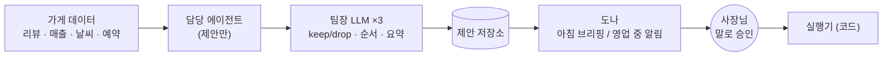
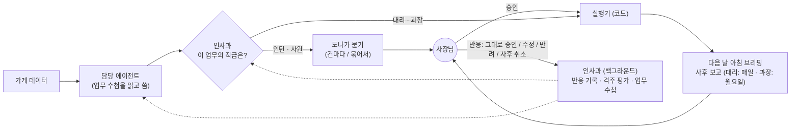

# 도나 에이전트 구조: 지금 구조와 인사과

2026-11-21 작성 · 기준 코드: 브랜치 `jiho/feat-evals-docs` (에이전트 조직 개편 0~8단계)

관련 문서
- 개편 계획과 11/20 결정: [agent-org-plan.md](agent-org-plan.md)
- 계약(저장 모양·응답 타입): [인수인계 문서 23장](../../docs/v0.2.0-voice-agent-handoff.md)
- 점검과 남은 것: [agent-org-checks.md](agent-org-checks.md), [open-features.md](open-features.md) 9장

이 문서에는 두 가지가 들어 있습니다.
1. **지금 구조 (구현됨):** 부서 셋, 담당 에이전트, 팀장 LLM, 제안 → 승인 → 실행
2. **바뀔 구조 (미구현, 2026-11-21 의논에서 정함):**
   - 팀장을 없앱니다.
   - **인사과**를 둡니다. 사장님 반응으로 담당의 직급을 올리고 내리며, 직급만큼 결재 없이 처리하게 합니다.

구현 계획(단계·파일·시험)은 [9장](#9-구현-계획)에 있습니다.

---

## 목차

1. [한눈에 보기](#1-한눈에-보기)
2. [지금 구조 (구현됨)](#2-지금-구조-구현됨)
3. [무엇이 바뀌나](#3-무엇이-바뀌나)
4. [인사과 (미구현)](#4-인사과-미구현)
5. [팀장 없애기 (미구현)](#5-팀장-없애기-미구현)
6. [바뀌는 기존 결정](#6-바뀌는-기존-결정)
7. [먼저 확인할 것과 위험](#7-먼저-확인할-것과-위험)
8. [정한 것 (2026-11-21 의논)](#8-정한-것-2026-11-21-의논)
9. [구현 계획](#9-구현-계획)

**용어**
- **담당**: 한 가지 일을 맡은 에이전트(또는 규칙)입니다. 예: 부정 리뷰 담당, 현장 변수 담당. 이전 문서에서는 "사원"이라고 불렀지만, 직급 이름과 겹쳐서 바꿉니다.
- **직급**: 담당이 결재 없이 처리할 수 있는 범위입니다. 인턴 · 사원 · 대리 · 과장 네 단계가 있습니다.
- **업무**: 직급을 매기는 단위입니다. 같은 담당이라도 업무마다 직급이 다릅니다.

---

## 1. 한눈에 보기

### 지금



### 바뀐 뒤



사장님은 승진과 강등을 듣지 않습니다. 사장님이 알게 되는 것은 세 가지뿐입니다.
- 결재를 받는 횟수가 줄어듭니다.
- 다음 날 아침에 사후 보고를 듣습니다.
- 수첩에 규칙을 적을 때 한 줄 알림을 받습니다.

---

## 2. 지금 구조 (구현됨)

### 2-1. 부서와 담당

| 부서 | 담당 | 파일 | 내는 것 | 실패하면 |
|---|---|---|---|---|
| 고객 응대 | 부정 리뷰 | `voice/agents/fix_card.py` | 교정 할 일(제목·한 문장), 조치 가능 여부, 리뷰 인용 | 원인별 템플릿 (`jobs/cause.py`) |
| 고객 응대 | 재방문 유도 | `jobs/schedule.py` + `agents/voice_reply.py` | 좋은 리뷰 예약 답글 | 템플릿 |
| 고객 응대 | (답글) | `agents/voice_reply.py` | 아쉬운 리뷰 사과 답글, 초안 | 주제별 안전 템플릿 |
| 매장 품질 관리 | 현장 변수 | `voice/agents/field_tasks.py` | 오늘 날씨·예약 메모에서 할 일 (최대 3) | 제안 없음 |
| 매장 품질 관리 | 매뉴얼 코칭 | `voice/proposals.py` `promote_repeats` + `agents/manual_line.py` | 7일 안 3번 나온 할 일 → 매일 할 일 제안 | 첫 할 일 제목 그대로 |
| 마케팅 | 소재 발굴 | `agents/topic_finder.py` | 메뉴 1~3개 + 이야기 한 줄 | 이번 달 많이 나간 메뉴 3개 |
| 마케팅 | 캡션 작성 | `agents/caption_writer.py` | 인스타 글 + 해시태그 8개 이하 | 템플릿 글 |
| 마케팅 | (휴무 읽기) | `agents/holiday_reader.py` | 네이버 휴무 안내에서 날짜 | 빈 목록 |
| (규칙) | 비 오는 날 포스터 | `voice/instagram/story_event.py` | 스토리 포스터 + 알바생 긴급 카드. 혜택 문장은 사장님 설정(`settings.story_event`)만 씀 | 실패 상태 |
| 세 부서 | 팀장 | `agents/team_lead.py`, `voice/departments.py` | 결과마다 keep/drop, 순서, 부서 한 줄 요약 | 모두 keep |

도움 에이전트도 있습니다. 직급 대상은 아닙니다.
- `intent_judge`: 뜻 판정
- `same_task`: 같은 할 일 묶기
- `improve_tip`: 고칠 점

### 2-2. 흐름

**밤 (브리핑 준비, 출근 한 시간 전)**
1. 담당들이 돌아 결과를 남깁니다. 알바생 할 일은 `proposal`, 마케팅 결과는 `marketing_plan`, 답글은 리뷰에 남깁니다.
2. 팀장 셋이 판단하고 `dept_report`를 남깁니다. 그 뒤 부서 사이 충돌을 코드로 거릅니다(`departments.py`). 예: 최근 7일 불만 메뉴를 마케팅이 올리자고 하면 뺍니다.
3. 브리핑 묶음을 저장합니다. 말하는 순간에는 꺼내기만 합니다.

**아침 브리핑**

단계 순서는 이렇습니다.
```
일정 → 쉬는 날 → 리뷰 → 아쉬운 리뷰 → 좋은 리뷰 → 예약 답글 → 인스타 → 비 오는 날 포스터 → 알바생 할 일
```
마지막의 알바생 할 일 단계에서는 밤사이 리뷰 교정, 매뉴얼화, 현장 변수 할 일을 **묶어서 한 번에** 묻습니다(`jobs/staff_tasks.py`).
- 대답: "응" / "두 번째는 빼" / "안 해"
- 브리핑에서 묻지 못한 것은 그날 다음 "도나야" 때 묻습니다.

**영업 중 아쉬운 리뷰** (`jobs/review_loop.py`)
1. 교정 카드, 답글, 같은 할 일 판정을 거쳐 팀장(15초)을 지나면 알림을 보냅니다.
2. 사장님이 알림을 열면 묻습니다.
3. 대답을 받습니다: "응, 진행해" / "쿠폰 빼고" / "다시 써" / "안 해"
4. 설정 `negative_review_auto_reply`를 켠 가게는 묻지 않고 답글을 올리고, 할 일만 묻습니다.

### 2-3. 지키는 원칙

- LLM 담당은 **제안만** 합니다. 실제로 쓰는 일(알바생 할 일 넣기, 게시, 답글 올리기)은 승인 뒤 코드가 합니다.
- 알바생 할 일은 사장님 승인 없이 들어가지 않습니다(11/20 결정 4·5·13). 예외는 사장님이 승인한 포스터에 딸린 카드입니다.
- 무거운 일은 밤에 끝냅니다. 말하는 순간에는 저장된 것을 꺼내기만 합니다.
- 에이전트가 실패하면 규칙·템플릿으로 물러납니다.
- 가격·할인·보상은 담당이 지어내지 못하게 검사로 막습니다.

### 2-4. 저장

자세한 모양은 23-2장에 있습니다. `voice.db`의 `docs`에 종류별로 두고, 표를 더하지 않습니다.
- `proposal`, `dept_report`, `marketing_plan`, `field_run`, `holiday_run`
- 가게 문서 `holidays`
- 가게 설정 `negative_review_auto_reply`

---

## 3. 무엇이 바뀌나

| 무엇 | 지금 | 바뀐 뒤 |
|---|---|---|
| 팀장 LLM | 세 부서에 하나씩. keep/drop, 순서, 요약 | **없음.** 순서는 코드가, 요약은 도나가 정함 (5장) |
| 결재 방식 | 업무마다 고정 (칭찬 답글은 묻지 않음, 알바생 할 일은 묶어 묻기 …) | 담당 × 업무의 **직급**이 정함 (4장) |
| 부정 리뷰 자동 답글 | 사장님이 설정 `negative_review_auto_reply`를 켬 | 설정을 없앰. 부정 리뷰 답글이 **대리**가 되면 묻지 않고 올림 |
| 사장님 수정 지시 | 그 건에만 반영 | 계속 지킬 규칙이면 **업무 수첩**에 남아 다음 초안부터 지킴 |
| 사후 보고 | 자동 답글 뒤 바로 알림 | **다음 날 아침 브리핑**에서 보고 |
| 되돌리기 | 알바생 할 일만 지울 수 있음 | 답글·게시물도 지울 수 있게 만듦 (전제, 7장) |

---

## 4. 인사과 (미구현)

인사과는 일을 만들지 않습니다. **직급만 관리**하는 네 번째 부서입니다.
- 반응 기록, 평가, 승진·강등은 **코드**가 합니다. 같은 기록이면 늘 같은 결과가 나옵니다.
- 사장님 말의 뜻은 지금 쓰는 판정(`dialog/intent_rules.py` + `intent_judge`)을 다시 씁니다.
- LLM은 **업무 수첩 규칙 뽑기**에만 씁니다.
- 사장님은 인사과를 신경 쓰지 않습니다. 승진 신청, 승진·강등 알림, 인사평가 보고는 **말하지 않습니다.**

### 4-1. 직급 = 결재 없이 처리할 수 있는 범위

| 직급 | 하는 방식 | 사장님이 듣는 것 |
|---|---|---|
| 인턴 | 건마다 묻고, 승인받은 뒤 처리 | 영업 중에는 들어올 때마다 알림. 밤사이 건은 아침 브리핑에서 하나씩 |
| 사원 | 같은 업무를 묶어 한 번에 묻고, 승인받은 뒤 처리 | 아침 브리핑에서 밤사이 건을 묶어서. 영업 중 건은 바로 알리지 않고 모았다가 다음 알림 때 함께 |
| 대리 | 묻지 않고 처리 | **다음 날 아침 브리핑**에서 건별로: "어제 칭찬 리뷰 3건에 답했어요. 첫 번째는 …" |
| 과장 | 묻지 않고 처리 | **월요일 아침 브리핑**에서 지난주 건수만: "지난주 리뷰 23건 처리했어요" |

- 지금 아침 브리핑에서 알바생 할 일을 묶어 묻는 방식이 곧 **사원**입니다.
- 대리와 과장의 사후 보고는 브리핑에 새 단계로 넣습니다. 저녁 보고나 주간 보고 흐름은 따로 만들지 않습니다.

### 4-2. 업무와 상한

같은 담당이라도 업무마다 직급이 다릅니다. 업무의 위험도가 **오를 수 있는 가장 높은 직급(상한)**을 정합니다.

| 위험도 | 상한 | 뜻 |
|---|---|---|
| 낮음 | 과장 | 틀려도 손님이나 가게에 손해가 거의 없음 |
| 중간 | 대리 | 틀리면 가게 이미지에 영향. 지울 수 있음 |
| 높음 | 사원 (늘 결재) | 돈이 걸리거나, 틀리면 손님이 다치거나, 알바생에게 일을 시킴 |

**지금 있는 업무**

| 업무 | 담당 | 위험도 | 상한 | 최소 건수 |
|---|---|---|---|---|
| 칭찬 리뷰 답글 | 재방문 유도 | 낮음 | 과장 | 20 |
| 부정 리뷰 답글 | 부정 리뷰 (답글) | 중간 | 대리 | 20 |
| 인스타 게시 (소재 + 캡션) | 소재 발굴 + 캡션 작성 | 중간 | 대리 | 5 |
| 포스터 생성·게시, 혜택 **없음** | 포스터 | 중간 | 대리 | 5 |
| 포스터 생성·게시, 혜택 **있음** | 포스터 | 높음 | 사원 | 5 |
| 리뷰 교정 할 일 | 부정 리뷰 | 알바생 할 일 | 사원 | 5 |
| 현장 변수 할 일 | 현장 변수 | 알바생 할 일 | 사원 | 5 |
| 매뉴얼화 제안 | 매뉴얼 코칭 | 알바생 할 일 | 사원 | 5 |

**앞으로 생길 업무**

| 업무 | 위험도 | 상한 | 최소 건수 |
|---|---|---|---|
| 휴무 공지 (게시물) | 낮음 | 과장 | 5 |
| 가격·할인 안내 | 높음 | 사원 | (생길 때 정함) |
| 알레르기 안내 | 높음 | 사원 | (생길 때 정함) |

**인사과 대상이 아닌 것**
- 사장님이 말로 시킨 일: 이미 사장님 결정입니다.
- 사실 확인: 네이버에서 읽은 휴무 날짜, 쉬는 날 확인 등입니다. 묻는 이유가 판단이 아니라 사실 확인이기 때문입니다.
- 뜻 판정, 같은 할 일 묶기 같은 도움 에이전트

**알바생 할 일의 상한이 사원인 이유:** 11/20 결정 "승인 없이 알바생에게 일이 가면 안 된다"를 지킵니다. 붙여 넣은 원안의 "알바 TODO = 중간(대리)"은 따르지 않습니다.

### 4-3. 혜택이 들어간 포스터

- 포스터에 할인·사은품·서비스처럼 **가게가 돈을 들이는 혜택**이 들어가면 직급과 상관없이 늘 사장님께 승인을 받습니다.
- 승인을 받은 포스터에 딸린 알바생 할 일(예: "스토리 태그 손님 음료 1캔 드리기")은 **승인 없이 바로 들어갑니다.** 사장님이 혜택을 승인한 것이 곧 그 일을 승인한 것이기 때문입니다. 지금 동작과 같습니다.
- 혜택이 있는지는 **코드로** 가립니다. 포스터의 혜택 문장은 사장님 설정(`settings.story_event.offer`)에서만 오므로, 이 칸이 비어 있지 않으면 혜택이 있는 것입니다. LLM 판정은 쓰지 않습니다.
- 혜택이 없는 포스터에는 알바생 할 일이 붙지 않습니다. 지금 포스터에 붙는 할 일은 혜택을 손님께 드리는 일뿐입니다.
- 지금 비 오는 날 포스터는 늘 혜택 문장이 있으므로 늘 승인을 받습니다.
- 인스타 게시 캡션은 이미 검사로 가격·할인·약속을 막고 있습니다(`caption_writer`).

### 4-4. 반응 기록

인사과는 결재 한 건마다 사장님 반응을 남깁니다. 묶음 결재도 **건마다** 셉니다.

| 반응 | 사장님 말 (예) | 지금 판정 | 승인 비율에서 |
|---|---|---|---|
| 그대로 승인 | "그래, 올려", "응, 넣어" | `action.approve` (고침 없음), 할 일 "응" | **승인** |
| 조금 수정 | "좀 더 부드럽게", "쿠폰 빼고 올려", "이모티콘 빼" | 정해진 고침(`edits`)은 있음. **자유로운 수정은 새로 만듦** | 승인 아님 |
| 반려 | "다시 써", "안 해", "두 번째는 빼" (뺀 건만) | `action.redo`, `action.cancel`, `drop_index` | 승인 아님 |
| 사후 취소 | 대리·과장이 처리한 건을 "두 번째 거 취소해", "그 답글 지워" | **새로 만듦** (알바생 할 일 취소 `staff.cancel`은 있음) | (대리·과장에는 승인 비율이 없음) **강등 사유** |
| 무응답 | 묻는 동안 대답이 없어 만료됨 | `proposals.expire` 등 | **세지 않음** (가정) |

조금 수정과 반려는 승인 비율에서 똑같이 "승인 아님"으로 셉니다. 둘의 차이는 업무 수첩에 남느냐뿐입니다(4-8).

### 4-5. 승진

**언제:** **격주 월요일 새벽**(브리핑 준비 때)에 모든 가게의 모든 업무를 한 번에 평가합니다. 바뀐 직급은 그날 브리핑부터 적용합니다.

**조건:** 그 2주 안의 기록만 봅니다. 2주 안에 최소 건수를 채우지 못하면 그대로 둡니다.

| 지금 직급 | 오르는 조건 |
|---|---|
| 인턴 → 사원 | 2주 안 결재가 최소 건수 이상이고, 그중 **그대로 승인이 90% 이상** (예: 리뷰 20건 중 18건) |
| 사원 → 대리 | 위와 같음 |
| 대리 → 과장 | 2주 안 묻지 않고 처리한 것이 최소 건수 이상이고, **사후 취소가 0건** |

- 한 번 평가에 한 단계만 오릅니다. 상한(4-2)을 넘지 않습니다.
- 90%에 못 미치면 그대로 둡니다. 낮은 승인 비율로는 강등하지 않습니다.
- 평가 결과는 백엔드 기록(`hr_review`)으로만 남기고 사장님께 말하지 않습니다. 원안의 "월말 인사평가 보고"는 이 격주 기록으로 대신합니다.

### 4-6. 강등

- **사후 취소 1건이면 그 자리에서 한 단계 내립니다.** 격주 평가를 기다리지 않습니다. 대리는 사원이 되고, 과장은 대리가 됩니다.
- 인턴과 사원은 늘 결재를 받으므로 사후 취소가 없고, 강등도 없습니다.
- 높은 위험 업무의 사고는 인턴으로 내립니다. 여기서 사고는 "결재받은 건을 나중에 사장님이 되돌림"입니다. 지금 높은 위험 업무는 혜택 포스터뿐이고, 나머지는 앞으로 생길 업무라 그때 적용합니다.
- 강등도 사장님께 말하지 않습니다.

### 4-7. 사후 보고와 취소 기간

| 직급 | 보고 | 사후 취소로 세는 기간 |
|---|---|---|
| 대리 | 다음 날 아침 브리핑, 건별 | 그 보고를 들은 날 **영업이 끝날 때까지** |
| 과장 | 월요일 아침 브리핑, 지난주 건수 | 월요일 보고를 들은 날 영업이 끝날 때까지 |

- 기간이 지난 뒤에도 "그거 지워"라고 하면 지웁니다. 다만 강등 사유로 세지 않습니다.
- 브리핑을 듣지 않은 날의 보고는 다음에 듣는 브리핑에 이어 붙입니다(가정).
- 원안의 "1시간 안에 취소"는 쓰지 않습니다. 사장님이 다음 날 아침에야 알게 되므로 1시간은 맞지 않습니다.

### 4-8. 업무 수첩

사장님의 수정 지시를 규칙으로 쌓아, 담당이 다음 초안부터 지키게 합니다. **모델을 따로 학습시키지 않습니다.** 프롬프트에 규칙 목록과 최근 그대로 승인된 예시 몇 개를 넣는 것으로 충분합니다.

| 항목 | 정한 것 |
|---|---|
| 단위 | 담당별 수첩 + **가게 공통 칸**. "이모티콘 쓰지 마"처럼 모든 글에 해당하는 규칙은 공통 칸에 넣습니다 |
| 무엇을 적나 | LLM이 "계속 지킬 규칙인가"를 판정해 규칙만 적습니다. "이건 좀 더 부드럽게"처럼 그 건에만 해당하는 말은 적지 않습니다 |
| 적을 때 | 도나가 한 줄로 알립니다: "앞으로 이모티콘은 안 쓸게요" |
| 부딪힐 때 | **새 규칙이 옛 규칙을 덮어씁니다** |
| 말로 관리 | "수첩에 뭐 적혀 있어?" → 읽어 줍니다. "그 규칙 지워" → 지웁니다 |
| 지켰는지 검사 | 규칙 중 코드로 볼 수 있는 것(이모티콘, 금지 낱말)은 검사에 더합니다. 나머지는 프롬프트만 |

- 11/20 결정 6("빡빡한 프롬프트 예시 금지")은 개발자가 써 넣는 예시를 두고 한 말입니다. 사장님이 승인한 실제 글을 예시로 넣는 것은 이 결정과 따로 봅니다.
- 수첩이 쌓일수록 승인 비율이 오르고, 승인 비율이 오르면 승진합니다.

### 4-9. 출발 직급

| 가게 | 출발 |
|---|---|
| 새로 가입하는 가게 | 모든 업무가 **인턴** |
| 인사과를 넣을 때 이미 쓰고 있는 가게 | 지금 동작에 맞는 직급. 칭찬 리뷰 답글 = **과장**(지금 묻지 않고 예약). 부정 리뷰 답글 = `negative_review_auto_reply`를 켰으면 **대리**, 아니면 인턴. 알바생 할 일 = **사원**(지금 아침 묶음). 나머지는 인턴 |
| 시연 가게 초옹장(s005) | 2주치 반응 기록을 fixture로 넣어 일부 업무가 오른 상태로 시작 (시계가 11/17에 고정이라 실제로 2주를 쌓을 수 없음) |

이미 쓰는 가게의 칭찬 리뷰 답글이 과장이 되면, 지금 아침 브리핑의 "예약 답글" 단계가 **월요일 건수 한 줄**로 바뀝니다.

### 4-10. 저장 모양 (초안)

지금처럼 `voice.db` `docs`에 종류를 더하고, 표는 더하지 않습니다.

| 종류 | id | 내용 |
|---|---|---|
| `hr_rank` | `<가게>:<업무>` | `{store_id, job, agent, rank, cap, since, changed_by: start \| promote \| demote, history[]}` |
| `hr_event` | `hr_<번호>` | `{store_id, job, agent, rank_at, ref (proposal·리뷰·게시물 id), reaction: approved \| edited \| rejected \| done \| canceled_after, said, at, reported_at?}`. `done`은 대리·과장이 묻지 않고 처리한 건 (사후 보고와 대리 → 과장 판정에 씀) |
| `notebook` | `<가게>:<담당>`, `<가게>:common` | `{rules: [{text, said, at, replaced_by?}]}` |
| `hr_review` | `<가게>:<평가일>` | `{period, per_job: [{job, count, approved, canceled, before, after}]}` |

결재를 받는 모든 곳은 `hr_rank`를 읽고 직급에 맞게 동작해야 합니다.
- 영업 중 아쉬운 리뷰 알림 (`review_loop`)
- 밤사이 답글 (`auto_reply`, `briefing`)
- 좋은 리뷰 예약 (`schedule`)
- 알바생 할 일 묻기 (`staff_tasks`)
- 인스타 게시 (`instagram/posts`)
- 포스터 (`story_event`)

---

## 5. 팀장 없애기 (미구현)

팀장 LLM은 거의 늘 keep이었고 이유도 뭉뚱그린 말이었습니다([agent-org-checks.md](agent-org-checks.md) 6장, F). 인사과가 생기면 사장님 반응이 담당을 직접 평가하므로 팀장을 없앱니다.

| 팀장이 하던 일 | 바뀐 뒤 |
|---|---|
| keep / drop | 없앱니다. 담당의 검사를 통과한 것은 모두 남습니다 (지금 팀장이 실패했을 때와 같음) |
| 사장님께 말할 순서 | 코드 규칙으로 정합니다. 예: 긴급 먼저 → 부서 순서(고객 응대 → 품질 관리 → 마케팅) → 들어온 순서 |
| 부서 한 줄 요약 | 도나가 브리핑 문장을 묶을 때 만듭니다 |
| 현장 변수 할 일의 긴급 확인 (11/20 결정 21) | 담당이 낸 `today_impact`를 그대로 씁니다. 알바생 할 일은 늘 결재를 받으므로 사장님이 묶음에서 듣습니다 |
| 영업 중 알림 전 판단 (결정 22) | 없앱니다. 알림이 최대 15초 빨라집니다 |

**남기는 것:** 부서 사이 충돌 거르기(코드, `departments.py`)는 그대로 둡니다. 부서 셋은 업무 묶음의 이름으로 남습니다.

**함께 고칠 것** (구현할 때)
- `agents/team_lead.py`와 `departments.run_leads`의 팀장 부분을 지웁니다. 충돌 거르기는 남깁니다.
- 스위치 `VOICE_AGENT_LEAD`를 없앱니다.
- `dept_report`의 `verdicts`·`order`·`summary`, `proposal`의 `lead` 칸을 정리합니다.
- 팀장 평가 세트 계획(점검 문서 6장 "할 것", 추후 정할 것 F)을 지웁니다.
- 인수인계 문서 23장: 23-1 팀장 줄, 23-5 "실시간 길도 고객 응대 팀장을 … 거칩니다"
- 점검 문서 8장: 영업 중 알림 시간(팀장 15초 빠짐)
- 시연 저장본을 다시 만듭니다 (팀장 결과가 들어 있음).

---

## 6. 바뀌는 기존 결정

[agent-org-plan.md](agent-org-plan.md) "정한 것" 표의 번호입니다.

| 결정 | 원래 | 바뀐 뒤 |
|---|---|---|
| 2 | 팀장도 LLM, 아래 결과만 판단 | 팀장 없음 (5장) |
| 4·5·13 | 알바생 할 일은 승인 뒤에만, 현장 변수는 매번 묻기, 브리핑 안 들으면 안 넣음 | **그대로.** 알바생 할 일의 상한이 사원이라 지켜짐. 예외: 승인받은 혜택 포스터에 딸린 할 일 (4-3) |
| 14 | 영업 중 아쉬운 리뷰는 기본 묻기, 설정을 켜면 자동 답글 | 설정을 없앰. 부정 리뷰 답글 직급이 정함 (인턴·사원 = 묻기, 대리 = 자동) |
| 15 | 자동 답글엔 보상 문장 없이, 올린 뒤 **바로 알림** | 보상 문장 없음은 그대로. 알림은 **다음 날 아침 사후 보고**로 바꿈 |
| 21 | 현장 변수 긴급 = `today_impact` + 팀장 확인 | `today_impact`만 |
| 22 | 영업 중 실시간 경로도 팀장을 거침 | 없음 |

붙여 넣은 원안(인사과 제안)에서 바꾼 것도 있습니다.

| 원안 | 정한 것 |
|---|---|
| 부정 리뷰 답변 = 높음(사원) | 중간(대리) |
| 알바 TODO = 중간(대리) | 사원 (11/20 결정 유지) |
| 승진은 AI가 신청하고 사장님이 결정 | 인사과가 백그라운드에서 정하고 사장님께 말하지 않음 |
| 가점·감점 점수 | 2주 안 그대로 승인 비율 90% |
| 대리는 저녁 보고, 1시간 안 취소 | 다음 날 아침 보고, 그날 영업 끝까지 취소 |
| 월말 인사평가를 사장님께 보고 | 격주 평가를 백엔드 기록으로만 |
| 승진 신청·인사평가 대사 | 뺌 (발표 자료에도 넣지 않음) |

---

## 7. 먼저 확인할 것과 위험

**먼저 확인할 것**

| 무엇 | 왜 |
|---|---|
| 리뷰 답글 지우기 | 대리·과장의 사후 취소는 지울 수 있어야 합니다. 그런데 v0.2.0은 답글을 실제 플랫폼에 올리지 않고 상태만 `posted`로 적습니다(`jobs/auto_reply.py`). 실제 네이버·배민 연결을 붙일 때 지우기가 되는지 확인해야 합니다. 안 되는 플랫폼은 그 업무의 상한을 사원으로 둡니다 |
| 인스타 게시물 지우기 | 지금 코드에 없습니다. **지울 수 있다고 가정하고** 새로 만듭니다(2026-11-21 결정, 9장 5단계). 구현하다 안 되는 것이 드러나면 인스타 게시와 포스터의 상한을 사원으로 낮춥니다 |
| 자유로운 수정 말 | "좀 더 부드럽게"를 받아 다시 쓰는 흐름이 없습니다. 반응 분류와 함께 새로 만듭니다 |
| 사후 취소 말 | 아침 사후 보고 뒤 "두 번째 거 취소해"를 받는 흐름이 없습니다 (알바생 할 일의 `staff.cancel`만 있음) |

**위험**

| 위험 | 내용 | 줄이는 방법 |
|---|---|---|
| 사장님 모르게 부정 리뷰에 AI 답글 | 부정 리뷰 답글이 대리까지 오르고 승진을 알리지 않으므로, 어느 날부터 묻지 않고 올라갑니다. 사장님은 다음 날 아침 보고에서야 압니다 | 사후 취소 1번이면 바로 강등. 답글 검사(보상·가격 금지, `reply_critic`)는 직급과 상관없이 그대로 |
| 작은 가게는 오르지 않음 | 2주 안에 리뷰 20건이 안 되는 가게는 리뷰 업무가 승진하지 못합니다 | 정한 대로 둡니다. 결재가 줄지 않을 뿐 위험은 없습니다 |
| 수첩 규칙을 잘못 뽑음 | 그 건에만 한 말을 규칙으로 적거나, 규칙을 놓칩니다 | 적을 때 한 줄로 알리고, 말로 지울 수 있습니다 |
| 새 규칙이 옛 규칙을 잘못 덮음 | 서로 다른 규칙을 부딪힌다고 보고 지웁니다 | 덮어쓴 규칙은 `replaced_by`로 남겨 되살릴 수 있게 합니다 |
| 사후 보고가 길어짐 | 대리 업무가 많아지면 아침 브리핑이 길어집니다 | 업무마다 건수 + 첫 건만 읽고 나머지는 "자세히"로 |

---

## 8. 정한 것 (2026-11-21 의논)

| # | 정한 것 |
|---|---|
| 1 | 인사과를 둡니다. 사장님 반응으로 담당 × 업무의 직급(인턴·사원·대리·과장)을 정하고, 직급만큼 결재 없이 처리합니다 |
| 2 | 부정 리뷰 답글은 **중간 위험(대리까지)** |
| 3 | 알바생 할 일(리뷰 교정·현장 변수·매뉴얼화)은 **사원까지** (11/20 결정 유지) |
| 4 | 혜택(할인·사은품·서비스)이 들어간 포스터는 늘 승인. 승인받은 포스터에 딸린 알바생 할 일은 승인 없이 들어감 |
| 5 | 가격·할인 안내, 알레르기 안내, 휴무 공지는 "앞으로 생길 업무"로 적음 |
| 6 | 팀장 LLM을 없앰. 순서는 코드, 요약은 도나. 부서 사이 충돌 거르기는 남김 |
| 7 | `negative_review_auto_reply` 설정을 없애고 직급으로 대신함. 켜 둔 가게는 부정 리뷰 답글을 대리에서 시작 |
| 8 | 승인 비율은 **그대로 승인만** 승인으로 셈. 조금 수정·반려는 모두 승인 아님 |
| 9 | 격주 월요일 새벽에 평가. 2주 안 기록만 보고, 최소 건수 이상이며 그대로 승인 90% 이상이면 한 단계 승진. 아래면 그대로 |
| 10 | 최소 건수: 리뷰 업무 20, 게시물(포스터·인스타·휴무 공지) 5, 알바생 할 일 5 |
| 11 | 대리 → 과장: 2주 안 최소 건수 이상 처리하고 사후 취소 0 |
| 12 | 사후 취소 1건이면 바로 한 단계 강등 |
| 13 | 승진·강등·평가는 인사과가 백그라운드에서 하고 사장님께 말하지 않음. 원안 대사는 뺌 |
| 14 | 사후 보고는 다음 날 아침 브리핑에서. 대리는 매일 건별, 과장은 월요일에 지난주 건수 |
| 15 | 사후 취소는 보고를 들은 날 영업이 끝날 때까지 |
| 16 | 인턴은 건마다(영업 중 알림), 사원은 묶어서(아침 브리핑 / 다음 알림) |
| 17 | 업무 수첩: 담당별 + 가게 공통 칸, 새 규칙이 옛 규칙을 덮어씀, 계속 지킬 규칙만 적고 한 줄 알림, 말로 듣고 지움 |
| 18 | 출발 직급: 새 가게는 인턴, 이미 쓰는 가게는 지금 동작에 맞춤(칭찬 답글 과장 등) |
| 19 | 답글·게시물 지우기 기능을 만드는 것을 전제로 함 |
| 20 | 이 문서는 팀 설계 문서. 구현 계획은 9장 |

**가정 (따로 정하지 않아 이 문서에서 정한 것)**
- 대답이 없어 만료된 결재는 승인 비율에서 세지 않습니다.
- 브리핑을 듣지 않은 날의 사후 보고는 다음 브리핑에 이어 붙입니다.
- 강등도 사장님께 말하지 않습니다.
- 사후 보고가 길면 업무마다 건수와 첫 건만 읽습니다.

---

## 9. 구현 계획

기준은 2026-11-21 `jiho/feat-evals-docs` 작업 트리입니다(11/21 수정은 아직 커밋 전). 코드 위치는 줄 번호 대신 함수 이름으로 적습니다.

### 9-0. 이 장에서 정한 것 (가정)

4~8장에서 정하지 않은 동작을 구현할 수 있도록 정한 것입니다. **2026-11-21 사용자가 모두 이대로 하기로 확인했습니다.** 바꾸려면 해당 단계 전에 고칩니다.

| # | 빈칸 | 이 계획에서 정한 것 |
|---|---|---|
| a | 사원의 영업 중 묶음 | 첫 건이 생기고 **30분 뒤**(문 닫기 전이면 그 전) 쌓인 것을 알림 한 번으로 묻습니다 (`config.HR_BATCH_WINDOW`) |
| b | 인턴·사원의 칭찬 리뷰 답글 | 브리핑 "예약 답글" 단계에서 "이렇게 예약할까요?"로 묻습니다(인턴은 건마다, 사원은 묶어서). 승인하면 예약합니다. 대답이 없으면 올리지 않고 초안으로 두고, **다음 브리핑에서 다시 묻습니다** |
| c | 대리·과장의 칭찬 리뷰 답글 | 지금처럼 예약해 올립니다. "예약 답글" 단계는 빼고, 올린 것을 사후 보고합니다 |
| d | 대리의 인스타 게시 | 브리핑 준비 때 만든 게시물을 그날 첫 식사 피크 한 시간 전에 올립니다 (`schedule.peaks`) |
| e | 사원의 인스타 게시 | 하루 한 건이라 묶을 것이 없으므로 인턴과 같게 둡니다 |
| f | 혜택 없는 포스터 | 지금 포스터는 혜택(`offer`)과 할 일(`staff_task`)이 설정에 없으면 제안하지 않습니다(`story_event.preset`). 그래서 혜택 없는 포스터 경로는 만들지 않고, 생길 때 만듭니다 |
| g | 사후 보고 위치 | 브리핑 새 단계 `done_report`를 쉬는 날 단계 다음(게이지 1)에 둡니다. 응답은 지금 있는 `answer` 타입과 `rows` 카드를 씁니다 |
| h | "들었다"의 뜻 | `done_report` 단계 응답을 앱에 보낸 때 `reported_at`을 적습니다. 적히지 않은 건은 다음 보고에 이어 붙습니다 |
| i | 첫 평가일 | **2026-11-30(월)**부터 14일마다 평가합니다 (`config.HR_EPOCH`). 그날 첫 브리핑 준비 때 돕니다. 월요일에 쉬는 가게는 그 뒤 첫 준비 때 돕니다 |
| j | "이미 쓰는 가게" 판별 | 배포할 때 이관 명령을 한 번 돌려, 그때 있는 가게를 모두 이미 쓰는 가게로 채웁니다. 그 뒤 `hr_rank`가 없는 가게는 새 가게(인턴)입니다 |
| k | "쿠폰 빼고" | 보상 문장은 사장님이 정해 둔 것이라 AI가 한 일이 아닙니다. 답글은 **그대로 승인**으로 셉니다 |
| l | "카드는 넣지 마"(리뷰 알림) | 답글은 그대로 승인, 교정 할 일만 반려로 셉니다 |
| m | "할 일은 넣지 마"(포스터) | 포스터는 그대로 승인으로 셉니다. 딸린 할 일은 사장님 설정 문장이라 기록하지 않습니다 |
| n | 인스타 "나중에" | "나중에·다음에·내일"은 세지 않습니다. "안 해·올리지 마"는 반려로 셉니다 |
| o | 수첩 규칙 판정 시점 | 대답이 늦어지지 않게 뒤에서 판정합니다. 규칙을 적으면 알림(`notices.push`, say 한 줄)으로 알립니다 |
| p | 수첩 규칙 지우는 말 | "이모티콘 규칙 지워"처럼 낱말로 고릅니다(`staff_orders._cancel`과 같은 방식). 못 고르면 목록을 읽어 주고 번호로 고르게 합니다 |
| q | 리뷰 알림에 딸린 교정 할 일 | 부정 리뷰 답글을 묻는 알림(인턴·사원)에서는 지금처럼 교정 카드를 함께 묻습니다. 부정 리뷰 답글이 대리면 답글은 묻지 않고 올리고, 교정 할 일만 사원 방식(묶음 창)으로 묻습니다 |
| r | 스위치 | `VOICE_HR=false`면 반응 기록, 평가, 수첩 판정을 멈춥니다. 직급은 저장된 그대로 읽습니다 |
| s | 직급 코드 | `intern`(인턴) · `staff`(사원) · `assistant`(대리) · `manager`(과장) |

### 9-1. 단계와 순서

| 단계 | 하는 일 | 먼저 끝나야 할 단계 | 크기 |
|---|---|---|---|
| 0 | 브랜치 정리 | — | S |
| 1 | 팀장 없애기 | 0 | S~M |
| 2 | 인사과 바탕: 업무 표, 직급, 기록, 평가, 이관 | 0 | M |
| 3 | 결재하는 곳마다 반응 기록 (동작은 그대로) | 2 | M |
| 4 | 직급대로 동작: 4-a 부정 답글·설정 없애기 / 4-b 칭찬 답글·인스타·포스터 / 4-c 알바생 할 일·묶음 창 | 3 | L |
| 5 | 사후 보고와 사후 취소 | 4 | M~L |
| 6 | 자유로운 수정 ("좀 더 부드럽게") | 3 | M |
| 7 | 업무 수첩 | 6 | M |
| 8 | 시연·평가·문서 | 단계마다, 끝에 한 번 | M |

- 1단계와 2단계는 겹치는 파일이 거의 없어서 동시에 할 수 있습니다.
- 6·7단계는 4·5단계와 따로 진행할 수 있습니다.
- 브랜치와 커밋은 [commit_guide.md](../../commit_guide.md)를 따릅니다.
  - 단계마다 브랜치를 하나씩 만듭니다. 예: `이름/feat-hr-base`
  - 커밋 메시지는 한 줄로 씁니다.
  - 여헌 님 승인을 받고 합칩니다.

### 0단계: 브랜치 정리

1. 11/21 수정([agent-org-checks.md](agent-org-checks.md) 0장)과 이 문서를 `jiho/feat-evals-docs`에 커밋합니다.
2. 인사과 작업은 `jiho/feat-evals-docs` 위에서 시작합니다. `main`에는 에이전트 조직 코드가 아직 없습니다.
3. 확인: `cd server && .venv/bin/python -m pytest voice/tests`가 통과해야 합니다(11/21 기준 1357개).

### 1단계: 팀장 없애기

| 파일 | 고칠 것 |
|---|---|
| `voice/departments.py` | `run_leads`에서 팀장 부르기를 뺍니다. 순서는 코드로 정합니다(긴급 → 고객 응대 → 품질 관리 → 마케팅 → 들어온 순서). `dept_report`에는 `{dept, date, items, order, source: "code"}`만 남깁니다. `cross_check`는 그대로 두고, `lead_one`은 지웁니다 |
| `voice/jobs/review_loop.py` `alert` | `departments.lead_one`을 부르는 갈래를 지웁니다 |
| `voice/proposals.py` `apply` | 긴급은 `urgent` 또는 `today_impact`로 정합니다. 팀장 verdict 조건은 지웁니다 |
| `voice/agents/team_lead.py`, `agents/prompts/team_lead.txt` | 지웁니다 |
| `voice/config.py` | `VOICE_AGENT_LEAD` 스위치를 지웁니다 |
| 부서 요약 | `dept_report.summary`를 읽는 곳이 있으면 도나의 브리핑 문장(코드)으로 바꿉니다 |

**시험**
- `test_departments.py`: 팀장 시험을 지우고, 순서와 충돌 시험은 남깁니다.
- `test_field_tasks.py`: `today_impact`가 참이면 긴급이 되는지 봅니다.
- `test_loop_negative.py`: 알림이 팀장을 부르지 않는지 봅니다.

**문서:** 5장 "함께 고칠 것" 목록을 따릅니다.

### 2단계: 인사과 바탕

새 파일 `voice/hr.py`를 만듭니다. `proposals.py`처럼 모듈 하나로 둡니다.

| 무엇 | 내용 |
|---|---|
| `JOBS` | 4-2 업무 표: key, 담당, 위험도, 상한, 최소 건수, 앞으로 생길 업무인지.<br>• 지금 업무: `positive_reply`, `negative_reply`, `instagram_post`, `story_poster`, `review_fix_task`, `field_task`, `manual_task`<br>• 앞으로 생길 업무: `holiday_notice`, `price_notice`, `allergy_notice` |
| `rank(store_id, job, *, offer=False)` | `hr_rank`를 읽고 상한을 적용합니다. 없으면 인턴으로 만듭니다. `story_poster`는 `offer`가 있으면 상한이 사원입니다 |
| `asks(store_id, job, **kw)` | 직급을 동작으로 바꿉니다. 인턴은 `"each"`, 사원은 `"batch"`, 대리·과장은 `None`. **결재하는 곳은 이 함수만 봅니다** |
| `record(store_id, job, ref, reaction, said)` | `hr_event`를 남깁니다(4-10). `VOICE_HR=false`면 아무것도 하지 않습니다 |
| `evaluate(store_id, day)` | 4-5 규칙대로 평가합니다. 평가일마다 한 번만 돕니다(`hr_review` id로 막음). 한 번에 한 단계만 올리고, 상한을 넘지 않습니다 |
| `demote(store_id, job, ref)` | 사후 취소면 한 단계 내립니다. 높은 위험 업무의 사고면 인턴으로 내립니다 |
| `migrate()`, `python -m voice.hr migrate` | 4-9 이관입니다.<br>• `negative_review_auto_reply`가 참이면 부정 답글은 대리<br>• 칭찬 답글은 과장<br>• 알바생 할 일은 사원<br>• 나머지는 인턴 |
| `voice/config.py` | `HR_EPOCH = 2026-11-30`, `HR_PERIOD = 14일`, `HR_PROMOTE_RATIO = 0.9`, `HR_BATCH_WINDOW = 30분`, 스위치 `VOICE_HR`(`env()` 방식) |
| `jobs/briefing.py` `prepare` | 맨 앞에서 `hr.evaluate`를 부릅니다. 평가일이 아니면 바로 돌아옵니다 |

**새 시험 `test_hr.py`**
- 10건 중 9건을 그대로 승인하면 오르고, 8건이면 그대로입니다.
- 최소 건수를 못 채우면 그대로입니다.
- 2주 밖의 기록은 세지 않습니다.
- 한 번에 한 단계만 오르고, 상한을 넘지 않습니다.
- 대리 → 과장: `done`이 최소 건수 이상이고 사후 취소가 0이면 오릅니다.
- 사후 취소가 생기면 즉시 강등됩니다.
- 같은 평가일에 두 번 불러도 한 번만 평가합니다.
- 혜택 포스터는 사원 상한입니다.
- 이관 결과가 4-9와 같습니다.
- 스위치를 끄면 기록과 평가를 하지 않습니다.

### 3단계: 결재하는 곳마다 반응 기록

이 단계에서는 동작을 바꾸지 않고 기록만 붙입니다. `said`에는 사장님 말 원문(`intent.owner_said`)을 넣고, `ref`에는 alert·proposal·post·story_event id를 넣습니다.

| 곳 | 업무 | 기록 |
|---|---|---|
| `review_loop.decide` | `negative_reply`, `review_fix_task`(카드가 있을 때) | • "응, 진행해": 둘 다 approved<br>• "카드는 넣지 마": 답글 approved, 할 일 rejected<br>• "쿠폰 빼고": 답글 approved<br>• "안 해": 둘 다 rejected<br>• 25분 시간 넘김(`fallback`): 기록 안 함 |
| `review_loop._decide_task` | `review_fix_task` | approve → approved, cancel → rejected |
| `staff_tasks.decide` | proposal의 `by`에 따라 나눕니다. `negative_review` → `review_fix_task`, `field_variable` → `field_task`, `manual_coach` → `manual_task` | 건마다 기록합니다. "두 번째는 빼"면 그 건만 rejected입니다 |
| `dialog/turn.py` `instagram_reply` | `instagram_post` | "올려"는 approved. 그 밖은 9-0 n |
| `story_event.decide` | `story_poster` | • 승인, "할 일은 넣지 마": approved<br>• "다시 그려", "안 해": rejected |
| `proposals.expire`, 알림 시간 넘김 | — | 기록 안 함 (무응답) |

**시험:** `test_loop_negative`, `test_staff_tasks`, `test_instagram`, `test_story_event`에 `hr_event`를 확인하는 줄을 더합니다.

### 4단계: 직급대로 동작

브랜치 셋으로 나눕니다.

**4-a. 부정 리뷰 답글과 설정 없애기**

| 파일 | 고칠 것 |
|---|---|
| `review_loop._auto`, `fallback` | `negative_review_auto_reply` 대신 `hr.asks(store_id, "negative_reply") is None`를 봅니다 |
| `review_loop.on_new_review` | 사원이면 바로 `review_alert`를 걸지 않고 묶음 창 작업 `hr_batch`에 넣습니다(4-c) |
| `review_loop.alert` (대리) | 답글은 묻지 않고 올립니다(`_auto_post`). 바로 보내던 `negative_auto` 알림은 보내지 않습니다(6장 결정 15). 교정 할 일은 제안으로 남겨 묶음 창으로 보냅니다. `hr.record(..., "done")` |
| `auto_reply.reply_now` (밤사이) | 대리면 올리고 `done`을 남깁니다. 아니면 아침 브리핑에서 묻습니다 |
| `briefing.step_negative`, `draft_negative`, `post_ready_negatives` | 허락 질문(`ask_permission`, Figma D-10 "아쉬운 리뷰에 제가 바로 답할까요?")을 지웁니다. 인턴은 리뷰마다 "이 답글 올릴까요?"로 묻고(지금 알림의 `ask_action`과 같은 모양), 사원은 묶어서 한 번 묻습니다 |
| `dialog/turn.py` `dispatch` | `permission.yes/no`에서 설정을 저장하는 갈래를 지웁니다 |
| `api/turn.py`, `api/tabs.py`, `repo.settings` 기본값 | `negative_review_auto_reply` 칸을 지웁니다. 앱이 바뀔 때까지 API는 이 칸이 와도 무시합니다 |
| 앱 (`donna-voice/app`) | 설정 화면의 "아쉬운 리뷰 바로 답하기" 토글을 지웁니다(앱 담당) |

**시험:** `test_loop_negative`의 켠 가게·끈 가게 시험을 직급 시험으로 바꿉니다. `test_scenario_*`, `test_v021_choongjang`의 허락 단계 기대도 고칩니다.

**4-b. 칭찬 리뷰 답글, 인스타, 포스터**

| 파일 | 고칠 것 |
|---|---|
| `briefing.schedule_replies`, `step_scheduling` | 인턴·사원이면 글은 써 두고 `reply_status: "awaiting"`으로 둡니다. 단계에서는 "이렇게 예약할까요?"라고 묻습니다(9-0 b). 승인하면 `scheduled`로 바꾸고 `post_scheduled` 작업을 겁니다. 대답이 없으면 `awaiting`을 그대로 두어 다음 브리핑에서 다시 묻습니다. 대리·과장이면 지금처럼 예약하고 단계는 보이지 않으며, 올릴 때 `done`을 남깁니다 |
| `dialog/turn.py` | 예약 답글 묻기의 대답을 처리합니다(응 / 두 번째는 빼 / 안 해). `staff_tasks.decide`와 같은 모양입니다 |
| `briefing.step_instagram`, `posts.queue_publish` | 대리면 단계를 보이지 않고 9-0 d 시각에 올리며 `done`을 남깁니다. 인턴·사원은 지금 그대로입니다 |
| `instagram/story_event.py` | 동작은 그대로입니다(늘 혜택이 있으므로 사원). `hr.rank(..., offer=True)`만 부릅니다 |

**4-c. 알바생 할 일의 인턴, 영업 중 묶음 창**

| 파일 | 고칠 것 |
|---|---|
| `jobs/staff_tasks.py` `step` | 업무별 직급을 봅니다. 인턴 업무는 한 건씩 묻고, 사원 업무는 지금처럼 묶어 묻습니다 |
| `jobs/queue.py` 새 작업 `hr_batch` | 영업 중 사원 업무가 생기면 첫 건 + 30분에 한 번 돕니다. 쌓인 부정 리뷰 답글과 교정 할 일을 알림 한 번(`notices.push`, `opens_turn`)으로 보냅니다 |
| 묶음 묻기 응답 | `ask_action`, `action.kind: "batch"`, 번호 붙은 `checklist` 카드(`ask_tasks`와 같은 카드). 대답: "응" / "두 번째는 빼" / "안 해" |
| `donna-voice/app/src/lib/api.ts` | `action.kind`에 `"batch"`를 더합니다 |

**새 시험 `test_hr_flow.py`**
- 인턴 칭찬 답글을 묻습니다.
- 사원 묶음 창이 30분 뒤 한 번 알립니다.
- 대리는 자동으로 처리하고 `done`을 남깁니다.
- 묶음 대답 "두 번째는 빼"를 처리합니다.

### 5단계: 사후 보고와 사후 취소

인스타 게시물은 지울 수 있다고 가정합니다(7장).

| 파일 | 고칠 것 |
|---|---|
| `voice/hr.py` | `report_items(store_id, now)`: 대리의 `done` 중 `reported_at`이 없는 것을 건별로 모읍니다. 월요일이면 과장의 지난주 `done` 건수도 더합니다. `mark_reported(ids)`도 만듭니다 |
| `jobs/briefing.py` | 새 단계 `done_report`를 `STEP_KEYS`의 `holiday` 다음에 둡니다(게이지 1). 업무마다 건수와 첫 건을 읽고, 나머지는 자세히 보기(show/read)로 둡니다 |
| `dialog/turn.py` | `done_report` 단계 응답을 보낼 때 `mark_reported`를 부르고, session에 `report_items`를 기억합니다 |
| `dialog/intent_rules.py` | 새 뜻 `report.undo`를 만듭니다: "두 번째 거 취소해", "그 답글 지워", "어제 인스타 지워". 순서 낱말은 `drop_index`를 다시 씁니다 |
| 지우기 | 답글은 `reply_status`를 `none`으로 돌리고 `reply_deleted_at`을 적습니다. v0.2.0은 플랫폼에 올리지 않으므로 상태만 바꾸고, 실제 연결을 붙일 때 플랫폼에서도 지웁니다. 인스타는 새 `posts.delete`가 Graph API로 지우고, 게시물 `status`를 `deleted`로 바꿉니다 |
| 강등 | 보고를 들은 날 영업이 끝나기 전이면 `hr.demote`를 부릅니다. 지났으면 지우기만 합니다 |

**시험**
- 대리가 처리 → 다음 날 보고 → 취소 → 강등이 이어집니다.
- 기간이 지난 취소는 강등하지 않습니다.
- 듣지 않은 보고는 다음 보고에 이어 붙습니다.
- 월요일에 과장 건수를 보고합니다.

### 6단계: 자유로운 수정

| 파일 | 고칠 것 |
|---|---|
| `dialog/intent_rules.py` | 새 뜻 `action.revise`를 만들고 사장님 말을 지시로 넘깁니다. 규칙은 "좀 더 …하게", "…는 쓰지 마/넣지 마"처럼 지금 `edits`로 잡히지 않는 말입니다. 규칙으로 못 가르면 `intent_judge`에 라벨을 더합니다 |
| `agents/voice_reply.py` `write` | `revise={"previous", "instruction"}`를 받으면 지시대로 다시 씁니다. 검사는 그대로 거칩니다 |
| `agents/caption_writer.py` | 같은 방식으로 고칩니다 |
| `review_loop.decide`, `turn.instagram_reply`, 칭찬 답글 묻기 | `action.revise`면 다시 쓴 글로 다시 묻고, `hr.record(..., "edited")`를 남깁니다 |

**평가:** `Harness/evals`에 수정 지시 세트를 더합니다. 지시를 지켰는지, 검사를 통과했는지 봅니다.

### 7단계: 업무 수첩

| 파일 | 고칠 것 |
|---|---|
| 새 `voice/notebook.py` | `rules(store_id, agent)`(담당 + 공통), `add`, `replace`, `remove`, `section(store_id, agent)`. `section`은 프롬프트에 넣을 규칙 글과 최근 그대로 승인된 예시 3개를 만듭니다. 예시는 답글과 캡션만 씁니다 |
| 새 `agents/notebook_rule.py` + `prompts/notebook_rule.txt` | • 입력: 사장님 말, 업무, 지금 규칙<br>• 출력: `{is_rule, scope: agent \| common, text, replaces: [], banned_words: [], no_emoji}`<br>• 검사: text 폭, `replaces`가 실제로 있는 id인지<br>• 예산: 5초 strict<br>• 실패하면 적지 않습니다 |
| 부르는 곳 | `hr.record`가 `edited`나 `rejected`이고 사장님 말이 있으면 뒤에서 부릅니다(`story_event._spawn`처럼). 규칙을 적으면 `notices.push(say=["앞으로 이모티콘은 안 쓸게요."])` |
| 프롬프트에 넣기 | `voice_reply`(kind에 따라 재방문 유도 또는 부정 리뷰), `caption_writer`, `topic_finder`, `fix_card`, `field_tasks`, `manual_line`의 `system_prompt`에 `notebook.section`을 붙입니다. Harness 캐시 키가 프롬프트를 포함하므로, 규칙이 바뀌면 다음에 새로 받습니다 |
| 코드 검사 | `banned_words`와 `no_emoji`를 `voice_reply`·`caption_writer`의 check에 더합니다 |
| 말로 관리 | 새 뜻 `notebook.read`("수첩에 뭐 적혀 있어?")와 `notebook.remove`("이모티콘 규칙 지워", 9-0 p) |

**시험과 평가**
- 새 시험 `test_notebook.py`를 만듭니다.
- 평가 세트 `notebook_rule`(계속 지킬 규칙인가)을 20건쯤 만들고 팀이 검토합니다.

### 8단계: 시연·평가·문서

1. s005 fixture에 `hr_rank`와 2주치 `hr_event`를 넣습니다(9-2의 1).
2. 시연 저장본을 다시 만듭니다. 먼저 `Harness.cache.clear_disk()`를 하고 `python -m voice.prepared_snapshot s005_choongjang`을 돌립니다.
3. 시나리오 시험(`test_scenario_a~d`, `test_v021_choongjang`)의 기대를 고칩니다.
4. 문서를 고칩니다.
   - 인수인계 문서에 새 장(인사과)을 씁니다.
   - [open-features.md](open-features.md) 9장, [agent-org-checks.md](agent-org-checks.md)를 고칩니다.
   - [operating-scenarios.md](operating-scenarios.md)에 결정이 바뀐 것을 기록합니다.
5. 앱에서 확인합니다: `api.ts` 타입, 설정 토글을 지운 것, `done_report` 카드 모양.

### 9-2. 구현 전에 정할 것

| # | 정할 것 | 고를 수 있는 것 | 언제까지 |
|---|---|---|---|
| 1 | 시연 가게 직급 배치 | **정함 (2026-11-21):** 지금 시연을 가장 적게 바꾸는 배치로 합니다. 부정 답글 인턴, 칭찬 답글 사원, 알바생 할 일 사원, 인스타 인턴, 포스터 사원(늘 결재). 사후 보고는 시연에 나오지 않습니다 | 8단계 |
| 2 | 브리핑 허락 질문(Figma D-10)이 사라짐 | **사용자가 디자인·앱 담당에게 알립니다** | 4-a |
| 3 | 9-0의 가정 | **정함 (2026-11-21):** 모두 이대로 합니다. b는 "다음 브리핑에서 다시 묻기"를 더했습니다 | — |

### 9-3. 위험

| 위험 | 줄이는 방법 |
|---|---|
| 4단계가 지금 시연 흐름(허락 질문, 예약 답글 단계)을 바꿉니다 | 시연 전이면 3단계까지만 합치거나, s005 직급을 지금 동작에 맞춘 배치(9-2의 1)로 둡니다 |
| 묶음 창 때문에 사원 업무의 영업 중 알림이 최대 30분 늦어집니다 | `HR_BATCH_WINDOW`로 줄일 수 있습니다 |
| 사후 보고 단계가 브리핑을 길게 만듭니다 | 업무마다 건수와 첫 건만 읽습니다 |
| 수첩 규칙이 프롬프트를 길게 만들어 에이전트가 느려지거나 길이 거절이 늘어납니다 | 담당마다 규칙 10개까지만 넣고, 넘으면 오래된 것부터 뺍니다 |
