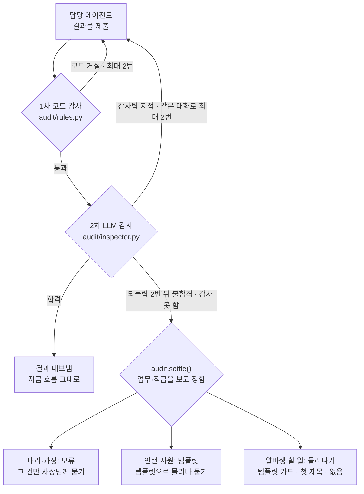

# 감사팀이 지금 하는 일

2026-11-22 · 기준: `main` 98dd06f (감사팀은 PR #42로 합쳐짐)

감사팀은 인사과를 뺀 담당 에이전트의 결과물을 검사합니다. 불합격이면 같은 대화로 지적을 돌려줘 다시 만들게 하고(최대 2번), 끝내 불합격이면 직급에 따라 처리합니다.

자세한 결정과 근거는 [audit-team-plan.md](audit-team-plan.md)에 있습니다.

## 흐름

코드 거절 2번과 감사팀 되돌림 2번은 따로 세며, 되돌린 제출도 1차부터 다시 거칩니다. 되돌림은 Harness 실행 틀(`AgentSpec.audit`, `audit_returns`)이 하고, 회차마다 감사 기록이 남습니다.

## 감사 대상과 지금 도는 기준

1차는 코드 검사로, 담당마다 흩어져 있던 `check()`를 `voice/audit/rules.py` 한곳에 모았습니다. 2차는 LLM 감사로, 기준마다 좁은 질문 하나를 묻고 LLM은 해당 부분을 글자 그대로 옮겨 오기만 하며 합격·불합격은 코드가 정합니다(`voice/audit/inspector.py`).

| 담당 | 하는 일 | 업무 | 2차 감사 기준 (지금 연결됨) |
| --- | --- | --- | --- |
| `voice_reply` | 리뷰 답글 쓰기·고쳐 쓰기 | `negative_reply`, `positive_reply` | `reply_critic` 6개(보상, 고칠 점, 가게 사정, 변명, 아는 척, 상관없는 말). 부정 답글에 교정 카드가 있으면 + `card_promise`(카드 조치를 약속했나, 고쳐 쓰기일 때는 묻지 않음). 칭찬 답글에 올리는 날 정보가 있으면 + `occasion_claim`(올리는 날 정보와 맞지 않는 날씨·행사·계절 이야기) |
| `fix_card` | 아쉬운 리뷰로 알바생 교정 할 일 | `review_fix_task` | `staff_scope`(알바생이 할 수 있나) → `fix_relevance`(불만이 생긴 단계를 고치나). 조치할 수 없다고 판단(`actionable=false`)하면 묻지 않음 |
| `field_tasks` | 날씨·예약 메모로 오늘 할 일 | `field_task` | 할 일마다 `staff_scope` → `field_link`(코드가 행동을 나눠 행동마다 근거 때문에 필요한지 예·아니오) → 긴급(`today_impact`)이면 `today_need`(오늘 안 하면 손님이 바로 겪나) |
| `manual_line` | 반복 할 일을 매일 할 일 한 줄로 | `manual_task` | `manual_added`(행동마다 반복된 할 일에 같은 일이 있나, 예·아니오) |
| `topic_finder` | 인스타 소재 고르기 | `instagram_post` | `angle_menu`(이야기 한 줄에 고른 메뉴 밖 음식이 있나) |
| `caption_writer` | 인스타 글·해시태그 | `instagram_post` | `caption_off`(올릴 메뉴·이야기 밖 이야기) → `store_claim`(재료·만드는 법·방송·수상 같은 사실 주장이 가게가 등록한 사실에 있나) |
| `holiday_reader` | 네이버 휴무 안내 읽기 | (사실 확인) | 날짜마다 `holiday_says`(그 날 쉰다는 뜻인가) |

기준은 정한 순서대로 묻고 처음 걸린 기준에서 멈춥니다. 새 기준 10개는 처음 측정에서 3개만 목표(놓침 5%·오탐 10% 이하)를 넘었고, 프롬프트를 다듬어 다시 재 10개 모두 넘어 전부 담당에 이었습니다(CLOVA HCX-005, 판정 세트 기준마다 4+4건). 고칠 점(`tip_grounded`)은 `improve_tip`이 운영 길에 없어 잇지 않았습니다. 실행 중 켜고 끄는 스위치는 없고, 기준을 고친 뒤 목표를 못 넘으면 그 기준을 빼는 것이 규칙입니다(`python -m Harness.evals audit`).

템플릿·규칙으로 만든 결과는 2차 감사를 하지 않습니다. 감사 질문도 담당과 같은 호출 예산(`CallBudget`)을 쓰고, 한 회차가 60초를 넘거나 예산이 모자라면 감사 못 함(`unchecked`)입니다.

## 끝내 불합격하면

되돌림 2번 뒤 세 번째 제출도 불합격이면 `audit.settle()`이 업무와 직급을 보고 처리를 정합니다. 끝내 불합격한 결과는 캐시에 넣지 않습니다.

| 경우 | 처리 |
| --- | --- |
| 대리·과장 건 (답글, 인스타) | 보류(hold): 묻지 않고 처리하던 것을 그 건만 사장님께 물음. 걸린 초안을 그대로 보여 주되 `safe_reply`(보상·가격 거르기)는 거침. 영업 중이면 인턴처럼 알림 + 15분 다시 알림·25분 대체 작업 |
| 인턴·사원 건 | 템플릿으로 물러나 물음 |
| 알바생 할 일 (교정 카드, 현장 할 일, 매뉴얼화) | 지금 물러나기: 원인별 템플릿 카드 / 제안 없음 / 첫 할 일 제목 |
| 휴무 읽기 | 빈 목록 |
| 감사 못 함 (호출 실패·예산 부족) | 대리·과장은 보류, 인턴·사원은 진행(사장님이 봄), 알바생 할 일은 쓰지 않음 |

보류 건에는 `audit_hold`를 적고, 인사과 기록(`hr.record`)에는 남기지 않습니다. 감사 결과는 직급에 반영되지 않고, 사장님은 감사팀의 존재를 모릅니다.

## 뒤에서 고쳐 쓰기

사장님이 "다시 써"라고 하면 도나는 바로 "고쳐서 알려 드릴게요"라고 답하고, 뒤에서 고쳐 쓰기 → 1차 → 2차 감사를 마친 뒤 알림(`revise_ready`)으로 다시 묻습니다. 앱이 대화 요청을 5초에 끊기 때문입니다(`known-bugs.md` B9). 코드는 `voice/jobs/revise_jobs.py`입니다.

- 대상: 영업 중 아쉬운 리뷰 답글(`alert`), 묶어 묻기 중 답글(`batch`), 인스타 글(`instagram`), 할 일을 빼고 승인한 부정 답글(`post`)
- 할 일을 빼고 승인한 답글은 다시 묻지 않고 올립니다. 끝내 불합격이면 조치 약속 없는 템플릿 사과(`plain`)를 올립니다
- 고치는 동안 "응"이면 지금 글을 올리고 늦은 결과는 버립니다. 또 "다시 써"면 앞 작업을 취소합니다. 25분 대체 작업이나 날이 바뀌면 결과를 버립니다
- 고치지 못하면 알림으로 "지금은 고치지 못했어요. 이대로 올릴지 말씀해 주세요"를 묻습니다

## 감사하지 않는 것

| 무엇 | 이유 |
| --- | --- |
| `intent_judge`, `same_task`, `notebook_rule` | 내부 판단이라 사장님이 보는 글이 아님 |
| 템플릿·규칙 결과 | 개발자가 쓴 고정 문장 |
| 받아쓰기(stt), 목소리(tts), 포스터 그림 | 글을 쓰는 LLM 담당이 아님 |
| 부서 사이 충돌 거르기 (`departments.cross_check`) | 일단 기존 코드 그대로 둠 |
| 사장님이 말로 시킨 알바생 할 일 (`staff_orders`) | 사장님 결정 그대로 |
| 수첩 규칙 중 코드로 못 보는 것 | 프롬프트에만 둠. 금지 낱말·이모티콘은 1차에서 봄 |
| 메인 서버(`app/`) 하네스 에이전트 | 감사 자리 기본값이 없음이라 동작 불변 |

## 기록과 개발자 대시보드

2차 감사 한 회차마다 `voice.db` `docs`에 `audit` 종류 한 줄(`au_<가게>_<번호>`)을 남깁니다: 업무, 담당, 회차, pass/fail/unchecked, 걸린 기준, 지적, 옮겨 온 부분, 호출 수, ms, 마지막 회차 여부. 1차 코드 거절은 지금처럼 실행 기록(trace)에만 남습니다.

개발자 대시보드 "감사" 탭(`GET /api/dev_tools/audit`, 음성 서버는 `GET /v1/dev/audit`)에서 업무별로 결과물 수, 한 번에 합격, 되돌림 뒤 합격, 끝내 불합격, 보류, 감사 못 함, 기준별 불합격, 시간과 호출 수를 봅니다. 결과물을 펼치면 회차와 고치기 전·후 제출이 나옵니다. 사장님 앱에는 아무것도 보이지 않습니다.

## 아직 안 된 것

- 판정 세트가 기준마다 4+4건 초안이라 계획(기준마다 6~10건)보다 적고 팀 검토 전. 같은 세트로 프롬프트를 다듬고 같은 세트로 쟀으므로 세트에 맞춘 효과가 섞여 있을 수 있음. 세트를 늘리거나 떼어 둔 사례로 다시 재야 함
- 기준선 측정(기존 거절 수, 질문 하나 시간)과 시연 가게 감사 켬·끔 전체 비교를 하지 않음. 영업 중 알림이 최악 1~2분 늦어진다는 것은 추정
- 시연 저장본(`prepared_snapshot`)을 다시 만들지 않음
- 앱에서 "다시 써"를 직접 해 보는 확인을 하지 않음
