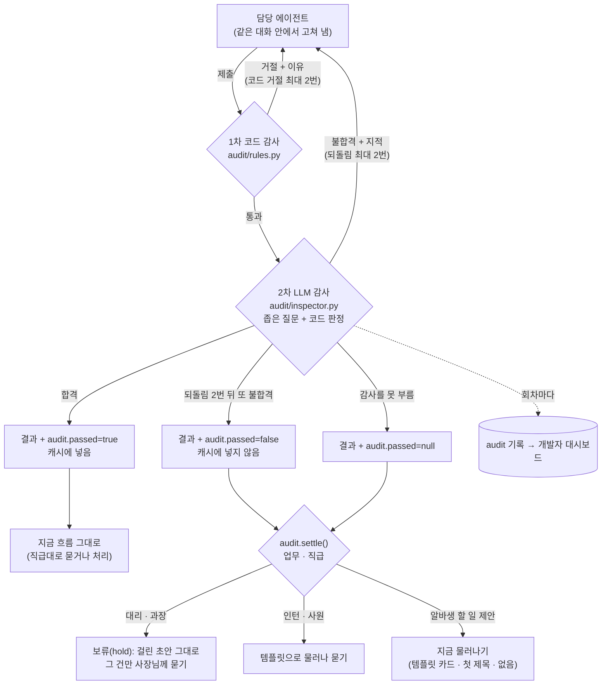
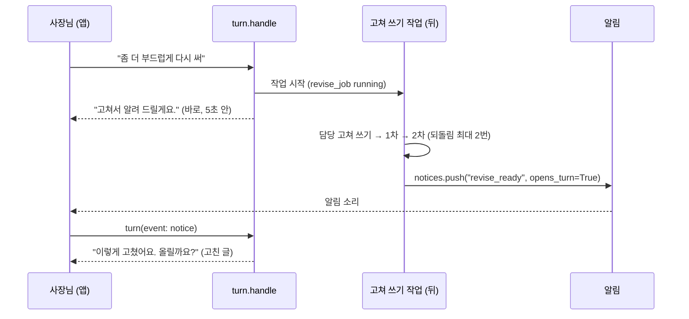

# 감사팀 계획

2026-11-22 작성 · 같은 날 결정 18까지 반영 · 상태: **계획 (미구현)** · 기준 코드: `main` 7fa03a9

관련 문서
- 지금 구조와 인사과: [agent-structure.md](agent-structure.md)
- 인사과 구현 기록: [hr-impl-notes.md](hr-impl-notes.md)
- 에이전트 실행 틀: `server/Harness/spec.py`, `server/Harness/runner.py`
- LLM 검토 방식의 근거: `server/Harness/agents/reply_critic.py` 맨 위 설명 (한 번에 판정 → 나눠 묻기로 놓침 23% → 2%)

**한 줄 요약:** 감사팀은 인사과를 뺀 나머지 담당이 낸 결과물을 검사합니다. 불합격이면 그 결과를 만든 담당에게 같은 대화로 지적을 돌려줘 다시 만들게 합니다(최대 2번). 끝내 불합격이면 직급에 따라 처리합니다.

---

## 목차

1. [왜 만드나](#1-왜-만드나)
2. [한눈에 보기](#2-한눈에-보기)
3. [정한 것](#3-정한-것)
4. [가정](#4-가정)
5. [용어](#5-용어)
6. [지금 검사 현황](#6-지금-검사-현황)
7. [감사 대상과 기준](#7-감사-대상과-기준)
8. [흐름 상세](#8-흐름-상세)
9. [뒤에서 고치고 알리기](#9-뒤에서-고치고-알리기)
10. [저장](#10-저장)
11. [스위치와 설정](#11-스위치와-설정)
12. [개발자 대시보드](#12-개발자-대시보드)
13. [평가](#13-평가)
14. [시간과 비용](#14-시간과-비용)
15. [위험](#15-위험)
16. [구현 단계](#16-구현-단계)
17. [바뀌는 기존 결정과 문서](#17-바뀌는-기존-결정과-문서)
18. [아직 정할 것](#18-아직-정할-것)
19. [계획하며 찾은 기존 문제](#19-계획하며-찾은-기존-문제)

---

## 1. 왜 만드나

지금 검사의 빈틈입니다.

| 빈틈 | 지금 | 감사팀이 하면 |
|---|---|---|
| 검사가 흩어져 있음 | 담당 파일마다 `check()`가 따로 있습니다. 같은 검사(가격·약속)를 일곱 군데에서 부릅니다 | 규칙이 한곳(`voice/audit/`)에 모이고, 바꿀 때 한 번만 고칩니다 |
| 뜻을 보는 검사가 거의 없음 | LLM 검토는 리뷰 답글(`reply_critic`)과 알바생 할 일 범위(`staff_scope`)뿐입니다 | "교정 할 일이 그 불만을 실제로 고치나", "답글이 교정 카드와 같은 조치를 약속했나" 같은 것을 봅니다 |
| 대리·과장 결과는 아무도 안 봄 | 인사과 직급이 오르면 사장님이 보지 않고 바로 올라갑니다 | 감사를 끝내 통과 못 하면 그 건만 사장님께 묻습니다 |
| 숫자가 없음 | 검사 거절은 실행 기록(trace)에 흩어져 있어 "어느 담당이 얼마나 걸리나"를 볼 수 없습니다 | 감사 기록(`audit`)으로 담당별 통과율·되돌림·보류를 봅니다 |

---

## 2. 한눈에 보기



- 사장님은 감사팀을 모릅니다. 보류된 건은 도나가 평소처럼 묻기만 합니다.
- 인사과와는 이어지지 않습니다. 보류된 건은 인사과 기록에도 남기지 않습니다.

---

## 3. 정한 것

2026-11-22 사용자와 의논해 정했습니다.

| # | 정한 것 |
|---|---|
| 1 | 감사팀은 인사과를 뺀 나머지 담당의 결과물을 검사하고, 불합격이면 만든 담당에게 되돌려 다시 만들게 합니다 |
| 2 | **코드 검사와 LLM 검사를 모두 감사팀으로 옮깁니다.** 담당마다 흩어진 코드 검사, `reply_critic`, `staff_scope` 판정을 감사팀이 가집니다 |
| 3 | **실시간 길도 포함해 전부** 감사합니다 |
| 4 | 실시간 길에서도 감사가 **끝날 때까지 기다립니다** |
| 5 | 도움 에이전트는 **글을 내는 것만** 감사합니다. `improve_tip`, `holiday_reader`는 넣고 `intent_judge`, `same_task`, `notebook_rule`은 뺍니다 |
| 6 | LLM 감사의 되돌림은 **최대 2번**입니다. 코드 감사 거절(지금 담당 안에서 최대 2번)은 따로 셉니다 |
| 7 | 끝내 불합격하면 **직급에 따라** 처리합니다. 대리·과장 건은 그 건만 사장님께 묻고, 인턴·사원 건은 템플릿으로 물러납니다. 알바생 할 일 제안은 **지금 물러나기**를 따릅니다(교정 카드 → 원인별 템플릿 카드, 매뉴얼화 → 첫 할 일 제목, 현장 변수 → 제안 없음). (2026-11-22, 처음 정한 "버림"을 바꿈) |
| 8 | 감사 결과는 **인사과 직급에 반영하지 않습니다** |
| 9 | 감사팀이 한 일은 **사장님께 알리지 않습니다.** 기록은 개발자 대시보드에만 둡니다 |
| 10 | 사장님이 말로 기다리는 길("다시 써", 인스타 글 고치기)은 **뒤에서 고치고 감사한 뒤 알림으로 다시 묻습니다.** 앱이 대화 요청을 5초에 끊기 때문입니다(19장). 결정 4는 이 방식으로 지킵니다 |
| 11 | LLM 감사가 불합격이면 **같은 대화에 이어서** 지적을 돌려줍니다. 담당이 앞서 조회한 근거를 기억한 채 고칩니다 |
| 12 | 끝내 불합격해 사장님께 묻게 된 대리·과장 건은 **걸린 초안을 그대로** 보여 줍니다. 단, 보상·가격을 거르는 마지막 코드 검사(`voice_reply.safe_reply`)는 그대로 거칩니다 |
| 13 | 업무 수첩 규칙 중 코드로 못 보는 것은 **LLM 감사가 보지 않습니다.** 지금처럼 프롬프트에만 둡니다. 코드로 보는 규칙(금지 낱말·이모티콘)은 1차 코드 감사에 남습니다 |
| 14 | 업무를 켜는 기준은 판정 세트에서 **놓침 5% 이하, 오탐 10% 이하**입니다 (13-2) |
| 15 | 사장님이 문장을 고쳐 달라고 한 뒤 **할 일은 빼고 승인한** 부정 답글은 뒤에서 고쳐 감사한 뒤 다시 묻지 않고 올립니다. 끝내 불합격이면 조치 없는 템플릿 사과로 올립니다 (9-1) |
| 16 | 앱 5초 문제는 `known-bugs.md` B9로 따로 적습니다 (19장) |
| 17 | **음성 쪽 LLM·모델과 이미지 생성은 감사하지 않습니다.** 뜻 판정(`intent_judge`), 받아쓰기(`stt.py`, CLOVA Speech), 목소리(`tts.py`), 포스터 그림(`app/poster_ai/image_engine`)이 해당합니다 (7-3) |
| 18 | **부서 사이 충돌 거르기(`departments.cross_check`, 불만 메뉴를 마케팅이 홍보하면 빼기)는 일단 감사팀이 맡지 않습니다.** 코드도 `departments.py`에 그대로 두고, 감사 기록에도 남기지 않습니다 |

---

## 4. 가정

이 문서에서 정했습니다. 확인이 필요합니다.

| # | 가정 | 이유 |
|---|---|---|
| a | **템플릿·규칙으로 만든 결과는 LLM 감사를 하지 않습니다** | 개발자가 쓴 고정 문장이라 감사할 판단이 없습니다. 영업 중 알림의 기본 답글이 템플릿(`VOICE_ALERT_AGENT_REPLY=false`)이라 실시간 시간도 줄어듭니다 |
| b | (없앰. 결정 18로 바뀜: 부서 사이 충돌 거르기는 감사팀이 맡지 않음) | |
| c | 비 오는 날 포스터 **그림**은 감사하지 않습니다 | 혜택 문장은 사장님 설정 그대로이고, 그림 검사는 다른 모델이 필요합니다 |
| d | 메인 서버(`app/`) 쪽 하네스 에이전트(`reply_agent`, `complaint_agent`, `campaign_agent`, `supervisor`)는 범위 밖입니다 | 스위치가 기본 꺼짐이고 도나 조직이 아닙니다. 하네스 실행 틀에 더하는 감사 자리는 기본값이 "없음"이라 그쪽 동작은 바뀌지 않습니다 |
| e | 보류된 대리·과장 건은 인사과에 **기록하지 않습니다.** 사장님이 승인해도 `approved`로, 묻지 않고 처리했다는 `done`으로도 세지 않습니다 | 결정 8을 지키기 위해서입니다 |
| f | LLM 감사 모델은 담당과 같은 HCX-005를 씁니다 | 지금 쓸 수 있는 모델이 CLOVA뿐입니다 |
| g | **감사를 못 부른 경우**(호출 실패, 호출 수 예산 부족)는 대리·과장 건이면 보류하고, 사장님이 보는 건이면 진행하며 기록만 남깁니다. 알바생 할 일은 지금 동작(`검토 안 됨` → 쓰지 않음)을 따릅니다 | 사장님이 보지 않는 길만 안전 쪽으로 둡니다 |
| h | `improve_tip`은 기준만 적고 연결은 미룹니다 | 지금 운영 길에서 쓰지 않습니다(브리핑 17-4에서 화면에서 뺌, `live_check`와 평가에서만 부름) |
| i | 한 결과물의 2차 감사는 기준을 **정한 순서대로** 묻고, 처음 걸린 기준에서 멈춥니다 | `reply_critic`과 같습니다. 고친 뒤 다시 처음부터 봅니다 |

---

## 5. 용어

| 용어 | 뜻 |
|---|---|
| 담당 | 결과물을 만드는 에이전트. 예: `fix_card`, `voice_reply` |
| 업무 | 인사과가 직급을 매기는 단위(`hr.JOBS`). 감사 기준도 업무마다 다릅니다. 같은 담당(`voice_reply`)이 업무 둘(`negative_reply`, `positive_reply`)을 맡습니다 |
| 1차 감사 | 코드 검사. 담당이 제출할 때마다 돕니다 |
| 2차 감사 | LLM 감사. 1차를 통과한 제출에만 돕니다 |
| 되돌림 | 2차 불합격 뒤 같은 대화에 지적을 돌려주고 다시 제출받는 것. 최대 2번 |
| 끝내 불합격 | 되돌림 2번 뒤 세 번째 제출도 2차 불합격 |
| 보류(hold) | 끝내 불합격(또는 감사 못 함)한 대리·과장 건. 그 건만 사장님께 묻습니다 |
| 감사 못 함 | 2차 질문을 부르지 못해 판정이 없음 (`audit.passed = null`) |

---

## 6. 지금 검사 현황

2차로 옮길 LLM 검사가 이미 세 곳에 있습니다. 감사팀은 이것을 그대로 가져가고 새 기준을 더합니다.

| 담당 | 파일 | 1차가 될 코드 검사 (지금 `check()`) | 지금 있는 LLM 검사 (→ 2차로) | 실패하면 (지금) | 부르는 곳 | 길 |
|---|---|---|---|---|---|---|
| `voice_reply` | `voice/agents/voice_reply.py` | 길이, 빈칸 문구, 가격·할인, 없는 메뉴, 없는 가게 사실, 수첩 금지어·이모티콘, `quoted_review_words`가 리뷰에 그대로 있나 | `reply_critic.inspect` (보상, 고칠 점, 지어낸 사정, 변명, 아는 척, 상관없는 말). 못 부르면 "검토 안 됨" + 정규식 | 주제별 템플릿 | `review_loop.alert`, `auto_reply._reply`, `briefing.draft_negative`, `briefing.schedule_replies`, 고쳐 쓰기 `revise` 4곳 | 밤 · 영업 중 · 말 |
| `fix_card` | `voice/agents/fix_card.py` | 인용이 리뷰에 그대로 있나, 제목·내용, 폭, 가격·약속 | `quote_judge.ask("staff_scope")`. 못 부르면 "검토 안 됨" → 쓰지 않음 | 원인별 템플릿 카드 (`cause.py`) | `review_loop.alert`, `auto_reply._reply`, `briefing.draft_negative` | 밤 · 영업 중 |
| `field_tasks` | `voice/agents/field_tasks.py` | 개수 3 이하, 단계, 근거 id, 인용 그대로, 폭, 가격·약속, 근거 없는 숫자, 알레르기 근거 | 할 일마다 `staff_scope`. 못 부르면 쓰지 않음 | 제안 없음 | `briefing._prepare` → `propose_today` | 밤 |
| `manual_line` | `voice/agents/manual_line.py` | 제목·내용, 폭, 가격·약속, 반복 할 일과 겹침(`dice` 0.2 이상) | 없음 | 첫 할 일 제목 그대로 | `proposals.promote_repeats` | 밤 |
| `topic_finder` | `voice/agents/topic_finder.py` | 메뉴 1~3개, 사진 있는 메뉴, 폭, 가격·약속, 근거 없는 숫자, 판매 주장은 매출 조회 뒤 | 없음 | 규칙(많이 나간 메뉴) | `marketing.plan_today` | 밤 |
| `caption_writer` | `voice/agents/caption_writer.py` | 길이, 해시태그, 가격·약속, 수첩 금지어, 근거 없는 숫자, 손님 말 인용 그대로 | 없음 | 템플릿 글 | `marketing.plan_today`, `turn._instagram_revise` | 밤 · 말 |
| `holiday_reader` | `voice/agents/holiday_reader.py` | 날짜 모양, 60일 안, 인용 그대로 | 없음 | 빈 목록 | `holidays.read_naver` | 밤 |
| `improve_tip` | `voice/agents/improve_tip.py` | 폭, 말끝 "요", 약속·가격, 근거 있음, 근거 없는 숫자 | 없음 | 템플릿 | (운영 길 없음, 가정 h) | — |
| (충돌, **감사 대상 아님**) | `voice/departments.py` `cross_check` | 최근 7일 불만 메뉴를 마케팅이 홍보 | — | 마케팅 계획 뺌 | `departments.run_reports` | 밤 · 결정 18로 그대로 둠 |

모든 담당은 `Harness.runner.run(SPEC, task, ctx)`로 돕니다. 코드 거절은 `거절: <이유>`를 같은 대화의 도구 결과로 돌려주며, `Budget.max_rejections`(대부분 2)를 넘으면 물러납니다(`runner.py`).

---

## 7. 감사 대상과 기준

### 7-0. 감사하는 에이전트

| 부서 | 에이전트 | 하는 일 | 업무 (`hr.JOBS`) |
|---|---|---|---|
| 고객 응대 | `voice_reply` | 아쉬운 리뷰 사과 답글, 칭찬 리뷰 답글, 사장님 지시로 고쳐 쓰기. 이름에 voice가 붙었지만 음성이 아니라 리뷰 답글 글쓰기입니다 | `negative_reply`, `positive_reply` |
| 고객 응대 | `fix_card` | 아쉬운 리뷰로 알바생 교정 할 일 만들기 | `review_fix_task` |
| 매장 품질 관리 | `field_tasks` | 날씨·예약 메모로 오늘 알바생 할 일 만들기 | `field_task` |
| 매장 품질 관리 | `manual_line` | 일주일 3번 반복된 할 일을 매일 할 일 한 줄로 | `manual_task` |
| 마케팅 | `topic_finder` | 인스타 소재 (메뉴 + 이야기 한 줄) | `instagram_post` |
| 마케팅 | `caption_writer` | 인스타 글과 해시태그 (고쳐 쓰기 포함) | `instagram_post` |
| 도움 | `holiday_reader` | 네이버 휴무 안내에서 쉬는 날 읽기 | (없음, 사실 확인) |
| 도움 | `improve_tip` | 최근 아쉬운 리뷰로 고칠 점 한 줄. 기준만 만들고 연결은 미룸 (가정 h) | (없음) |

감사하지 않는 것은 7-3에 있습니다.

### 7-1. 2차 감사 방식

`reply_critic`과 같은 방식입니다.
1. 기준마다 **좁은 질문 하나**를 `quote_judge`로 묻습니다. LLM은 결과물에서 해당하는 부분을 글자 그대로 옮겨 오기만 합니다(`found`, `quotes`).
2. **합격·불합격은 코드가 정합니다.** 예: 옮겨 온 부분이 있으면 불합격, 없으면 합격.
3. 옮겨 온 부분이 결과물에 글자 그대로 없으면 버립니다(`quote_judge`가 이미 함).
4. 같은 질문·같은 글이면 캐시된 판정을 씁니다(`quote_judge`가 이미 함). 되돌림 뒤 바뀌지 않은 부분은 다시 부르지 않습니다.
5. 빡빡한 프롬프트 예시는 쓰지 않습니다(11/20 결정 6). 질문 프롬프트는 원칙 한 줄 + 판단 기준 몇 줄입니다.

새 질문은 감사팀 쪽에 둡니다(`voice/audit/questions.py`, 프롬프트 `voice/audit/prompts/*.txt`). 이를 위해 `quote_judge.ask`가 이름 대신 `Question` 객체도 받게 합니다(16장 5단계).

### 7-2. 업무별 기준

각 기준의 "지적"은 되돌릴 때 담당에게 주는 문장입니다. 옮겨 온 부분(`quotes`)을 넣어 줍니다.

#### 부정 리뷰 답글 (`negative_reply`, 담당 `voice_reply`, 리뷰 분위기 negative)

| 순서 | 기준 | 질문 | 판정 (코드) | 지적 | 새로/옮김 |
|---|---|---|---|---|---|
| 1~6 | 보상, 고칠 점, 가게 사정, 변명, 아는 척, 상관없는 말 | `reply_critic.inspect`의 질문 그대로 | 그대로 | 그대로 (`Violation.describe`) | 옮김 |
| 7 | 교정 카드 조치 약속 | `card_promise`: "이 답글에서 다음 조치를 하겠다고 한 부분" (조치 = `task.fix.action`) | `found`가 false면 불합격. `task.fix`가 없으면 묻지 않음 | "교정 카드 조치('…')를 하겠다는 말이 없어요. 사과와 함께 이 조치를 한 문장으로 넣어 주세요" | 새로 |

- 고쳐 쓰기(`task.revise`)일 때는 7번을 묻지 않습니다. 사장님 지시가 우선이기 때문입니다.

#### 칭찬 리뷰 답글 (`positive_reply`, 담당 `voice_reply`, 리뷰 분위기 positive)

| 순서 | 기준 | 질문 | 판정 | 지적 | 새로/옮김 |
|---|---|---|---|---|---|
| 1~6 | (위와 같음, 고칠 점은 불만이 없어 건너뜀) | `reply_critic` | 그대로 | 그대로 | 옮김 |
| 7 | 올리는 날 맥락 | `occasion_claim`: "올리는 날 정보와 맞지 않는 날씨·행사·경기·계절 이야기" (올리는 날 정보 = `reply_occasion` 도구 결과) | 옮겨 온 부분이 있으면 불합격. `task.occasion`이 없으면 묻지 않음 | "올리는 날 정보에 없는 이야기예요: '…'. 빼거나 올리는 날 정보에 맞게 고쳐 주세요" | 새로 |

#### 리뷰 교정 할 일 (`review_fix_task`, 담당 `fix_card`)

| 순서 | 기준 | 질문 | 판정 | 지적 | 새로/옮김 |
|---|---|---|---|---|---|
| 1 | 알바생이 할 수 있나 | `staff_scope` 그대로 | 그대로 | 그대로 | 옮김 |
| 2 | 불만을 고치나 | `fix_relevance`: "이 할 일에서 리뷰 불만('{quote}')을 줄이는 행동" | `found`가 false면 불합격 | "이 할 일은 리뷰 불만('…')을 줄이지 않아요. 그 불만을 직접 줄이는 행동으로 써 주세요" | 새로 |

- `actionable=false`(조치할 수 없다고 판단)이면 2차를 묻지 않습니다. 결과가 할 일이 아니기 때문입니다.

#### 현장 변수 할 일 (`field_task`, 담당 `field_tasks`)

할 일마다 봅니다. 하나라도 걸리면 그 할 일 번호를 지적에 넣어 되돌립니다.

| 순서 | 기준 | 질문 | 판정 | 지적 | 새로/옮김 |
|---|---|---|---|---|---|
| 1 | 알바생이 할 수 있나 | `staff_scope` | 그대로 | 그대로 (번호 붙임) | 옮김 |
| 2 | 근거와 이어지나 | `field_link`: "근거 글(날씨 또는 예약 메모 '…')과 상관없는 부분" | 옮겨 온 부분이 있으면 불합격 | "n번째 할 일의 '…'는 근거('…')와 상관없어요" | 새로 |
| 3 | 오늘 꼭 해야 하나 | `today_need`: "오늘 안 하면 손님이 바로 겪는 일인 까닭" (11/20 긴급 정의). `today_impact=true`인 할 일만 | `found`가 false면 불합격 | "n번째 할 일은 오늘 안 해도 손님이 바로 겪지 않아요. today_impact 를 false 로 내 주세요" | 새로 |

#### 매뉴얼화 제안 (`manual_task`, 담당 `manual_line`)

| 순서 | 기준 | 질문 | 판정 | 지적 | 새로/옮김 |
|---|---|---|---|---|---|
| 1 | 새 행동을 더했나 | `manual_added`: "다듬은 한 줄에서 반복된 할 일들에 없는 행동" | 옮겨 온 부분이 있으면 불합격 | "'…'는 반복해서 넣은 할 일에 없는 행동이에요. 빼 주세요" | 새로 (지금 `dice` 겹침 검사의 뜻 판정 버전) |

#### 인스타 게시 (`instagram_post`, 담당 `topic_finder` → `caption_writer`)

소재와 캡션을 **따로** 감사합니다. 소재가 합격한 뒤에 캡션을 씁니다. 캡션 불합격은 캡션 담당에게만 되돌립니다.

| 담당 | 순서 | 기준 | 질문 | 판정 | 지적 | 새로/옮김 |
|---|---|---|---|---|---|---|
| `topic_finder` | 1 | 이야기와 메뉴 | `angle_menu`: "이야기 한 줄에서 고른 메뉴(…)와 상관없는 부분" | 있으면 불합격 | "이야기 '…'는 고른 메뉴와 상관없어요" | 새로 |
| `caption_writer` | 1 | 메뉴 밖 이야기 | `caption_off`: "글에서 올릴 메뉴(…)도, 이야기(…)도 아닌 음식이나 이야기" | 있으면 불합격 | "'…'는 올릴 메뉴·이야기와 상관없어요" | 새로 |
| `caption_writer` | 2 | 지어낸 가게 사정 | `store_claim` (`reply_critic`과 같은 질문) → 가게 사실과 맞나 (`reply_critic.backed_by_facts`) | 사실에 없으면 불합격 | "가게가 등록한 사실에 없는 이야기예요: '…'" | 새로 (질문은 재사용) |

#### 휴무 읽기 (`holiday_reader`, 업무 없음 · 사실 확인)

| 순서 | 기준 | 질문 | 판정 | 지적 |
|---|---|---|---|---|
| 1 | 인용이 그 날 쉰다는 뜻인가 | `holiday_says` (날짜마다): "이 글이 {날짜}에 쉰다고 말하는 부분" | `found`가 false면 불합격 | "'…'는 {날짜}에 쉰다는 말이 아니에요. 그 날짜를 빼 주세요" |

- 휴무는 늘 사장님께 확인받는 사실이라 끝내 불합격하면 지금 물러나기(빈 목록)를 따릅니다.

#### 고칠 점 (`improve_tip`, 연결은 미룸 · 가정 h)

| 기준 | 질문 | 판정 |
|---|---|---|
| 근거 리뷰에 있는 문제인가 | `tip_grounded`: "고칠 점에서 근거 리뷰들에 나오지 않는 문제" | 있으면 불합격 |

### 7-3. 감사하지 않는 것

| 무엇 | 이유 |
|---|---|
| `intent_judge`, `same_task`, `notebook_rule` | 결정 5·17 (내부 판단, 사장님이 듣는 글이 아님) |
| 템플릿·규칙 결과 (`source` = `TEMPLATE`, `FALLBACK`, `RULE`) | 가정 a |
| 포스터 그림 (`app/poster_ai/image_engine`) | 결정 17 (가정 c) |
| 부서 사이 충돌 거르기 (`departments.cross_check`) | 결정 18. 지금 코드 그대로 돕니다 |
| 받아쓰기(`voice/stt.py`), 목소리(`voice/tts.py`) | 결정 17. LLM 담당이 아니라 음성 모델입니다 |
| 사장님이 말로 시킨 알바생 할 일 (`staff_orders`) | 사장님 결정 그대로입니다 |
| 수첩 규칙 중 코드로 못 보는 것 | 결정 13 |

---

## 8. 흐름 상세

### 8-1. 실행 틀에 감사 자리 만들기 (`Harness/spec.py`, `Harness/runner.py`)

하네스는 도나 조직을 모릅니다. 실행 틀에는 "제출이 코드 검사를 통과한 뒤 부를 함수" 자리만 만들고, 도나 쪽 담당만 그 자리를 채웁니다.

**`spec.py`에 더할 것**
```python
@dataclass
class AuditVerdict:
    status: Literal["pass", "fail", "unchecked"]
    reason: str | None = None          # fail 일 때 담당에게 돌려줄 지적
    detail: dict = field(default_factory=dict)  # 기록용: 기준 이름, quotes, 부른 질문 수, ms

AuditFunc = Callable[[dict, Evidence, dict, RunContext], AuditVerdict]  # (통과한 제출 인자, 근거, task, 맥락)

# AgentSpec 에 칸 둘
audit: AuditFunc | None = None   # None 이면 지금과 같다 (메인 서버 하네스 에이전트)
audit_returns: int = 2           # 2차 불합격 뒤 되돌림 최대 횟수 (결정 6)

# Proposal 에 칸 하나
audit: dict | None = None        # {"passed": True | False | None, "rounds": n, "reasons": [...]}  감사 자리가 없으면 None
```

**`runner.run` 제출 처리 (바뀐 뒤, 의사 코드)**
```python
if call.name == spec.submit.name:
    reason = missing or _check(...)                       # 1차 코드 감사 (지금과 같음)
    if reason:                                            # → 지금처럼 "거절: …", rejections += 1
        ...
    else:
        verdict = _audit(spec, call.arguments, evidence, task, ctx)   # 2차 (spec.audit 없으면 pass)
        log(kind="audit", detail={"status": verdict.status, "reason": verdict.reason, "round": returns})
        if verdict.status == "fail" and returns < spec.audit_returns:
            returns += 1
            result = f"감사팀 지적: {verdict.reason}\n{spec.retry_hint.format(submit=...)}"
            # 같은 대화에 이어서 (결정 11). 다음 제출은 다시 1차부터 거친다
        else:
            passed = {"pass": True, "fail": False, "unchecked": None}[verdict.status]
            proposal = Proposal(..., source="AGENT", audit={"passed": passed, "rounds": returns, "reasons": reasons})
            if passed is not False:
                cache.put(key, proposal)                  # 끝내 불합격은 캐시에 넣지 않는다 (8-6)
            return proposal
```

**단계·시간 예산**
- 루프 횟수 상한: `budget.max_steps + spec.audit_returns`. 되돌림 한 번에 담당 호출이 한 번 더 필요하기 때문입니다.
- 마감(`deadline`): 2차 감사에 쓴 시간은 담당의 `max_seconds`에서 빼지 않습니다. `audit_spent`를 따로 재어 `now - audit_spent > deadline`으로 봅니다. 결정 4(끝날 때까지 기다림)를 지키되, 담당 혼자 오래 도는 것은 지금처럼 막기 위해서입니다.
- 감사 한 회차의 상한: `AUDIT_ROUND_SECONDS = 60`. 이를 넘으면 그 회차는 `unchecked`입니다. 서버가 멈춰 있는 것을 막기 위한 안전장치일 뿐, 평소에는 닿지 않습니다.
- 호출 수 예산(`CallBudget`)은 감사 질문도 같이 씁니다. 모자라면 `unchecked`입니다.

### 8-2. 담당의 입구 함수가 돌려줄 것

지금 입구 함수들은 `proposal.source != "AGENT"`면 `None`이나 템플릿을 돌려줍니다. 감사 결과를 함께 돌려주도록 바꿉니다.

| 입구 | 지금 돌려주는 것 | 바뀐 뒤 |
|---|---|---|
| `voice_reply.write` | `{text, source, notes}` | `+ audit` (`proposal.audit`, 템플릿이면 `None`) |
| `voice_reply.revise` | `{text, source, notes}` 또는 `None` | `+ audit`. 끝내 불합격이면 `None` (고쳐 쓰기는 사장님이 다시 보므로 고치지 못한 것으로) |
| `fix_card.suggest` / `card_for` | 카드 dict | `card_for` 결과에 `card_audit` |
| `field_tasks.suggest` | 할 일 목록 또는 `None` | 끝내 불합격이면 `None` → 제안 없음 (결정 7) |
| `manual_line.write` | `{title, detail}` 또는 `None` | 끝내 불합격이면 `None` → 지금 물러나기(첫 제목) |
| `topic_finder.suggest` | `{menu_ids, angle}` 또는 `None` | `+ audit` |
| `caption_writer.write` | `{body, hashtags}` 또는 `None` | `+ audit` |
| `holiday_reader.suggest` | 목록 또는 `None` | 끝내 불합격이면 `None` → 빈 목록 |

### 8-3. 끝내 불합격 처리: `audit.settle`

결정 7을 한곳에 둡니다.

```python
def settle(store_id: str, job: str, audit: dict | None, *, offer: bool = False) -> str:
    """'ok' | 'hold' | 'template' | 'fallback'"""
    if not config.audit_on() or audit is None or audit["passed"] is True:
        return "ok"
    if job in STAFF_TASK_JOBS:                     # review_fix_task, field_task, manual_task
        return "fallback"                          # 지금 물러나기 (결정 7)
    if hr.asks(store_id, job, offer=offer) is None:  # 대리·과장
        return "hold"                              # passed False 와 None(감사 못 함, 가정 g) 모두
    return "ok" if audit["passed"] is None else "template"   # 인턴·사원: 감사 못 함은 진행(사장님이 봄)
```

### 8-4. 부르는 곳마다 바뀌는 것

| 곳 | 업무 | 지금 | `hold` | `template` |
|---|---|---|---|---|
| `review_loop.alert` (영업 중) | `negative_reply` | 대리·과장 → `_auto_post` (올리고 `done` 기록) | 올리지 않고 인턴처럼 알림(`notices.push negative_review`)을 보내 묻습니다. 걸린 초안 그대로(결정 12) + `safe_reply`. 다시 알림·25분 대체 작업도 잡습니다 | 인턴·사원: 템플릿 답글(`found["reply"]`)로 묻습니다 |
| `auto_reply._reply` (문 닫은 뒤) | `negative_reply` | 대리·과장만 돌며 올리고 `done` 기록 | 올리지 않고 `reply_ready`에 걸린 초안 + `audit_hold`를 남깁니다. `briefing.step_negative`가 대리·과장일 때 묻는 목록(지금 `auto_reply_failed_at`)에 `audit_hold`를 더합니다 | (이 길은 대리·과장만 돕니다) |
| `briefing.draft_negative` (밤 초안) | `negative_reply` | 인턴·사원 초안 | (대리·과장은 `auto_reply` 길) | 템플릿 초안 |
| `briefing.schedule_replies` | `positive_reply` | 대리·과장 → `scheduled` + 예약 작업 | 그 리뷰만 `awaiting` + `audit_hold`. `step_scheduling`이 대리·과장일 때도 `audit_hold`인 것은 묶어 묻습니다 (지금은 단계를 숨김) | 인턴·사원: 템플릿 답글로 `awaiting` |
| `marketing.plan_today` + `briefing.auto_instagram` | `instagram_post` | 대리 → 묻지 않고 게시 예약 | 게시 예약을 하지 않고 계획에 `audit_hold`. `step_instagram`이 대리여도 `audit_hold`면 묻습니다 | 소재 불합격 → 계획 없음(지금 규칙: 많이 나간 메뉴). 캡션 불합격 → 본문 없음(지금 템플릿 글) |
| `fix_card.card_for` | `review_fix_task` | 에이전트 카드 | — | `fallback`: 원인별 템플릿 카드 (지금 에이전트 실패와 같은 길). 템플릿 카드가 없는 원인이면 카드 없음 |
| `field_tasks.propose_today` | `field_task` | 제안 만들기 | — | `fallback` → 제안 없음 (지금 실패와 같음) |
| `proposals.promote_repeats` | `manual_task` | 제안 만들기 | — | `fallback`: 첫 할 일 제목 그대로 (지금 물러나기) |
| `holidays.read_naver` | (사실 확인) | 확인 전 휴무 | — | 빈 목록 |

**교정 카드와 답글의 순서:** 지금처럼 `fix_card`를 먼저 감사까지 마친 뒤, 합격한 카드의 조치로 `voice_reply`를 씁니다. 카드가 템플릿 카드로 물러나면 답글은 지금처럼 그 템플릿 카드의 조치로 쓰고, 카드가 없으면 조치 없는 사과(`plain`)로 씁니다.

### 8-5. 보류 건과 인사과 (가정 e)

- 보류 건에는 결과물 쪽에 `audit_hold: true`를 적습니다(리뷰, `alert`, 마케팅 계획).
- `hr.record`의 맨 앞에서 그 ref의 결과물이 `audit_hold`면 아무것도 남기지 않습니다. 인사과에서 바뀌는 곳은 이 한 줄뿐입니다.
- 결재 반응을 남기는 곳(`batch_ask`, `review_loop` 결정, `turn` 인스타, `step_scheduling`)은 손대지 않습니다.
- 대리 → 과장 판정의 `done` 건수도 보류 건만큼 덜 셉니다. 묻지 않고 처리한 것이 아니므로 맞습니다.

### 8-6. 캐시

| 무엇 | 바뀌는 것 |
|---|---|
| 끝내 불합격 결과 | 캐시에 넣지 않습니다 (8-1) |
| 캐시 키 | 감사 기준이 바뀌면 예전 결과를 다시 쓰지 않도록 키에 **감사 버전**(`audit.VERSION`, 기준·질문 프롬프트의 해시)을 더합니다. `AgentSpec.cache_scope`를 씁니다 |
| 감사를 켜기 전 캐시 | 감사 버전이 키에 들어가므로 저절로 빗나갑니다 |
| `Proposal` 캐시 저장 | `cache._PROPOSAL_KEYS`에 `audit`을 더해 되살릴 때 감사 결과도 돌아오게 합니다 |
| `quote_judge` 캐시 | 그대로 씁니다. 같은 글·같은 질문은 다시 부르지 않습니다 |

### 8-7. 감사 못 함 (가정 g)

| 업무 | 처리 |
|---|---|
| 대리·과장 건 | `hold` |
| 인턴·사원 건 | 진행합니다. 사장님이 결재하며 봅니다. 기록에 `unchecked` |
| 알바생 할 일 (`fix_card`, `field_tasks`) | 지금처럼 "검토 안 됨"이면 쓰지 않습니다 |
| `voice_reply`의 `reply_critic` 마지막 질문 실패 | 지금처럼 정규식 대신 거르기(`guards.memory`, `guards.made_up_fact`)를 하고 `unchecked` |

---

## 9. 뒤에서 고치고 알리기

결정 10입니다. 사장님이 "다시 써", "좀 더 짧게"라고 한 말을 받는 길은 지금 고쳐 쓰기(LLM, 최대 40초)를 대화 요청 안에서 기다립니다. 감사까지 붙이면 더 길어지므로 비 오는 날 포스터와 같은 방식으로 바꿉니다.

### 9-1. 바꿀 길

| 길 | 파일 | 지금 |
|---|---|---|
| 영업 중 아쉬운 리뷰 고쳐 쓰기 | `jobs/review_loop._revise` | 그 자리에서 `voice_reply.revise` 후 "이렇게 고쳤어요" |
| 묶어 묻기 중 부정 답글 고쳐 쓰기 | `jobs/batch_ask._neg_revise` | 그 자리에서 고침 |
| 묶어 묻기 중 칭찬 답글 고쳐 쓰기 | `jobs/batch_ask` (`positive` 고침, 194행) | 그 자리에서 고침 |
| 인스타 글 고쳐 쓰기 | `dialog/turn._instagram_revise` | 그 자리에서 `caption_writer.write(revise=...)` |
| 할 일을 뺀 뒤 승인한 부정 답글 | `jobs/batch_ask.ready_reply` | 승인 "응"을 받은 자리에서 고친 뒤 올림. 바뀐 뒤: 뒤에서 고쳐 감사한 뒤 **다시 묻지 않고** 올림, 끝내 불합격이면 조치 없는 템플릿 사과(`plain`)로 올림 (결정 15, 9-5) |

### 9-2. 흐름



- 인사과 반응(`edited`)과 업무 수첩 판정은 지금처럼 **지시를 받은 때** 남깁니다.
- 작업은 `threading.Thread`로 돕니다(`story_event`와 같음). 작업 큐(30초마다 확인)를 쓰면 최대 30초가 더 늦어지기 때문입니다.
- 끝내 불합격하거나 고치지 못하면 알림으로 "지금은 고치지 못했어요. 이대로 올릴지 말씀해 주세요"를 묻습니다(지금 실패 문장과 같음).

### 9-3. 고치는 동안 생기는 일

| 상황 | 처리 |
|---|---|
| 고치는 동안 "그냥 올려" / "응" | 작업을 `canceled`로 바꾸고 지금 글을 올립니다. 늦게 끝난 결과는 버립니다 |
| 고치는 동안 또 "다시 써" | 앞 작업을 `canceled`로 바꾸고 새 지시로 새 작업을 시작합니다. 새 지시는 앞 지시와 이어 붙여 줍니다 |
| 고치는 동안 25분 대체 작업(`review_fallback`)이 돎 | 지금 `_revise`처럼 결과를 넣기 전에 알림 상태를 다시 읽고, 처리됐으면 버립니다 |
| 고치는 동안 날이 바뀜 | 다음 준비(`_prepare`) 때 남은 `running` 작업을 `expired`로 바꿉니다 |
| 같은 리뷰에 작업이 둘 | 가게 × 대상마다 `running`은 하나만 둡니다 (`locks.lock("revise", ref)`) |

### 9-4. 앱에서 바꿀 것

- 알림 종류 `revise_ready`를 앱의 알림 종류 타입에 더합니다(`donna-voice/app/src/lib/api.ts`). `opens_turn` 알림은 지금도 `turn(event: notice)`로 열리므로 처리 흐름은 그대로입니다.
- 바로 돌아오는 대답("고쳐서 알려 드릴게요")은 새 응답 타입이 필요 없습니다. 지금 `answer` 타입을 씁니다.

### 9-5. 할 일을 빼고 승인한 부정 답글 (결정 15)

예를 들어 직급이 사원인 가게의 영업 중 묶음 창에서 생기는 일입니다.

1. 손님 리뷰: "국물이 너무 싱거웠어요."
2. 교정 카드 담당이 할 일 "국물 간 매일 확인"을 냅니다. 답글 담당은 이 조치를 약속하는 답글을 씁니다: "싱거우셨다니 죄송합니다. **국물 간을 매일 다시 확인하겠습니다.**" 이와 함께, 조치 약속이 없는 사과(`plain`)도 따로 둡니다: "싱거우셨다니 죄송합니다. 꼭 살펴보겠습니다."
3. 도나가 묻습니다: "이렇게 답글 올리고, 알바생 할 일에 '국물 간 매일 확인' 넣을까요?"
4. 사장님: "좀 더 부드럽게 써 줘." → 약속이 든 답글을 부드럽게 고쳐 다시 묻습니다.
5. 사장님: "할 일은 빼고 올려."

할 일을 뺐으므로 아무도 국물 간을 확인하지 않습니다. 그런데 "매일 다시 확인하겠습니다"를 올리면 지키지 않을 약속이 됩니다. 그래서 지금 코드(`ready_reply`)는 약속이 없는 사과(`plain`)를 올립니다. 그런데 사장님이 4번에서 "부드럽게"라고 했으므로, `plain`도 그 지시대로 **이 자리에서 LLM으로 고쳐 쓴 뒤** 바로 올립니다.

이 고친 글은 사장님이 한 번도 보지 못하고 올라갑니다. 그래서 감사가 필요하고, 고쳐 쓰는 시간(5초 넘음, 19장)도 문제입니다. 바뀐 뒤는 이렇습니다.
- 사장님께는 바로 "할 일은 빼고 답글을 올릴게요"라고 답합니다.
- 뒤에서 `plain`을 고쳐 쓰고 감사합니다. 사장님은 이미 승인했으므로 다시 묻지 않고 올립니다.
- 끝내 불합격이거나 고치지 못하면 고치지 않은 `plain`을 올립니다. 지시는 빠지지만 하지 않을 조치는 약속하지 않습니다(지금 실패 때와 같음).
- 4번의 고쳐 달라는 말이 없었다면 LLM을 부르지 않고 `plain`을 바로 올립니다. 이 경우는 지금과 같습니다.

---

## 10. 저장

`voice.db` `docs`에 종류를 더하고, 표는 더하지 않습니다.

### 10-1. 새 종류

| 종류 | id | 내용 |
|---|---|---|
| `audit` | `au_<가게>_<번호>` | 아래 |
| `revise_job` | `rv_<가게>_<번호>` | `{id, store_id, target: alert \| review \| instagram, ref, job, instruction, previous, state: running \| ready \| failed \| canceled \| expired, result: {text \| body, hashtags, source, audit}, notice_id, created_at, done_at}` |

`audit` 한 줄 = 한 결과물의 2차 감사 한 회차입니다.
```json
{
  "id": "au_s005_0042", "store_id": "s005",
  "job": "negative_reply", "agent": "voice_reply", "ref": "rv_123",
  "run_id": "…", "path": "night | live | owner",
  "round": 0,
  "status": "pass | fail | unchecked",
  "criterion": "card_promise",
  "reason": "교정 카드 조치('…')를 하겠다는 말이 없어요 …",
  "quotes": ["…"],
  "calls": 3, "ms": 6400,
  "final": false,
  "at": "2026-11-22T06:12:00+09:00"
}
```
- `round`: 0이 첫 감사, 1·2가 되돌림 뒤 감사입니다.
- `final`: 그 결과물의 마지막 회차면 true입니다. 대시보드가 결과물 단위로 셀 때 씁니다.
- 1차 코드 거절은 `audit`에 남기지 않습니다. 지금처럼 실행 기록(trace)에 남습니다. 회차마다 남기면 너무 많기 때문입니다. 대시보드는 trace의 `submit` 거절 수를 함께 읽습니다.

### 10-2. 기존 문서에 더하는 칸

| 종류 | 칸 |
|---|---|
| 리뷰 | `reply_audit: {passed, rounds, hold}`, `audit_hold` |
| `alert` | `audit: {reply, card}`, `audit_hold` |
| `proposal` | `audit` |
| `marketing_plan` | `audit: {topic, caption}`, `audit_hold` |

---

## 11. 스위치와 설정

| 이름 | 기본 | 뜻 |
|---|---|---|
| `VOICE_AUDIT` | `false` (평가를 넘으면 `true`) | 끄면 **새 기준**과 보류(`hold`)·템플릿 처리를 하지 않습니다. 옮긴 기존 LLM 검사(`reply_critic`, `staff_scope`)는 늘 돕니다. 지금 있던 보호를 끄지 않기 위해서입니다 |
| `VOICE_AUDIT_<JOB>` | `VOICE_AUDIT` 따름 | 업무마다 켜고 끕니다. 평가에서 기준을 넘은 업무만 먼저 켤 수 있게 합니다 |
| `config.AUDIT_RETURNS` | 2 | 결정 6 |
| `config.AUDIT_ROUND_SECONDS` | 60 | 8-1 안전장치 |

스위치를 읽는 법은 지금 `VOICE_*`와 같습니다(셸 환경 변수 → `server/.env`, `config.env`).

`VOICE_AUDIT=false`여도 옮긴 기존 검사의 자리는 1차에서 2차로 바뀝니다. 그래서 거절 횟수 세는 법이 조금 달라집니다. 지금은 코드와 LLM 거절을 합쳐 2번이고, 바뀐 뒤에는 코드 2번 + LLM 2번입니다. 그만큼 템플릿으로 물러나는 일이 줄어듭니다.

---

## 12. 개발자 대시보드

| 무엇 | 어디 | 내용 |
|---|---|---|
| API | `voice/api/dev.py` `GET /v1/dev/audit?store_id=&day=` | 그날 `audit` 기록, 업무별 요약 |
| 요약 숫자 | 같은 응답 | 업무마다: 결과물 수, 한 번에 합격, 되돌림 뒤 합격, 끝내 불합격, 보류, 감사 못 함, 기준별 불합격 수, 평균·최대 ms, 질문 호출 수 |
| 화면 | `dev/app.js` "감사" 탭 | 위 숫자 표 + 결과물마다 회차 펼쳐 보기(지적, quotes, 고치기 전·후 글) |
| 실행 이름 | `app/modules/dev_tools/data_provider.py` `AGENT_NAMES` | 새 질문 이름(`audit_card_promise_judge` 등)을 "음성 · 감사 · …"로 |

사장님 앱에는 아무것도 보이지 않습니다(결정 9).

---

## 13. 평가

### 13-1. 판정 세트

`Harness/evals/data/audit_cases.json`. 기준마다 "걸려야 하는 것"과 "걸리면 안 되는 것"을 둡니다.

| 업무 | 기준 | 걸려야 함 | 걸리면 안 됨 | 출처 |
|---|---|---|---|---|
| 부정 답글 | 기존 6개 | (기존 `critic_cases.json` 41건 재사용) | | 기존 |
| 부정 답글 | `card_promise` | 10 | 10 | 시연 저장본의 답글 + 카드, 일부러 조치를 뺀 글 |
| 칭찬 답글 | `occasion_claim` | 8 | 8 | 비 안 오는 날 "비 오는 날" 쓴 글 등 |
| 교정 할 일 | `fix_relevance` | 10 | 10 | 시연 리뷰 + 카드, 엉뚱한 카드 |
| 현장 변수 | `field_link`, `today_need` | 각 8 | 각 8 | 시연 날씨·예약 메모 |
| 매뉴얼화 | `manual_added` | 6 | 6 | |
| 인스타 | `angle_menu`, `caption_off`, `store_claim` | 각 6 | 각 6 | |
| 휴무 | `holiday_says` | 6 | 6 | 네이버 안내 글 예 |

- "걸려야 함"에는 실제 CLOVA가 썼던 잘못된 글을 우선 넣습니다(실행 기록에서 찾음).
- 사례 모양은 `critic_cases.json`과 같게 둡니다: `{id, job, criterion, input: {...}, output: {...}, expected_ok, expected_criteria}`.

### 13-2. 숫자와 기준

| 숫자 | 뜻 | 목표 (결정 14) |
|---|---|---|
| 놓침 | 걸려야 하는 것을 통과시킴 | 5% 이하 |
| 오탐 | 걸리면 안 되는 것을 걸음 | 10% 이하 (`critic_eval` 목표와 같음) |
| 못 부름 | 질문 호출 실패 | 기록만 |
| 흔들림 | 같은 사례를 2번 돌려 판정이 바뀐 비율 | 기록만 |

업무마다 목표를 넘으면 그 업무의 `VOICE_AUDIT_<JOB>`을 켭니다.

### 13-3. 돌리는 법

- `python -m Harness.evals audit` (`evals/cli.py`에 명령을 더함). `--runs 2`, `--ids`, `--job` 거르기.
- 결과는 지금 평가처럼 `db/app_data/harness_eval/`에 남고 개발자 대시보드 평가 탭에 나옵니다.

### 13-4. 전체 비교

시연 가게(s005) 밤 준비를 감사 켬·끔으로 각각 돌려 비교합니다(`voice/live_check.py` 넓히기).
- 결과물 수, 되돌림 수, 보류 수, 템플릿으로 물러난 수
- 준비 시간, CLOVA 호출 수, 429 수

---

## 14. 시간과 비용

질문 하나는 약 2~4초로 봅니다(측정 전 추정, `critic_eval` 기록 기준으로 16장 0단계에서 잽니다).

| 업무 | 지금 LLM 검사 호출 (결과물 하나) | 더해지는 호출 (한 회차) | 되돌림 한 번에 더해지는 것 |
|---|---|---|---|
| 부정 답글 | `reply_critic` 최대 6 | +1 (`card_promise`, 카드 있을 때) | 담당 호출 1 + 바뀐 글의 질문들 |
| 칭찬 답글 | `reply_critic` 최대 6 | +1 (`occasion_claim`) | 같음 |
| 교정 할 일 | `staff_scope` 1 | +1 | 담당 1 + 질문 2 |
| 현장 변수 | 할 일마다 `staff_scope` 1 | 할 일마다 +1, 긴급이면 +1 | |
| 매뉴얼화 | 0 | +1 | |
| 인스타 | 0 | 소재 +1, 캡션 +2 | |
| 휴무 | 0 | 날짜마다 +1 | |

- **답글은 지금도 LLM 검사를 6번 부르므로 늘어나는 몫이 작습니다.** 크게 늘어나는 것은 되돌림이 많을 때입니다. 0단계에서 되돌림 비율을 잽니다.
- 밤 준비는 리뷰 수에 비례해 늘어납니다. 시연 저장본(`prepared_snapshot`)을 쓰는 시연에는 영향이 없습니다.
- 영업 중 알림: 카드(담당 ≤30초 + 감사)와, 카드가 에이전트일 때 답글(담당 ≤40초 + 감사)이 이어서 돕니다. **최악 약 1~2분 늦어집니다(추정).** 30분 골든타임과 15분 다시 알림 안에는 듭니다.
- 사장님이 말로 기다리는 길은 9장 방식이라 대화 응답 시간은 늘지 않습니다. 알림이 오는 데까지 걸리는 시간은 위와 비슷합니다.

---

## 15. 위험

| 위험 | 내용 | 줄이는 방법 |
|---|---|---|
| 과잉 불합격 | 좋은 결과를 걸면 템플릿이 늘고 대리 업무가 자꾸 묻습니다 | 업무마다 평가를 넘은 것만 켭니다(11장). 대시보드에서 기준별 불합격을 봅니다 |
| 감사관이 담당과 같은 모델 | 같은 실수를 못 볼 수 있습니다 | 담당과 다른 일(좁은 질문, 인용만)을 시키고 판정은 코드가 합니다 |
| 지적을 따르다 다른 규칙을 어김 | 고친 글이 1차에 걸릴 수 있습니다 | 되돌림 뒤 제출도 1차부터 다시 거칩니다 |
| 걸린 초안을 사장님께 보임 (결정 12) | 감사가 맞았다면 사장님이 문제 있는 글을 승인할 수 있습니다 | 보상·가격은 `safe_reply`가 마지막에 거릅니다. 감사가 틀렸을 수도 있어 사장님이 최종 판단합니다 |
| 영업 중 알림이 늦어짐 | 14장 | 0단계 측정. 기본 템플릿 답글은 LLM 감사를 하지 않습니다(가정 a) |
| 뒤에서 고치기 경합 | 고치는 동안 상태가 바뀝니다 | 9-3 표. 결과를 넣기 전에 늘 다시 읽습니다 |
| 보류 건이 쌓임 | 감사가 엄격하면 대리 업무가 사실상 인턴처럼 됩니다 | 대시보드의 보류 수를 봅니다. 많으면 그 업무의 기준을 다시 봅니다 |
| CLOVA 429 | 밤 준비 호출이 늘어 한도에 걸립니다 | `limiter` 동시 2개 그대로. 감사 질문도 같은 `CallBudget`을 씁니다 |
| 비교 평가가 어긋남 | 단일 에이전트 A(`single_agent.py`)는 B의 검사를 복사해 둡니다 | 2단계에서 `audit/rules.py`를 import하도록 맞춥니다 |

---

## 16. 구현 단계

- 단계마다 따로 커밋합니다(한 줄 메시지).
- 단계마다 `server/`에서 `pytest voice/tests Harness/tests`가 모두 통과해야 합니다.
- 브랜치는 `jiho/feat-audit-*`처럼 단계별로 쌓습니다.
- 0~9단계입니다. 처음 계획의 "부서 사이 충돌 옮기기" 단계는 결정 18로 뺐습니다.

### 0단계: 기준선 측정과 판정 세트

| 항목 | 내용 |
|---|---|
| 할 일 | ① 지금 실행 기록에서 담당별 1차 거절 수, `reply_critic` 거절 수, 물러나기 수를 셉니다. ② 질문 하나의 시간을 잽니다. ③ 13-1 판정 세트를 만듭니다 |
| 파일 | `Harness/evals/data/audit_cases.json`, `Harness/evals/audit_eval.py`, `Harness/evals/cli.py` |
| 확인 | `python -m Harness.evals audit`가 기존 6개 기준 사례로 지금 `critic_eval`과 같은 숫자를 냄 |
| 커밋 | `feat(audit): 감사 판정 세트와 평가 명령` |

### 1단계: 감사팀 뼈대

| 항목 | 내용 |
|---|---|
| 할 일 | `voice/audit/` 패키지, `audit` 기록 쓰기·읽기, 스위치, 개발자 API(빈 요약) |
| 파일 | `voice/audit/__init__.py` (`JOBS`, `VERSION`, `settle`), `voice/audit/log.py` (`record(...)`, `day_summary(...)`), `voice/config.py` (`audit_on(job=None)`, `AUDIT_RETURNS`, `AUDIT_ROUND_SECONDS`), `voice/api/dev.py` (`GET /v1/dev/audit`) |
| 테스트 | `voice/tests/test_audit_log.py`: 기록 번호, `final` 표시, 요약 숫자 / `test_audit_settle.py`: 업무·직급·passed 조합마다 `settle` 결과 (8-3 표 전부) |
| 커밋 | `feat(audit): 감사팀 뼈대 (기록, 스위치, settle)` |

### 2단계: 1차 코드 감사 옮기기 (동작 불변)

| 항목 | 내용 |
|---|---|
| 할 일 | 6장 표의 코드 검사를 `voice/audit/rules.py`로 옮깁니다. 담당별 함수 하나씩(`reply`, `fix_card`, `field_tasks`, `manual_line`, `topic_finder`, `caption_writer`, `holiday_reader`, `improve_tip`). 각 담당의 `SPEC.check`는 `rules.<담당>`을 가리킵니다. **이 단계에서는 LLM 검사(`reply_critic`, `staff_scope`)도 rules 함수 끝에 그대로 둡니다.** 순수 이동입니다 |
| 파일 | `voice/audit/rules.py`, `voice/agents/*.py` (check 본문 삭제), `Harness/agents/single_agent.py` (복사본 → import) |
| 테스트 | 기존 `test_agents.py`, `test_fix_card.py`, `test_field_tasks.py`, `test_marketing.py`, `test_holidays.py`, `test_single_voice_agent.py`가 **고치지 않고** 통과. 거절 문장이 글자까지 같음 |
| 커밋 | `refactor(audit): 담당 코드 검사를 감사팀 rules 로 옮김` |

### 3단계: 실행 틀에 감사 자리

| 항목 | 내용 |
|---|---|
| 할 일 | 8-1의 `AuditVerdict`, `AgentSpec.audit`, `audit_returns`, `Proposal.audit`, 루프 상한·마감 계산, 끝내 불합격은 캐시에 넣지 않기, `cache._PROPOSAL_KEYS`에 `audit` |
| 파일 | `Harness/spec.py`, `Harness/runner.py`, `Harness/cache.py` |
| 테스트 | `Harness/tests/test_runner_audit.py` (가짜 CLOVA `FakeClova`): ① 감사 자리 없으면 지금과 같은 결과·같은 호출 수 ② 1회 불합격 → 지적이 tool 메시지로 감 → 합격 ③ 3회 불합격 → `passed False`, 캐시에 없음 ④ `unchecked` → `passed None` ⑤ 되돌림 뒤 제출이 1차에 걸리면 거절 수만 늘어남 ⑥ 감사 시간은 마감에서 빠짐 ⑦ 캐시에서 되살린 `Proposal`에 `audit`이 있음. 기존 `Harness/tests` 전부 통과 (메인 서버 하네스 에이전트 동작 불변) |
| 커밋 | `feat(harness): 제출 뒤 감사 자리와 되돌림 횟수` |

### 4단계: 옮긴 LLM 검사를 2차로

| 항목 | 내용 |
|---|---|
| 할 일 | `reply_critic`, `staff_scope`를 rules에서 빼서 `voice/audit/inspector.py`의 업무별 감사 함수로 옮깁니다. 담당 `SPEC.audit`에 연결합니다. `voice_reply`는 task의 리뷰 분위기로 업무를 고릅니다. 이 단계에서는 새 기준 없이 옮긴 것만 돕니다(11장: 스위치와 상관없이 돎) |
| 파일 | `voice/audit/inspector.py`, `voice/audit/rules.py`, `voice/agents/voice_reply.py`, `fix_card.py`, `field_tasks.py` |
| 테스트 | `test_agents.py` 등 기존 테스트 중 거절 횟수를 세던 것은 새 세는 법(코드 2 + 감사 2)에 맞게 고칩니다. 고친 테스트 목록을 커밋 메시지가 아니라 이 문서 16장 끝에 적습니다. 새 `voice/tests/test_audit_moved.py`: `reply_critic` 불합격 → 같은 대화로 지적 → 합격 |
| 커밋 | `feat(audit): reply_critic·staff_scope 를 감사팀 2차 감사로` |

### 5단계: 새 기준

| 항목 | 내용 |
|---|---|
| 할 일 | 7-2의 새 질문 9개(`card_promise`, `occasion_claim`, `fix_relevance`, `field_link`, `today_need`, `manual_added`, `angle_menu`, `caption_off`, `holiday_says`; `tip_grounded`는 적기만)와 판정 코드. `quote_judge.ask`가 `Question` 객체를 받게 합니다. 새 감사 자리를 `manual_line`, `topic_finder`, `caption_writer`, `holiday_reader`에 연결합니다. 기준마다 `config.audit_on(job)`을 봅니다 |
| 파일 | `voice/audit/questions.py`, `voice/audit/prompts/*.txt`, `voice/audit/inspector.py`, `Harness/agents/quote_judge.py` (객체 받기), 담당 SPEC |
| 테스트 | `voice/tests/test_audit_criteria.py`: 기준마다 가짜 판정(`found`/`quotes`)을 넣어 코드 판정·지적 문장·묻지 않는 조건(카드 없음, `actionable=false`, 고쳐 쓰기)을 봅니다. **평가:** 0단계 세트로 업무별 놓침·오탐 |
| 확인 | 13-2 목표를 넘은 업무 목록을 이 문서에 적음 |
| 커밋 | `feat(audit): 업무별 새 감사 기준` |

### 6단계: 끝내 불합격 처리

| 항목 | 내용 |
|---|---|
| 할 일 | 8-2 입구 함수의 돌려주는 것, 8-4 표의 다섯 곳, `audit_hold` 칸, `hr.record`의 보류 건 건너뛰기(8-5), `step_negative`·`step_scheduling`·`step_instagram`이 대리·과장이어도 보류 건은 묻게 |
| 파일 | `voice/agents/*.py` (입구), `jobs/review_loop.py`, `jobs/auto_reply.py`, `jobs/briefing.py`, `marketing.py`, `proposals.py`, `holidays.py`, `hr.py` (한 줄) |
| 테스트 | 시나리오 `voice/tests/test_audit_hold.py`: ① 대리 가게 영업 중 부정 리뷰, 답글 끝내 불합격 → 올리지 않고 알림, 걸린 초안을 묻고, 승인해도 `hr_event` 없음 ② 같은 가게 문 닫은 뒤 → 아침 브리핑 아쉬운 리뷰 단계에 나옴 ③ 과장 가게 칭찬 답글 불합격 → 예약 답글 단계에서 그 건만 묻고 나머지는 예약 ④ 인턴 가게 불합격 → 템플릿으로 묻기 ⑤ 교정 카드 불합격 → 원인별 템플릿 카드로 묻고, 답글은 그 조치로 ⑥ 대리 인스타 불합격 → 게시 예약 없음, 인스타 단계에서 묻기 ⑦ `VOICE_AUDIT=false` → 지금 동작 |
| 커밋 | `feat(audit): 끝내 불합격 건을 직급대로 보류·템플릿·버림` |

### 7단계: 뒤에서 고치고 알리기

| 항목 | 내용 |
|---|---|
| 할 일 | 9장 전부: `revise_job`, 고쳐 쓰기 다섯 길을 뒤로, 알림 `revise_ready`, `turn.handle`의 알림 분기, 9-3 경합, 앱 알림 종류 |
| 파일 | `voice/jobs/revise_jobs.py` (새), `jobs/review_loop.py`, `jobs/batch_ask.py`, `dialog/turn.py`, `notices.py`, `donna-voice/app/src/lib/api.ts` |
| 테스트 | `voice/tests/test_revise_jobs.py`: ① "다시 써" 응답이 LLM을 기다리지 않음(가짜 담당이 멈춰 있어도 바로 돌아옴) ② 끝나면 알림, 알림을 열면 고친 글로 묻기 ③ 고치는 동안 "응" → 지금 글 올림, 늦은 결과 버림 ④ 또 "다시 써" → 앞 작업 취소 ⑤ 25분 대체 뒤 결과 버림 ⑥ 날 바뀜 → expired. 기존 `test_hr_revise.py`, `test_loop_negative.py`는 새 흐름에 맞게 고침 |
| 확인 | 앱(웹)에서 "다시 써" 한 번 해 봄 (`donna-voice/dev-web.sh`) |
| 커밋 | `feat(voice): 고쳐 쓰기를 뒤에서 하고 알림으로 다시 묻기` |

### 8단계: 대시보드

| 항목 | 내용 |
|---|---|
| 할 일 | 12장: 요약 숫자 채우기, `dev/app.js` 감사 탭, `AGENT_NAMES` |
| 테스트 | `server/tests/dev_tools/test_audit_tab.py`: 기록 몇 줄을 넣고 요약 숫자 |
| 커밋 | `feat(dev): 개발자 대시보드 감사 탭` |

### 9단계: 문서, 시연 저장본, 켜기

| 항목 | 내용 |
|---|---|
| 할 일 | ① `agent-structure.md` 2장에 감사팀 줄·흐름 ② 인수인계 문서에 저장 모양(10장) ③ 시연 저장본 다시 만들기(`python -m voice.prepared_snapshot s005_choongjang`, CLOVA 필요) ④ 13-4 전체 비교 ⑤ 목표를 넘은 업무부터 `VOICE_AUDIT_<JOB>=true` |
| 확인 | 시연 흐름 한 번 (밤 준비 → 브리핑 → 영업 중 아쉬운 리뷰 → "다시 써") |
| 커밋 | `docs(audit): 감사팀 구조와 저장 모양` |

### 단계 순서와 의존

```
0 ─┐
1 ─┼─ 2 ─ 3 ─ 4 ─ 5 ─ 6 ─ 8 ─ 9
   └──────────── 7 (3 뒤면 언제든)
```
7단계(뒤에서 고치기)는 감사와 상관없이 19장 문제도 고치므로 앞당길 수 있습니다.

### 4단계에서 고친 기존 테스트

거절 세는 법이 "코드 2 + 감사 2"로 바뀌어 고친 테스트입니다.
- `voice/tests/test_agents.py::test_voice_reply_tool_rejection_and_resubmit`: `voice_reply.write` 결과에 `audit`이 더해져 나머지 칸만 비교하고, 한 번에 합격했는지 봅니다.
- `voice/tests/test_compensation_guard.py::test_g5_agent_draft_with_refund_falls_back`: 보상 초안이 되돌림 2번 뒤 끝내 불합격하는 차례로 바꿨습니다(같은 글의 판정은 캐시라 한 번만 묻습니다). `reply_source`는 6단계에서 템플릿 처리가 들어간 뒤 `TEMPLATE`인지 다시 봅니다.

### 5단계에서 고친 기존 테스트

스위치를 두지 않아(18장 3번) 새 기준이 늘 돌므로, 가짜 CLOVA 차례에 감사 질문의 답을 더했습니다. 검사하는 내용은 바꾸지 않았습니다.
- `test_field_tasks.py`(8개): 할 일마다 `staff_scope` → `field_link` → (긴급이면) `today_need` 답 (`ALLERGY_OK`, `UMBRELLA_OK`)
- `test_fix_card.py`(4개), `test_audit_moved.py`(2개): `staff_scope` → `fix_relevance` 답 (`CARD_OK`)
- `test_marketing.py`(4개): 소재 뒤 `angle_menu`, 캡션 뒤 `caption_off` → `store_claim` 답. 감사 질문이 요청 하나를 차지해 거절 메시지의 요청 번호가 3 → 4
- `test_holidays.py`(3개): `holiday_says` 답 (다음 날 같은 글은 캐시)
- `test_dedupe.py::test_manual_line_rejects_new_actions`: `manual_added` 답

측정(아래) 뒤 목표를 넘지 못한 기준을 담당에서 빼면서 위 차례도 남은 기준(`staff_scope`, `caption_off`, `holiday_says`)만 남겼습니다.

### 5단계 측정 (2026-11-22)

`python -m Harness.evals audit --runs 2` (새 기준 사례 80건 × 2회, 실제 CLOVA HCX-005). 결과 폴더 `db/app_data/harness_eval/audit-20261122-142605`.
판정 세트는 0단계 초안(기준마다 걸려야 함 4 · 걸리면 안 됨 4, 팀 검토 전)이라 건수가 계획(13-1)보다 적습니다.

| 업무 | 기준 | 놓침 | 오탐 | 못 부름 | 목표 | 담당에 이음 |
|---|---|---|---|---|---|---|
| 부정 답글 | `card_promise` | 0/8 | 0/8 | 0 | 넘음 | 예 |
| 칭찬 답글 | `occasion_claim` | 2/8 | 0/8 | 0 | 못 넘음 | 아니요 |
| 교정 할 일 | `fix_relevance` | 4/8 | 0/8 | 1 | 못 넘음 | 아니요 |
| 현장 변수 | `field_link` | 5/8 | 4/8 | 0 | 못 넘음 | 아니요 |
| 현장 변수 | `today_need` | 2/8 | 0/8 | 0 | 못 넘음 | 아니요 |
| 매뉴얼화 | `manual_added` | 5/8 | 1/8 | 0 | 못 넘음 | 아니요 |
| 인스타 | `angle_menu` | 0/8 | 1/8 | 1 | 못 넘음 (오탐 12.5%) | 아니요 |
| 인스타 | `caption_off` | 0/8 | 0/8 | 0 | 넘음 | 예 |
| 인스타 | `store_claim` | 2/8 | 0/8 | 1 | 못 넘음 | 아니요 |
| 휴무 | `holiday_says` | 0/8 | 0/8 | 0 | 넘음 | 예 |

18장 3번(스위치 없음, 목표를 넘지 못한 기준은 코드에 잇지 않음)에 따라 넘은 3개만 담당에 이었습니다. 나머지는 질문·프롬프트·판정 함수와
판정 세트를 남겨 두어, 프롬프트나 세트를 고친 뒤 다시 재고 넘으면 `voice/audit/inspector.py`의 업무별 감사에 한 줄씩 더합니다.
그래서 `manual_line`, `topic_finder`는 지금 2차 감사 자리가 없습니다(감사 결과 `None`).

---

## 17. 바뀌는 기존 결정과 문서

| 무엇 | 원래 | 바뀐 뒤 |
|---|---|---|
| 담당마다 검사 | 각 담당 파일의 `check()` | 규칙은 감사팀(`audit/rules.py`), 부르는 자리는 그대로 |
| `reply_critic`, `staff_scope` | 담당 안 제출 검사 (거절 2번에 같이 셈) | 감사팀 2차 (되돌림 2번 따로) |
| 대리·과장 = 묻지 않고 처리 | 늘 | 감사 보류 건은 예외로 묻기 |
| 고쳐 쓰기 | 대화 안에서 기다림 | 뒤에서 고치고 알림 |
| 인사과 반응 기록 | 결재마다 | 보류 건은 남기지 않음 |

고칠 문서: `agent-structure.md`(2장, 4-1 대리 설명), 인수인계 문서 23·24장, `hr-impl-notes.md`(보류 건 기록 안 함), `known-bugs.md`(19장).

---

## 18. 아직 정할 것

2026-11-22에 처음 1·2·3번(알바생 할 일 처리, 켜는 기준, 할 일 빼고 승인한 답글)을 정했습니다(결정 7·14·15).

| # | 무엇 | 제안 |
|---|---|---|
| 1 | 4장 가정 a, c~i | 이 문서대로 |
| 2 | 영업 중 알림이 최악 1~2분 늦어지는 것 (14장) | 0단계에서 재고, 2분이 넘으면 다시 의논 |
| 3 | **스위치를 둘지 (11장)** | 아래 |

**3번 스위치에 대해 (2026-11-22 의논 중)**
- 처음 계획: 업무마다 `VOICE_AUDIT_<업무>` 스위치를 두고, 판정 세트 목표(결정 14)를 넘은 업무만 켭니다. 새 기준이 틀려 멀쩡한 글을 자꾸 걸면, 담당이 쓸데없이 다시 쓰고, 템플릿이 늘고, 대리 업무를 괜히 다시 묻게 되기 때문입니다.
- 사용자 의견: 감사팀은 늘 자기 일을 하면 된다.
- 제안: 실행 중 스위치를 빼고, **목표를 넘지 못한 기준은 코드에 넣지 않는 것**을 개발 규칙으로 둡니다(거르는 때를 실행 중 → 개발 중으로). CLOVA 키가 없으면 담당이 템플릿을 쓰고 템플릿은 감사하지 않으므로, 키 없는 시험·시연에도 스위치가 필요 없습니다.
- 정할 것: 스위치를 모두 뺄지, 인사과(`VOICE_HR`)처럼 전체 스위치 하나만 남길지. 정해지면 11장, 13-2, 16장 1·6·9단계를 고칩니다.

---

## 19. 계획하며 찾은 기존 문제

**앱이 대화 요청을 5초에 끊습니다.**
- 위치: `donna-voice/app/src/lib/api.ts` `request(..., timeout = 5000)`. `/v1/turn`은 한도를 따로 주지 않습니다.
- 끊기면 앱은 "지금은 답하기 어려워요. 조금 뒤에 다시 말씀해 주세요"를 말합니다(`conversation.tsx`).
- 그런데 지금도 고쳐 쓰기(`voice_reply.revise`, `caption_writer.write(revise=...)`)는 대화 요청 안에서 LLM을 부릅니다(예산 최대 40초·30초).
- 그래서 **감사와 상관없이** 고쳐 쓰기가 5초를 넘으면 사장님은 실패 문장을 듣고, 서버는 고친 글로 상태를 바꿔 둡니다. 다음 말에서 어긋날 수 있습니다.
- 9장(7단계)이 이 문제도 고칩니다. 실제로 몇 초 걸리는지는 확인하지 못했습니다(CLOVA 키가 필요).
- [known-bugs.md](known-bugs.md) B9로 따로 적었습니다.
